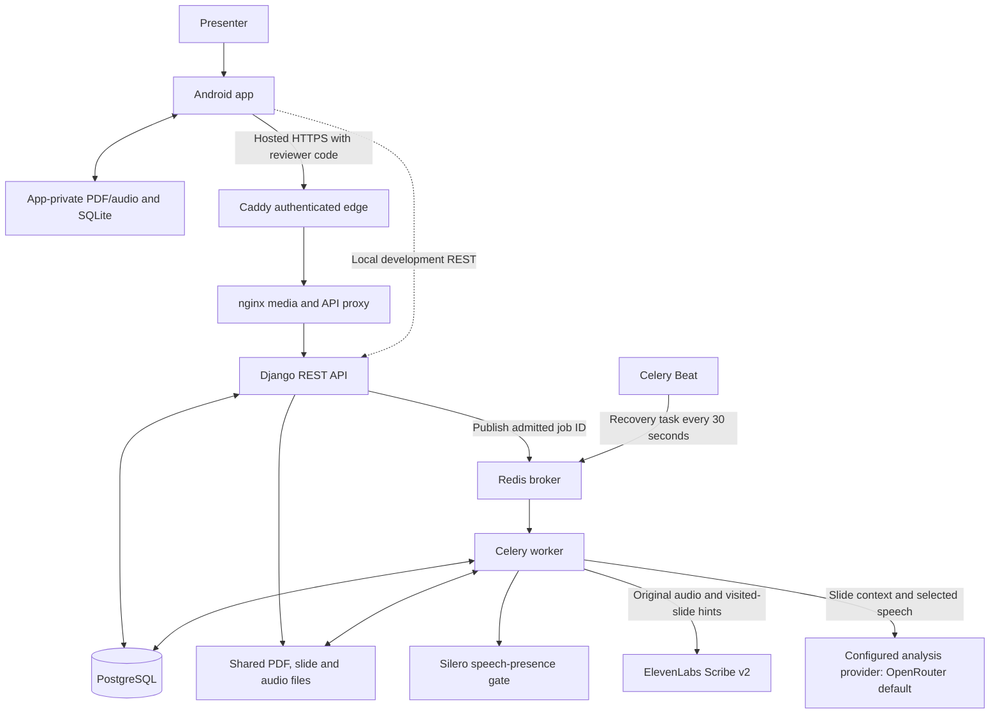
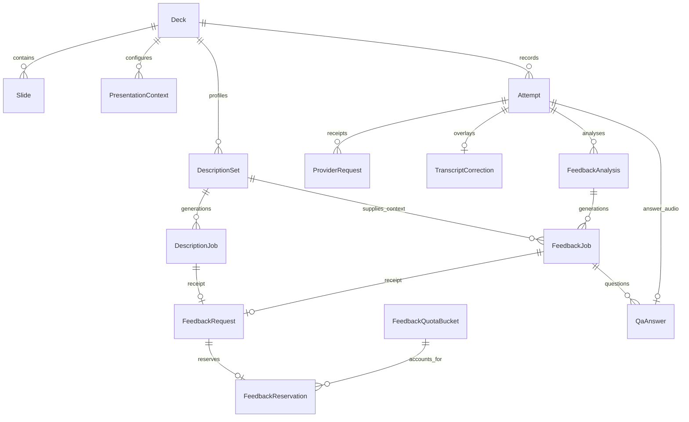
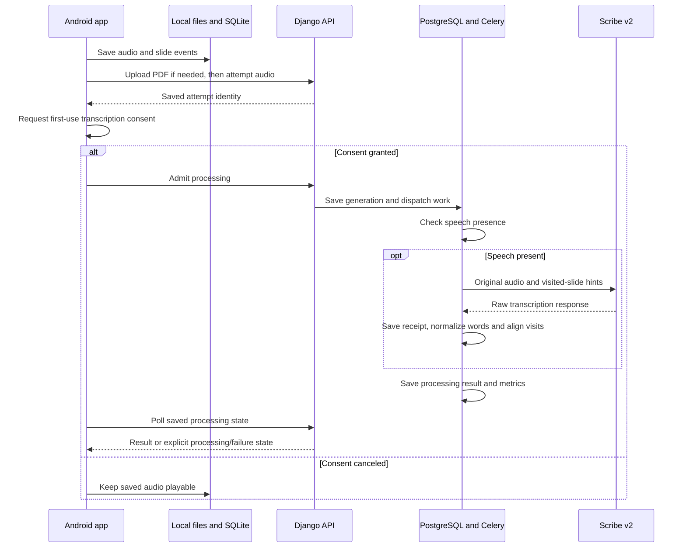

# OutLoud Design Documentation

Team 07 | Rev.4.0 | Iteration 3 | 5 November 2026

OutLoud records rehearsal audio and slide visits, transcribes speech, and links feedback to the recording. This revision describes [published demo v8](https://github.com/snuhcs-course/swpp-2026-project-team-07/releases/tag/outloud-demo-v8-20261103), source `cdb8055`. [Requirements v4.0](docs/requirements-and-specifications.md) separates implemented behavior from unmet acceptance criteria. [Testing Documentation](docs/testing.md) records dated evidence and its limits.

### Source and deployment status

| Layer | Baseline and status | Evidence date |
| --- | --- | --- |
| Merged repository | `main` at `7b7ef3b`, [PR #32](https://github.com/snuhcs-course/swpp-2026-project-team-07/pull/32), documents the PR31 application (`c4a3f48`). Design Rev.3.1 remains valid for that historical baseline. | October 23, 2026 |
| Published Android product | v8, `cdb8055`, includes the v7 repairs and selected PR #34 UI. These release changes are not merged into `main`. Implementation links below are pinned to the release source. | November 3, 2026 |
| Hosted backend | The v8 release record reports a separately reviewed, deployed v2.4 grading-budget patch compatible with the same APK. Its source patch remains uncommitted/unpushed; the APK source alone does not contain that later patch. | November 3, 2026; record reviewed November 5 |
| Local candidates | Early slide-advice preview and v2.5 performance/audience-citation repairs remain local and unreleased. They are not features of the published APK or evidence of current hosted behavior. | November 3–4, 2026 |

This documentation update changes no application source, database schema or runtime configuration. Deployment status above comes from the release record; no fresh service, provider or device check was performed for this revision. The [reconciliation evidence](docs/testing-evidence/iteration-3-reconciliation-20261105.md) separates dated operational checks, human participation and local candidates.

## 1. Document Revision History

| Version | Date | Description |
| --- | --- | --- |
| 1.0 | 2026-09-28 | Initial design. |
| 2.0 | 2026-10-09 | Iteration 1 design and proposed extensions. |
| 3.0 | 2026-10-21 | Iteration 2 design: Scribe transcription, rehearsal/review, saved settings, corrections, scoring and durable Q&A. Separate branch changes and open requirements remain identified. |
| 3.1 | 2026-10-23 | Clarified upload/consent order, automatic analysis, local run composition, database relationships and recovery. Aligned the roadmap with Requirements v3.0. |
| 4.0 | 2026-11-05 | Reconciled v8 architecture, reviewer access, provider/default changes, compact UI and recovery. Separated released, deployment-reported and local work; retained unmet requirements and historical evidence. |

## 2. System Architecture

The app captures and plays local audio; backend workers perform provider analysis. Django stores job admission and revisions in PostgreSQL before dispatch. Redis carries job identifiers. The API and worker share media storage. Celery Beat wakes recovery work from saved database state. Provider keys and raw provider receipts stay on the backend.

[Local Compose](https://github.com/snuhcs-course/swpp-2026-project-team-07/blob/cdb8055f0fd5022aafccb47625889d3f9a403f5f/compose.yaml) defines loopback development services and persistent database/media volumes. The development API has no application-account authentication. The hosted demo adds [production/public Compose](https://github.com/snuhcs-course/swpp-2026-project-team-07/blob/cdb8055f0fd5022aafccb47625889d3f9a403f5f/compose.public.yaml), an authenticated HTTPS edge and a media/API proxy. Reviewer access covers the shared server workspace; it does not isolate users or create ownership permissions. Provider receipts remain private backend records. See [hosting guidance](docs/azure-hosting.md).

The [demo access client](https://github.com/snuhcs-course/swpp-2026-project-team-07/blob/cdb8055f0fd5022aafccb47625889d3f9a403f5f/mobile/src/services/demoAccess.ts) stores the entered reviewer code in secure device storage scoped to the configured HTTPS origin. It refuses authenticated redirects and never automatically replays an upload or generation POST after code re-entry. Local recording, local playback and cached results remain usable offline; remote media and processing require authorized connectivity. No reviewer code belongs in source, screenshots or documentation.

| Layer | Main libraries and services |
| --- | --- |
| App | Expo SDK 57, React Native 0.86, TypeScript, Expo Router |
| Navigation and UI | React state/subscriptions, Gesture Handler, Reanimated, React Native SVG |
| Device storage and media | expo-audio, react-native-pdf, expo-document-picker, expo-file-system, expo-sqlite |
| Backend | Django REST Framework, PostgreSQL 16, Celery, Redis 7 |
| PDF/audio processing | pypdfium2, pypdf, Pillow, PyAV, Silero VAD, ONNX Runtime |
| External AI | ElevenLabs `scribe_v2` for transcription; OpenRouter analysis defaults to `openai/gpt-6-luna`; retained Gemini/OpenAI adapters are separate configurations |

Dependency versions: [mobile manifest](https://github.com/snuhcs-course/swpp-2026-project-team-07/blob/cdb8055f0fd5022aafccb47625889d3f9a403f5f/mobile/package.json), [backend lock file](https://github.com/snuhcs-course/swpp-2026-project-team-07/blob/cdb8055f0fd5022aafccb47625889d3f9a403f5f/backend/requirements.txt). The released configuration defaults to OpenRouter for new analysis and disables feedback until configured. A default is not evidence of enabled services or the model selected by a running deployment. Provider/model identity is retained with saved jobs and receipts; cutover rules fence new work without relabelling historical results. See the [provider configuration](docs/ai-feedback.md).

### Architectural decisions

| Decision | Choice and reason |
| --- | --- |
| Local capture, server analysis | Keep recordings playable during network/provider failure and keep provider credentials off the phone. Analysis requires connectivity. |
| REST polling | Read persisted processing state after navigation or restart without maintaining a socket. Polling adds requests and update delay. |
| Database-backed jobs | Retain generations, claims and receipts across worker/broker interruptions. Redis provides delivery; PostgreSQL records work state. |
| Original evidence identities | Retain attempt, word and visit identities with integer audio-relative milliseconds. Repeated/backward visits remain distinct. |
| Revisioned inputs | Freeze transcript corrections, settings and selected speech per job. Generation/revision checks guard result writes and expose stale results. |
| Separate analysis jobs | Transcription, selected-slide feedback, scoring and Q&A have separate admission/state rules. Reading saved results does not request new analysis. |

## 3. Data Model

The [Django models](https://github.com/snuhcs-course/swpp-2026-project-team-07/blob/cdb8055f0fd5022aafccb47625889d3f9a403f5f/backend/rehearsals/models.py) define fields and constraints. The diagram omits historical grouping tables that current selected-slide feedback does not write.

| Structure | Key fields and responsibility |
| --- | --- |
| Deck / Slide | PDF, content hash, preparation version and ordered slide text/images. Unique PDF hash/version and `(deck, slide_index)` keys prevent duplicate preparation and slide identities. |
| PresentationContext | Deck, audience, required duration and revision. Several contexts can reference one deduplicated PDF. New untouched imports use General audience and 600 seconds after synchronization through the existing context API. Existing edits, clears and accepted legacy five-minute settings are preserved. The bundled Seoul deck has a separate five-minute offline seed; it needs explicitly saved server choices for audience/duration-dependent analysis. |
| Attempt | Recording UUID, original audio, duration, slide events, transcript, metrics and processing generation/state. A new recording gets a new UUID; retries keep it. |
| ProviderRequest | Attempt/generation, provider/model, exact request options, submission state and raw transcription receipt. Unique per attempt/generation. |
| TranscriptCorrection | One optional overlay per attempt, with base transcript ID, edits and revision. Original words, audio and timing stay intact. |
| DescriptionSet / DescriptionJob | Cached slide context/cues keyed by deck/source, provider/project, model and prompt/schema versions; jobs retain generation and claim state. |
| FeedbackAnalysis / FeedbackJob | One analysis per attempt/type; jobs freeze source/settings/correction inputs and the description dependency, then retain validated results. |
| FeedbackRequest / Reservation / QuotaBucket | Private analysis receipts and provider/model quota accounting. Each receipt belongs to exactly one description job or feedback job. |
| QaAnswer | One optional binding per answer attempt: question job, question ID and answer part. Audio/transcription stay on that original attempt. |

The device uses SQLite's `records(key, value)` table for JSON metadata and keeps media as files. `SavedAttempt` holds recording/checkpoint/upload state. `DeckState` holds the selected `Run`, pending comparison and local presentation state. Each `Run.parts[slide]` identifies an attempt and one or more original audio intervals; a review run can combine slides from different recordings. See [local storage](https://github.com/snuhcs-course/swpp-2026-project-team-07/blob/cdb8055f0fd5022aafccb47625889d3f9a403f5f/mobile/src/services/storage.ts), [recording metadata](https://github.com/snuhcs-course/swpp-2026-project-team-07/blob/cdb8055f0fd5022aafccb47625889d3f9a403f5f/mobile/src/features/recording/storage.ts) and [run composition](https://github.com/snuhcs-course/swpp-2026-project-team-07/blob/cdb8055f0fd5022aafccb47625889d3f9a403f5f/mobile/src/domain/run.ts).

Hiding a presentation with Undo does not delete its complete server media/results. Protected database relationships also prevent deletion without an explicit cleanup workflow. Full deletion remains Iteration 3 work.

## 4. Backend API

Routes below are relative to `/api/`. The [route definitions](https://github.com/snuhcs-course/swpp-2026-project-team-07/blob/cdb8055f0fd5022aafccb47625889d3f9a403f5f/backend/rehearsals/urls.py), [serializers](https://github.com/snuhcs-course/swpp-2026-project-team-07/blob/cdb8055f0fd5022aafccb47625889d3f9a403f5f/backend/rehearsals/serializers.py) and [API contract](docs/api-contract.md) define request fields and validation.

| Endpoint | Responsibility |
| --- | --- |
| `POST decks/`, `GET decks/{id}/` | Prepare a PDF; read ordered slides and original media. |
| `POST attempts/`, `GET attempts/{id}/`, `GET decks/{id}/attempts/` | Store original recording/visit metadata; read saved attempts. |
| `POST attempts/{id}/process/` | Admit transcription or eligible recovery using the same recording identity. |
| `POST presentation-contexts/`, `GET/PATCH presentation-contexts/{id}/` | Create/read/save audience and duration with revision checks. |
| `GET decks/{id}/profiles/`, `POST decks/{id}/profiles/generate/` | Read or prepare reusable slide profiles/cues. |
| `GET/PATCH attempts/{id}/corrections/` | Read/save confirmed transcript overlays. |
| `GET/POST attempts/{id}/slide-review/` | Read/admit selected-slide feedback. |
| `GET/POST attempts/{id}/presentation-score/` | Read/admit rubric-based assessment. |
| `GET/POST attempts/{id}/audience-qa/` | Read/admit durable questions for selected speech and context. |
| `GET/POST attempts/{id}/qa-answer/` | Bind, process or read a spoken answer for a saved question. |

Upload stores media; a separate request admits processing. A successful read can return cached, pending, failed or stale analysis. New work uses revision/selection assertions; conflicting requests return an error rather than replacing a different recording. Description, whole-attempt feedback, correction-suggestion and synchronous deck-Q&A routes remain for existing callers; current Android Q&A uses the durable routes above.

## 5. Recording, Transcription and Alignment

### Current rehearsal flow

V8 retains PR31's upload order: rehearsal audio uploads before first-use transcription consent. Cancel prevents the new Scribe request but does not undo the upload. Q&A checks consent before uploading a new answer. Pre-upload rehearsal disclosure remains an unmet requirement; the sequence above describes the implementation, not the required target flow.

The [capture engine](https://github.com/snuhcs-course/swpp-2026-project-team-07/blob/cdb8055f0fd5022aafccb47625889d3f9a403f5f/mobile/src/features/rehearsal/CaptureEngine.tsx) uses the recorder's audio clock for slide events and writes durable checkpoints about once a second. Leaving the foreground requests a stop; interrupted capture/upload state remains available for recovery. V8 still blocks Back during recording instead of offering the required stop/save/discard confirmation.

Audio uses mono AAC at 64 kbps. The capture ceiling is 30 minutes, with automatic stop requested one second early for native finalization. PDFs allow 50 MiB and any positive slide count; audio uploads allow 25,000,000 bytes. Saved duration settings allow 1–30 minutes, independent of the capture ceiling, and audience text allows 500 characters. Offline setting edits remain pending; revision conflicts offer Use server or Keep mine.

### Preparation and alignment

[PDF preparation](https://github.com/snuhcs-course/swpp-2026-project-team-07/blob/cdb8055f0fd5022aafccb47625889d3f9a403f5f/backend/rehearsals/services/pdf.py) extracts text, renders slide images and removes NUL characters from extracted text. Extracted-text normalization removes NUL only; surrogate-text handling remains Iteration 3 work.

For speech, workers send original audio and up to 100 validated terms from visited slides to Scribe v2 with `no_verbatim=false`. No-speech input completes without a Scribe call. The [adapter](https://github.com/snuhcs-course/swpp-2026-project-team-07/blob/cdb8055f0fd5022aafccb47625889d3f9a403f5f/backend/rehearsals/services/transcription.py) keeps recognized fillers, excludes spacing/audio-event entries and converts seconds to integer milliseconds with decimal half-up rounding. V8 continues the Scribe-only transcription introduced in Iteration 2; OpenRouter is not a transcription replacement.

[Alignment](https://github.com/snuhcs-course/swpp-2026-project-team-07/blob/cdb8055f0fd5022aafccb47625889d3f9a403f5f/backend/rehearsals/services/alignment.py) assigns a word by its start time to the current slide visit. A word on a boundary belongs to the new visit; the final event wins when events share a timestamp. Empty and repeated/backward visits retain their place in recording order. Review maps continuous seek positions through the selected run's original attempt intervals, including composite runs. The v7/v8 repair retains the exact selected source, cancels superseded seeks, preserves play/pause state and prevents an outdated load from replacing a newer source. Original audio, word timing and slide events are never rescaled.

## 6. AI Coaching

### Initial work and updates

The app starts initial selected-slide feedback after usable transcription and saved settings are ready. A pending Keep/Overwrite comparison holds this work until selection is settled. Changed inputs can mark feedback outdated. The durable interfaces retain update/retry rules; the selected compact UI exposes targeted recovery controls in feedback details but not the earlier transcript-correction and general feedback-update tools. [Initial feedback](https://github.com/snuhcs-course/swpp-2026-project-team-07/blob/cdb8055f0fd5022aafccb47625889d3f9a403f5f/mobile/src/features/feedback/InitialFeedbackHost.tsx), [automatic scoring](https://github.com/snuhcs-course/swpp-2026-project-team-07/blob/cdb8055f0fd5022aafccb47625889d3f9a403f5f/mobile/src/features/feedback/InitialPresentationScoreHost.tsx) and [Q&A](https://github.com/snuhcs-course/swpp-2026-project-team-07/blob/cdb8055f0fd5022aafccb47625889d3f9a403f5f/mobile/src/features/qa/InitialQaHost.tsx) use separate controllers. Saved reads reuse existing output.

### Evidence and scoring

Compact selected-review requests include shared deck context once and distinguish selected speech from neighboring context. The backend reconstructs quoted evidence from original word/visit IDs and validates slide and audio bounds. Selected-slide feedback returns up to four prioritized findings. Transcript corrections change the interpretation while preserving source audio and timing.

The scoring provider selects ordinal rubric judgments and evidence references; backend code validates them and calculates scores with exact arithmetic. The overall score combines 70% of the mean slide score with 30% whole-presentation criteria. Invalid, insufficient or stale evidence can leave a score unavailable. Composite runs retain eligible per-slide source scores but receive no fabricated whole-run grade. Source validation does not establish advice usefulness, score calibration or judgment correctness. See [selected review](docs/feedback-compact-context.md), [scoring](docs/presentation-score-v2.md) and [Q&A implementation](https://github.com/snuhcs-course/swpp-2026-project-team-07/blob/cdb8055f0fd5022aafccb47625889d3f9a403f5f/backend/rehearsals/services/audience_qa.py).

### Concurrency and recovery

Database transactions, generations and claim tokens guard work admission and result writes. Jobs freeze input revisions. Workers persist raw receipts before validating responses, so eligible recovery can reuse received data. An uncertain provider outcome requires explicit acknowledgement before another potentially charged submission. Separate states distinguish missing media, failed processing, unavailable analysis and stale advice.

### V8 diagnostics and explicit recovery

[Measurements v2](https://github.com/snuhcs-course/swpp-2026-project-team-07/blob/cdb8055f0fd5022aafccb47625889d3f9a403f5f/backend/rehearsals/services/presentation_measurements.py) shares upload's inclusive ±1,000 ms decoded/capture-duration tolerance. Diagnostics use their valid common window; rates retain the original capture-duration denominator. Audio, transcript timing and visits remain unchanged. Safe error codes distinguish unavailable/invalid audio, decoding or measurement failure and insufficient speech.

Completed singleton slide reviews with invalid evidence, model failure or missing output can expose an explicit revision-fenced Retry. Cooldowns, active-work locks and uncertain-charge acknowledgement remain enforced. An open GitHub issue does not establish that a release lacks its repair. See the [v8 recovery evidence](https://github.com/snuhcs-course/swpp-2026-project-team-07/blob/cdb8055f0fd5022aafccb47625889d3f9a403f5f/docs/issue49-fix-verification-20261103.md).

The [November 3 release update](https://github.com/snuhcs-course/swpp-2026-project-team-07/releases/tag/outloud-demo-v8-20261103) reports the later deployed v2.4 grading policy: 24,000 output tokens, 128 KiB inner JSON and a grading-only 240-second response deadline. Prompt wording, rubric, score weights and public API shapes are unchanged. It reports successful grading of the original ten-slide rehearsal with zero evidence rejections after the confirmed audience was saved. This bounded repair result does not establish human score-quality acceptance. Build-time reports retain their earlier pre-deployment outcomes.

## 7. Frontend Architecture

| Component | Responsibility |
| --- | --- |
| [AppShell](https://github.com/snuhcs-course/swpp-2026-project-team-07/blob/cdb8055f0fd5022aafccb47625889d3f9a403f5f/mobile/src/screens/AppShell.tsx) | Mounted screen stack, navigation and shared background analysis hosts. |
| [RehearseScreen](https://github.com/snuhcs-course/swpp-2026-project-team-07/blob/cdb8055f0fd5022aafccb47625889d3f9a403f5f/mobile/src/screens/RehearseScreen.tsx) / CaptureEngine | Slide navigation, countdown/capture, recorder lifecycle and cues. |
| [Presentation store](https://github.com/snuhcs-course/swpp-2026-project-team-07/blob/cdb8055f0fd5022aafccb47625889d3f9a403f5f/mobile/src/features/presentations/store.ts) / run domain | Persist presentation state, compose selected slide takes and retain pending Keep/Overwrite choices. |
| [Review](https://github.com/snuhcs-course/swpp-2026-project-team-07/blob/cdb8055f0fd5022aafccb47625889d3f9a403f5f/mobile/src/screens/ReviewScreen.tsx) / [Full Review](https://github.com/snuhcs-course/swpp-2026-project-team-07/blob/cdb8055f0fd5022aafccb47625889d3f9a403f5f/mobile/src/screens/FullReviewScreen.tsx) | Read selected recordings, transcript overlays, scores, feedback and evidence playback. |
| [Q&A client](https://github.com/snuhcs-course/swpp-2026-project-team-07/blob/cdb8055f0fd5022aafccb47625889d3f9a403f5f/mobile/src/features/qa/client.ts) | Question/answer identity, consent and durable API operations. |

Must Cover and Further Insight are slide-derived cues, not summaries of the presenter's speech. Keep current/Overwrite selects which take supplies the affected slides; it does not provide the full two-attempt audio/transcript/feedback viewer. V8 includes the first-Redo lifecycle repair: the single-use capture engine is remounted after save/failure so another take can start. This release inclusion does not mean the separate B09 branch or PR #34 has been merged. See Testing Documentation for dated defect and retest evidence.

Compact Review presents measured timing, informational filler counts and verified content/delivery findings. Timing uses an inclusive ±15% allocation range; nonzero fillers alone do not establish a communication defect. Feedback details retain complete observations and suggestions. Full Review supplies run playback and transcript/evidence access. Earlier recognition-correction, saved-recording upload/transcription retry and manual remote-audio download controls are not exposed by the selected compact UI, even though supporting services remain.

Q&A speech selects Korean when Hangul is present, otherwise English when Latin text is present, with platform fallback for other text. Mixed Hangul/Latin uses Korean. This is a heuristic, not general language detection; voice availability and pronunciation need device/listening checks.

## 8. Changes Since Iteration 2 and Remaining Design

### Changes since Iteration 2

| Change | Status and source | Evidence date |
| --- | --- | --- |
| Azure HTTPS and reviewer access; OpenRouter analysis cutover | Included in v8 `cdb8055`; [hosted configuration](https://github.com/snuhcs-course/swpp-2026-project-team-07/blob/cdb8055f0fd5022aafccb47625889d3f9a403f5f/docs/azure-hosting.md), [provider policy](https://github.com/snuhcs-course/swpp-2026-project-team-07/blob/cdb8055f0fd5022aafccb47625889d3f9a403f5f/docs/ai-feedback.md). Scribe, scoring and Q&A already existed in Iteration 2. | November 2–3, 2026 |
| Redo lifecycle and selected compact UI | Included in v8; [repair and source verification](https://github.com/snuhcs-course/swpp-2026-project-team-07/blob/cdb8055f0fd5022aafccb47625889d3f9a403f5f/docs/apk-redo-feedback-verification-20261102.md). PR #34 remains administratively open. | November 2, 2026 |
| Ten-minute/General defaults, full feedback details, seeking, metric labels and Q&A speech language | Included in v7 and retained in v8; [combined verification](https://github.com/snuhcs-course/swpp-2026-project-team-07/blob/cdb8055f0fd5022aafccb47625889d3f9a403f5f/docs/demo-v7-combined-verification-20261103.md). Human usefulness/audible acceptance is separate. | November 3, 2026 |
| Duration diagnostics and targeted slide-feedback recovery | Included in v8; [release build record](https://github.com/snuhcs-course/swpp-2026-project-team-07/blob/cdb8055f0fd5022aafccb47625889d3f9a403f5f/docs/demo-v8-issue49-verification-20261103.md). | November 3, 2026 |
| V2.4 grading budget/deadline | Deployment reported by the [v8 release update](https://github.com/snuhcs-course/swpp-2026-project-team-07/releases/tag/outloud-demo-v8-20261103); later source patch remains unpushed. | November 3, 2026 |
| Early advice preview and v2.5 performance/audience-citation changes | Local, uncommitted and unreleased; see the [dated reconciliation evidence](docs/testing-evidence/iteration-3-reconciliation-20261105.md). Numeric score streaming is not implemented. | November 3–4, 2026 |

### Remaining Iteration 3 requirements

| Work | Existing components affected |
| --- | --- |
| Stop/save/discard confirmation | RehearseScreen navigation and capture lifecycle. |
| Spoken summaries and failure states | Transcript/Review views and backend analysis contracts. |
| Complete attempt comparison | Run composition, Keep/Overwrite state and Review playback. |
| Full deletion and partial-failure recovery | Presentation/recording stores, backend model relationships and media lifecycle. |
| Pre-upload rehearsal disclosure | Capture-to-analysis handoff and recording upload; preserve Q&A's pre-upload check. |
| Reported bug follow-up | PDF upload, visit display/association, navigation/playback and Q&A. |
| Numerical targets | Set performance, recognition, feedback-quality and cost targets from pilot measurements. |

[Requirements v4.0](docs/requirements-and-specifications.md#iteration-3-implementation-status) retains the acceptance criteria. Owners, exact dates and numerical targets remain unset. Q&A and separate English/Korean sessions remain in semester scope; broad Korean recognition, advice usefulness and stable/calibrated scores remain unverified. Reported navigation, recording-timer, large-text and import defects need current-build retests. Backward-navigation restrictions and onboarding remain proposals. Model experiments, grouped feedback and local performance work are not adopted by this document.

### Design patterns (Iteration 5)

Document at least two implemented patterns with their module, motivation, alternatives, component roles, benefit and a short code example.
