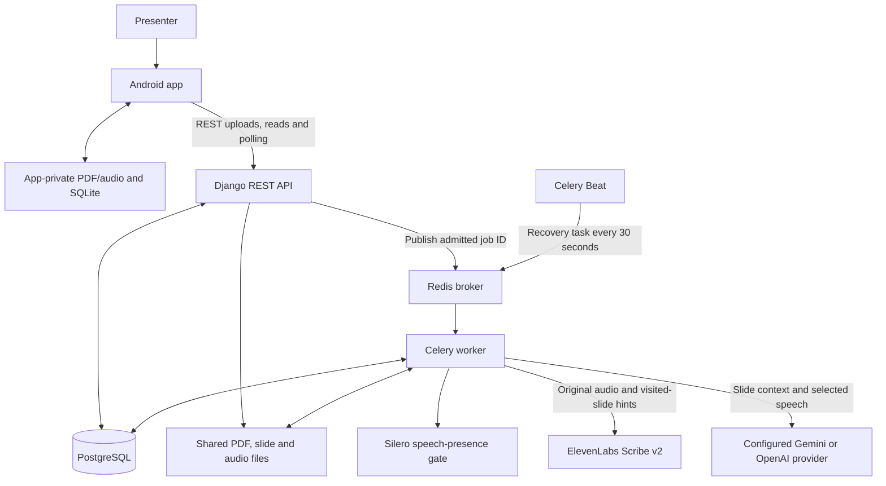
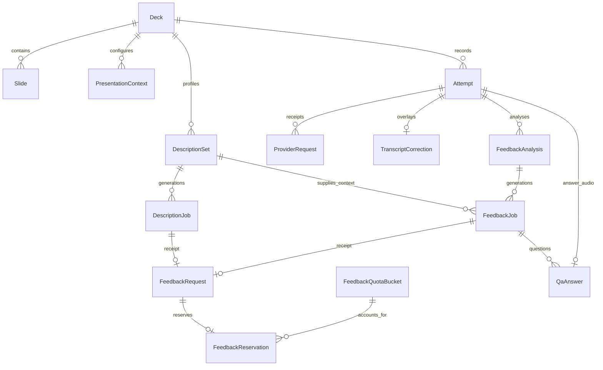
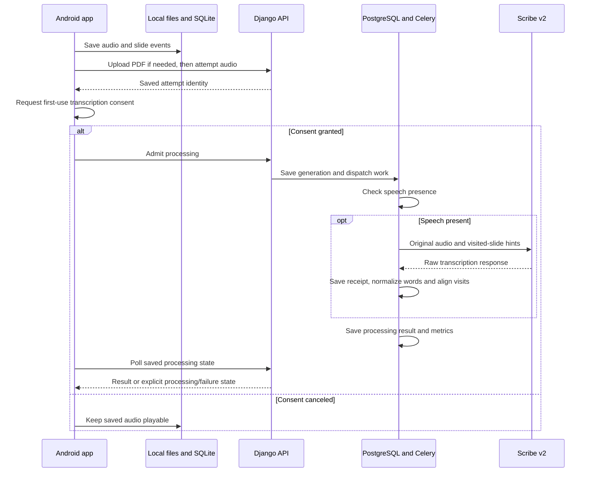

# OutLoud Design Documentation

Team 07 | Rev.3.1 | Iteration 2 | 23 October 2026

OutLoud records rehearsal audio and slide visits, transcribes speech, and links feedback to the recording. This document describes [merged PR31](https://github.com/snuhcs-course/swpp-2026-project-team-07/pull/31), `c4a3f48`. [Requirements v3.0](docs/requirements-and-specifications.md) defines the scope and Iteration 3 work. [Testing Documentation](docs/testing.md) contains test plans, results and reported defects.

## 1. Document Revision History

| Version | Date | Description |
| --- | --- | --- |
| 1.0 | 2026-09-28 | Initial design. |
| 2.0 | 2026-10-09 | Iteration 1 design and proposed extensions. |
| 3.0 | 2026-10-21 | Iteration 2 design: Scribe transcription, rehearsal/review, saved settings, corrections, scoring and durable Q&A. Separate branch changes and open requirements remain identified. |
| 3.1 | 2026-10-23 | Clarified upload/consent order, automatic analysis, local run composition, database relationships and recovery. Aligned the roadmap with Requirements v3.0. |

## 2. System Architecture

The app captures and plays local audio; backend workers perform provider analysis. Django stores job admission and revisions in PostgreSQL before dispatch. Redis carries job identifiers. The API and worker share media storage. Celery Beat wakes recovery work from saved database state. Provider keys and raw provider receipts stay on the backend.

[Compose](compose.yaml) defines the local development services and persistent database/media volumes. The baseline has no API authentication; remote deployment needs authentication and access control. App-private files and private database receipts do not provide access control for the development media server.

| Layer | Main libraries and services |
| --- | --- |
| App | Expo SDK 57, React Native 0.86, TypeScript, Expo Router |
| Navigation and UI | React state/subscriptions, Gesture Handler, Reanimated, React Native SVG |
| Device storage and media | expo-audio, react-native-pdf, expo-document-picker, expo-file-system, expo-sqlite |
| Backend | Django REST Framework, PostgreSQL 16, Celery, Redis 7 |
| PDF/audio processing | pypdfium2, pypdf, Pillow, PyAV, Silero VAD, ONNX Runtime |
| External AI | ElevenLabs `scribe_v2`; backend-configured Gemini/OpenAI analysis adapters |

Dependency versions: [mobile manifest](mobile/package.json), [backend lock file](backend/requirements.txt).

### Architectural decisions

| Decision | Choice and reason |
| --- | --- |
| Local capture, server analysis | Keep recordings playable during network/provider failure and keep provider credentials off the phone. Analysis requires connectivity. |
| REST polling | Read persisted processing state after navigation or restart without maintaining a socket. Polling adds requests and update delay. |
| Database-backed jobs | Retain generations, claims and receipts across worker/broker interruptions. Redis provides delivery; PostgreSQL records work state. |
| Original evidence identities | Retain attempt, word and visit identities with integer audio-relative milliseconds. Repeated/backward visits remain distinct. |
| Revisioned inputs | Freeze transcript corrections, settings and selected speech per job. Generation/revision checks guard result writes and expose stale results. |
| Separate analysis jobs | Transcription, selected-slide feedback, scoring and Q&A have separate admission/state rules. Reading saved results does not request new analysis. |

## 3. Data Model

The [Django models](backend/rehearsals/models.py) define fields and constraints. The diagram omits historical grouping tables that current selected-slide feedback does not write.

| Structure | Key fields and responsibility |
| --- | --- |
| Deck / Slide | PDF, content hash, preparation version and ordered slide text/images. Unique PDF hash/version and `(deck, slide_index)` keys prevent duplicate preparation and slide identities. |
| PresentationContext | Deck, audience, required duration and revision. Several contexts can reference one deduplicated PDF. New untouched imports use General audience and 300 seconds. |
| Attempt | Recording UUID, original audio, duration, slide events, transcript, metrics and processing generation/state. A new recording gets a new UUID; retries keep it. |
| ProviderRequest | Attempt/generation, provider/model, exact request options, submission state and raw transcription receipt. Unique per attempt/generation. |
| TranscriptCorrection | One optional overlay per attempt, with base transcript ID, edits and revision. Original words, audio and timing stay intact. |
| DescriptionSet / DescriptionJob | Cached slide context/cues keyed by deck/source, provider/project, model and prompt/schema versions; jobs retain generation and claim state. |
| FeedbackAnalysis / FeedbackJob | One analysis per attempt/type; jobs freeze source/settings/correction inputs and the description dependency, then retain validated results. |
| FeedbackRequest / Reservation / QuotaBucket | Private analysis receipts and provider/model quota accounting. Each receipt belongs to exactly one description job or feedback job. |
| QaAnswer | One optional binding per answer attempt: question job, question ID and answer part. Audio/transcription stay on that original attempt. |

The device uses SQLite's `records(key, value)` table for JSON metadata and keeps media as files. `SavedAttempt` holds recording/checkpoint/upload state. `DeckState` holds the selected `Run`, pending comparison and local presentation state. Each `Run.parts[slide]` identifies an attempt and one or more original audio intervals; a review run can combine slides from different recordings. See [local storage](mobile/src/services/storage.ts), [recording metadata](mobile/src/features/recording/storage.ts) and [run composition](mobile/src/domain/run.ts).

Hiding a presentation with Undo does not delete its complete server media/results. Protected database relationships also prevent deletion without an explicit cleanup workflow. Full deletion remains Iteration 3 work.

## 4. Backend API

Routes below are relative to `/api/`. The [route definitions](backend/rehearsals/urls.py), [serializers](backend/rehearsals/serializers.py) and [API contract](docs/api-contract.md) define request fields and validation.

| Endpoint | Responsibility |
| --- | --- |
| `POST decks/`, `GET decks/{id}/` | Prepare a PDF; read ordered slides and original media. |
| `POST attempts/`, `GET attempts/{id}/`, `GET decks/{id}/attempts/` | Store original recording/visit metadata; read saved attempts. |
| `POST attempts/{id}/process/` | Admit transcription or eligible recovery using the same recording identity. |
| `POST presentation-contexts/`, `GET/PATCH presentation-contexts/{id}/` | Create/read/save audience and duration with revision checks. |
| `GET decks/{id}/profiles/`, `POST decks/{id}/profiles/generate/` | Read or prepare reusable slide profiles/cues. |
| `GET/PATCH attempts/{id}/corrections/` | Read/save confirmed transcript overlays. |
| `GET/POST attempts/{id}/slide-review/` | Read/admit selected-slide feedback. |
| `GET/POST attempts/{id}/presentation-score/` | Read/admit rubric-based assessment. |
| `GET/POST attempts/{id}/audience-qa/` | Read/admit durable questions for selected speech and context. |
| `GET/POST attempts/{id}/qa-answer/` | Bind, process or read a spoken answer for a saved question. |

Upload stores media; a separate request admits processing. A successful read can return cached, pending, failed or stale analysis. New work uses revision/selection assertions; conflicting requests return an error rather than replacing a different recording. Description, whole-attempt feedback, correction-suggestion and synchronous deck-Q&A routes remain for existing callers; current Android Q&A uses the durable routes above.

## 5. Recording, Transcription and Alignment

### Current rehearsal flow

PR31 uploads rehearsal audio before asking for transcription consent. Cancel prevents that new transcription request; it does not undo the upload. Q&A checks consent before uploading a new answer. Moving rehearsal disclosure before upload is planned for Iteration 3.

The [capture engine](mobile/src/features/rehearsal/CaptureEngine.tsx) uses the recorder's audio clock for slide events and writes durable checkpoints about once a second. Leaving the foreground requests a stop; interrupted capture/upload state remains available for recovery. PR31 blocks Back during recording instead of offering stop/save/discard confirmation.

Audio uses mono AAC at 64 kbps. The capture ceiling is 30 minutes, with automatic stop requested one second early for native finalization. PDFs allow 50 MiB and any positive slide count; audio uploads allow 25,000,000 bytes. Saved duration settings allow 1–30 minutes, independent of the capture ceiling, and audience text allows 500 characters. Offline setting edits remain pending; revision conflicts offer Use server or Keep mine.

### Preparation and alignment

[PDF preparation](backend/rehearsals/services/pdf.py) extracts text, renders slide images and removes NUL characters from extracted text. Extracted-text normalization removes NUL only; surrogate-text handling remains Iteration 3 work.

For speech, workers send original audio and up to 100 validated terms from visited slides to Scribe v2 with `no_verbatim=false`. No-speech input completes without a Scribe call. The [adapter](backend/rehearsals/services/transcription.py) keeps recognized fillers, excludes spacing/audio-event entries and converts seconds to integer milliseconds with decimal half-up rounding. PR31 uses Scribe only.

[Alignment](backend/rehearsals/services/alignment.py) assigns a word by its start time to the current slide visit. A word on a boundary belongs to the new visit; the final event wins when events share a timestamp. Empty and repeated/backward visits retain their place in recording order. Review seeks within the original attempt intervals, including when selected slides come from different attempts.

## 6. AI Coaching

### Initial work and updates

The app starts initial selected-slide feedback after usable transcription and saved settings are ready. A pending Keep/Overwrite comparison holds this work until selection is settled. Changed inputs can mark feedback outdated; users request Update feedback or Retry feedback. [Initial feedback](mobile/src/features/feedback/InitialFeedbackHost.tsx), [automatic scoring](mobile/src/features/feedback/InitialPresentationScoreHost.tsx) and [Q&A](mobile/src/features/qa/InitialQaHost.tsx) use separate controllers. Saved reads reuse existing output.

### Evidence and scoring

Compact selected-review requests include shared deck context once and distinguish selected speech from neighboring context. The backend reconstructs quoted evidence from original word/visit IDs and validates slide and audio bounds. Selected-slide feedback returns up to four prioritized findings. Transcript corrections change the interpretation while preserving source audio and timing.

The scoring provider selects rubric judgments and evidence references. Backend code validates those selections and calculates scores; invalid or insufficient evidence can leave a score unavailable. Source validation does not establish that advice is useful or a judgment is correct. See [selected review](docs/feedback-compact-context.md), [scoring](docs/presentation-score-v2.md) and [Q&A implementation](backend/rehearsals/services/audience_qa.py).

### Concurrency and recovery

Database transactions, generations and claim tokens guard work admission and result writes. Jobs freeze input revisions. Workers persist raw receipts before validating responses, so eligible recovery can reuse received data. An uncertain provider outcome requires explicit acknowledgement before another potentially charged submission. Separate states distinguish missing media, failed processing, unavailable analysis and stale advice.

## 7. Frontend Architecture

| Component | Responsibility |
| --- | --- |
| [AppShell](mobile/src/screens/AppShell.tsx) | Mounted screen stack, navigation and shared background analysis hosts. |
| [RehearseScreen](mobile/src/screens/RehearseScreen.tsx) / CaptureEngine | Slide navigation, countdown/capture, recorder lifecycle and cues. |
| [Presentation store](mobile/src/features/presentations/store.ts) / run domain | Persist presentation state, compose selected slide takes and retain pending Keep/Overwrite choices. |
| [Review](mobile/src/screens/ReviewScreen.tsx) / [Full Review](mobile/src/screens/FullReviewScreen.tsx) | Read selected recordings, transcript overlays, scores, feedback and evidence playback. |
| [Q&A client](mobile/src/features/qa/client.ts) | Question/answer identity, consent and durable API operations. |

Must Cover and Further Insight are slide-derived cues, not summaries of the presenter's speech. Keep current/Overwrite selects which take supplies the affected slides; it does not provide the full two-attempt audio/transcript/feedback viewer. PR31's mounted recording engine can remain finished when Review returns to Redo; remounting after save is a separate B09 change outside this baseline. See Testing Documentation for defect and retest evidence.

## 8. Planned Design

### Iteration 3

| Work | Existing components affected |
| --- | --- |
| Stop/save/discard confirmation | RehearseScreen navigation and capture lifecycle. |
| Spoken summaries and failure states | Transcript/Review views and backend analysis contracts. |
| Complete attempt comparison | Run composition, Keep/Overwrite state and Review playback. |
| Full deletion and partial-failure recovery | Presentation/recording stores, backend model relationships and media lifecycle. |
| Pre-upload rehearsal disclosure | Capture-to-analysis handoff and recording upload; preserve Q&A's pre-upload check. |
| Reported bug follow-up | PDF upload, visit display/association, navigation/playback and Q&A. |
| Numerical targets | Set performance, recognition, feedback-quality and cost targets from pilot measurements. |

[Requirements v3.0](docs/requirements-and-specifications.md#iteration-2-implementation-status) retains the acceptance criteria. Owners, exact dates and numerical values remain unset. Q&A and separate English/Korean sessions remain in semester scope; Korean quality remains unverified. Backward-navigation restrictions and onboarding remain proposals.

### Design patterns (Iteration 5)

Document at least two implemented patterns with their module, motivation, alternatives, component roles, benefit and a short code example.
