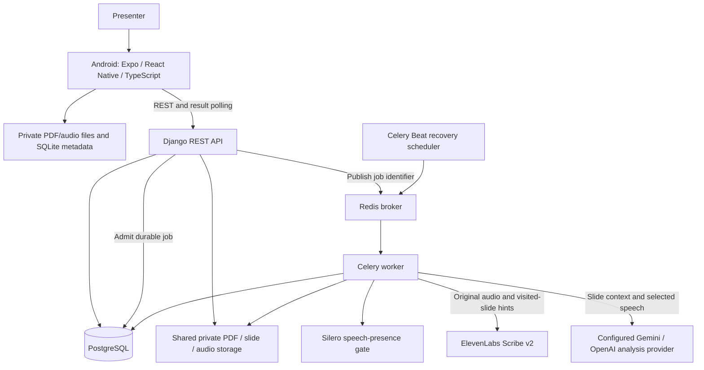
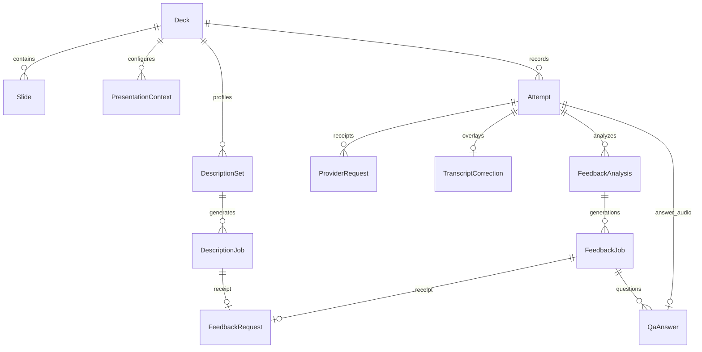

# OutLoud Design Documentation

Team 07 · Revision 3.0 · Iteration 2 · October 21, 2026

Implementation baseline: merged PR31, `c4a3f48d2a635bb2edb44828c62fb286b55f8d94`. The team uses this version for the recorded demo. The [Iteration 1 design](../Design-Documentation.md) and its exports retain their historical scope. Test plans and results belong in [Testing Documentation](testing.md).

## 1. Document revision history

| Version | Date | Change |
| --- | --- | --- |
| 1.0 | September 28, 2026 | Initial architecture and proposed contracts; preserved on the Wiki's historical design page. |
| 2.0 | October 9, 2026 | Iteration 1 design and planned extensions; preserved in the repository's original design document. |
| 3.0 | October 21, 2026 | Describe merged Scribe transcription, redesigned rehearsal/review, saved settings, corrections, scoring and durable Q&A; identify separate branch work and unresolved requirements. |

## 2. System architecture

The app saves recordings before upload so users can play and recover local audio without a server. Django validates identities and revisions; workers handle slow provider calls outside HTTP requests. PostgreSQL holds job state and private receipts. Redis transports work, while the recovery scheduler republishes eligible work from saved state. Provider keys remain on the server.

| Layer | Main libraries and services |
| --- | --- |
| Android | Expo SDK 57, React Native 0.86, TypeScript, Expo Router |
| Native media and storage | expo-audio, react-native-pdf, expo-document-picker, expo-file-system, expo-sqlite |
| API and jobs | Django REST Framework, Celery, PostgreSQL, Redis |
| PDF and speech preparation | pypdfium2, pypdf, Pillow, PyAV, Silero VAD, ONNX Runtime |
| External processing | ElevenLabs `scribe_v2`; configured Gemini/OpenAI analysis adapters |

| Decision | Rationale and consequence |
| --- | --- |
| Local capture with server analysis | Keeps recording independent of connectivity and provider secrets off the phone; analysis needs the server and internet. |
| REST polling with persisted results | Users can reopen saved state without retaining a live socket; polling adds requests and visible delay. |
| Audio-relative source identities | Zero-based slide indexes, integer milliseconds and original word/visit IDs let review seek to the cited recording, including repeated/backward visits. |
| Revisioned input snapshots | Settings, corrections and selected takes can change while work runs; source checks keep old responses from replacing current results. |
| Durable jobs and raw receipts | Generations and claim tokens reject late workers. Saved output supports recovery; an uncertain submission requires explicit acknowledgement before another provider call. |
| Independent scoring and slide feedback | Score displays use the assessment result; displaying a score does not require another slide-feedback call. |
| Scribe-only recognition | The merged adapter normalizes Scribe output into the existing transcript contract. This revision has no Whisper fallback or historical Whisper-receipt decoding. |

## 3. Data model

This diagram summarizes current relationships. [Django models](../backend/rehearsals/models.py) define the complete fields and constraints.

- **Deck/Slide:** original PDF, ordered slide assets, extracted text and preparation identity. `(content_hash, preparation_version)` deduplicates accepted PDFs; `(deck, slide_index)` is unique. Extraction removes NUL characters before database storage and preserves the original PDF bytes.
- **PresentationContext:** audience, required duration and revision, separate from deduplicated PDFs and recording attempts. New untouched imports initialize General audience and 300 seconds. Offline edits stay pending; conflicts offer Use server or Keep mine.
- **Attempt:** immutable recording UUID, audio, original slide events, transcript, metrics and processing state. A new recording gets a new UUID; upload and analysis retries retain the existing recording.
- **TranscriptCorrection:** confirmed text overlays with their own revision and base transcript identity. Original audio, words and timing remain intact.
- **DescriptionSet/DescriptionJob:** reusable slide context and cues, keyed by source, provider/project, model, prompt and schema versions.
- **FeedbackAnalysis/FeedbackJob/FeedbackRequest:** analysis type, frozen inputs, job generation, private receipt and validated output. Quota buckets/reservations coordinate admission. Historical grouping tables remain for migration consistency; current singleton feedback does not use them.
- **QaAnswer:** binds an answer Attempt to its question job, question ID and answer part. Retries preserve that binding and cached transcription.

The app keeps private PDF/audio files and SQLite metadata for recordings and checkpoints. Read/reopen paths reuse validated cached results. Hiding a presentation with Undo does not establish deletion of its server audio, receipts or derived results; several server relationships use PROTECT.

## 4. Interfaces and processing flow

The [API contract](api-contract.md) owns exact payloads, statuses and validation rules. Routes below are relative to `/api/`; the [route definitions](../backend/rehearsals/urls.py) are the implementation reference.

| Boundary | Purpose |
| --- | --- |
| `POST decks/`, `GET decks/{id}/` | Store/prepare a PDF and read its slides. |
| `POST attempts/`, `GET attempts/{id}/`, `GET decks/{id}/attempts/` | Save original recordings and read saved rehearsal state. |
| `POST attempts/{id}/process/` | Admit processing or eligible recovery using the existing attempt identity. |
| `POST presentation-contexts/`, `GET/PATCH presentation-contexts/{id}/` | Save audience/time with revision checks. |
| `GET decks/{id}/profiles/`, `POST .../profiles/generate/` | Read or recover reusable slide profiles/cues. |
| `GET/PATCH attempts/{id}/corrections/` | Save confirmed recognition overlays. |
| `GET/POST attempts/{id}/slide-review/` | Read/admit selected-slide feedback. |
| `GET/POST attempts/{id}/presentation-score/` | Read/admit overall and per-slide assessment. |
| `GET/POST attempts/{id}/audience-qa/`, `GET/POST attempts/{id}/qa-answer/` | Durable questions and bound spoken answers. |

The existing description, whole-attempt feedback and correction-suggestion endpoints remain available. Legacy synchronous deck Q&A routes remain for older callers; the current Android screen uses durable Q&A.

1. Import the PDF, prepare its text/images and synchronize saved settings. Eligible upload work prepares reusable slide profiles.
2. Record original audio and slide visits. Finalize local media and metadata before upload.
3. Apply the ElevenLabs disclosure for new transcription submissions. Q&A also guards new answer uploads. Cancel retains local audio. The older specification's pre-upload disclosure must still be reconciled across rehearsal and Q&A flows.
4. The speech gate handles no-speech input without a Scribe call. For speech, workers send original audio with up to 100 hints derived from visited slides.
5. Normalize timed words and align them to original visits. Review can apply confirmed correction overlays.
6. Scoring, singleton feedback and Q&A admit their own work and validate source revisions. Saved reads reuse output; they do not regenerate advice on every screen visit.

## 5. Recording and frontend behavior

Home imports/opens presentations. Rehearse owns native capture, slide navigation and cues; Review/Full Review show selected recordings, transcripts, scores and evidence. Q&A owns durable question/answer interaction. The [implementation handoff](outloud-implementation-handoff.md#16-main-implementation-locations) maps screens, hooks, services and domain modules. Its October 17 delivery-status statements describe the earlier snapshot; PR31 merged on October 20.

New audio uses mono AAC at 64 kbps. Current limits are 50 MiB per PDF, a positive slide count without a fixed ten-slide cap, up to 1,800 seconds per capture, and 25,000,000 bytes per audio upload. Explicit presentation-time settings accept 60–1,800 seconds; audience text is limited to 500 characters. These describe implementation constraints, not newly approved product requirements.

Must Cover and Further Insight cues remain separate from a summary of what the presenter said. Keep current/Overwrite selects between the current and new retake; the app does not yet provide the specification's complete arbitrary-two-attempt audio/transcript/feedback comparison.

**Separate B09 change:** PR31 leaves a finished capture engine mounted beneath Review, so the first Redo can reuse an engine in `done`. The published [retry-recording branch](https://github.com/snuhcs-course/swpp-2026-project-team-07/blob/3ae9d162d53088a129bffaf15a915400480a6483/docs/b09-retry-recording.md) remounts it after saving. That change remains outside this merged baseline. Its tests and device outcomes belong in Testing Documentation; the reported seven-second timer jump remains open.

## 6. AI interpretation and evidence

Scribe spacing/audio-event entries do not become speech words. The adapter retains recognized fillers, converts seconds to integer milliseconds with decimal half-up rounding and rejects unusable timing. Speech gating establishes presence, not pause/filler accuracy.

Singleton slide review returns up to four prioritized findings. The backend reconstructs evidence from original source identities and validates quotes, visits and bounded audio intervals before display. Invalid findings do not become valid advice because neighboring findings pass. Confirmed corrections alter interpretation while preserving the original evidence.

The merged implementation uses compact selected-review requests. It includes shared deck context once and keeps selected words and neighboring context distinct. Restoring the earlier format is a recommendation from the reported experiment, pending a team decision and implementation. No rollback is claimed here.

The scoring provider selects rubric judgments; backend code validates them and computes the arithmetic. Automatic scoring refreshes after synchronized scoring inputs change. Singleton feedback and Q&A have separate initial-generation and explicit-update rules. The [scoring contract](presentation-score-v2.md), [compact-context specification](feedback-compact-context.md) and [phase ledger](iteration-2-ai-feedback.md) define the details.

## 7. Recovery and current requirements differences

Jobs retain generations, claim tokens and private raw receipts. Duplicate reads/admissions reuse eligible saved work. Unknown provider outcomes require explicit recovery; the system does not promise exactly-once provider execution. Missing media, failed processing, stale advice and unavailable results retain distinct states.

The [requirements status addendum](requirements-and-specifications.md#october-21-implementation-status) tracks Back confirmation, spoken summaries, complete comparison, deletion, consent, automatic feedback and Q&A/Korean scope. An implemented capability does not settle a team scope conflict. Jooyoung's separate cleanup branch and local phone-demo repairs require reconciliation before integration, including older 20-minute versus current 30-minute behavior.

## 8. Design patterns and next revision

Detailed design-pattern reporting is due in Iteration 5, including at least two patterns with module, motivation, alternatives, roles, benefit and a short code example. The team has not selected those entries in this update. Document actual refactoring and its rationale when implemented.

Update this document when a merged change affects contracts, provider boundaries, storage or user flows. Keep historical designs and submission exports labeled by their actual revision; the existing Iteration 1 PDF/HTML tools produce that older document.

Sources: merged source and contracts at `c4a3f48`, the October 17 implementation handoff, B09's October 20 records/publication on October 21, and the course Design Documentation Guidelines (eTL file 9307191), read October 21. OpenAI Codex prepared this revision from those records; no application or provider behavior changed during this documentation task.
