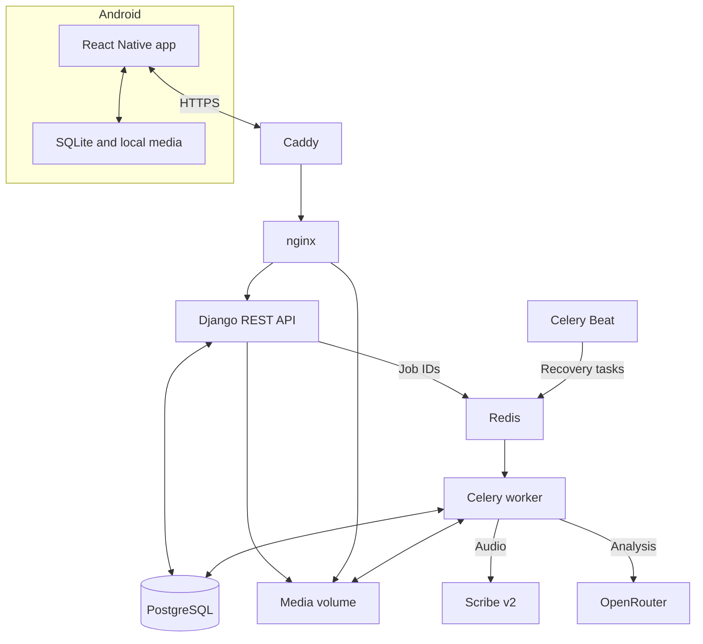
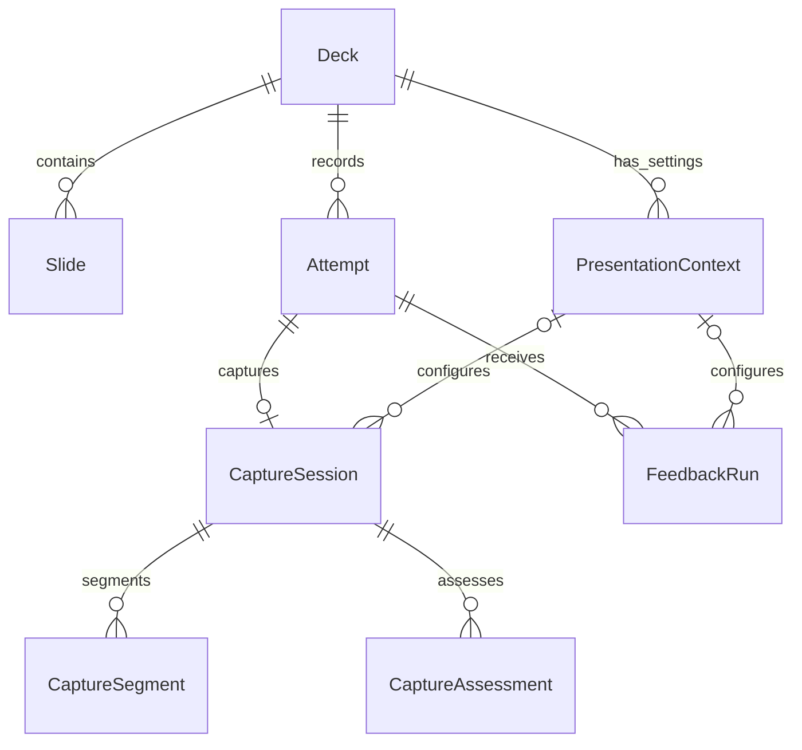
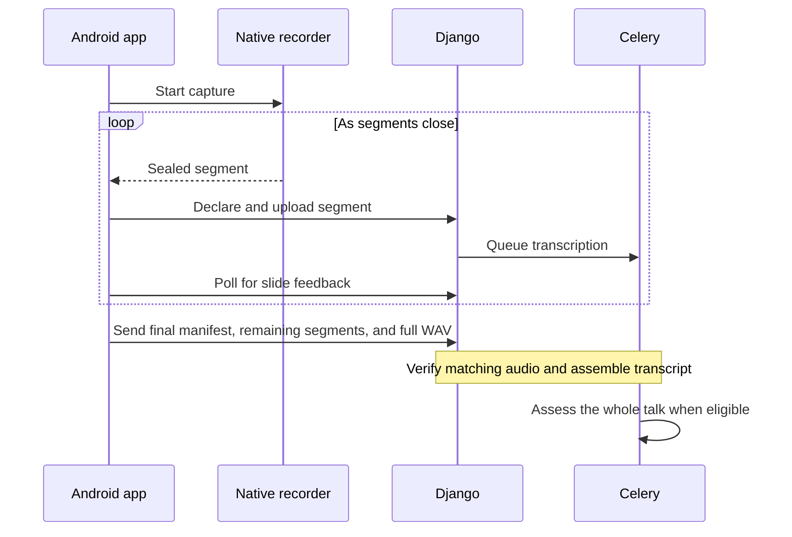
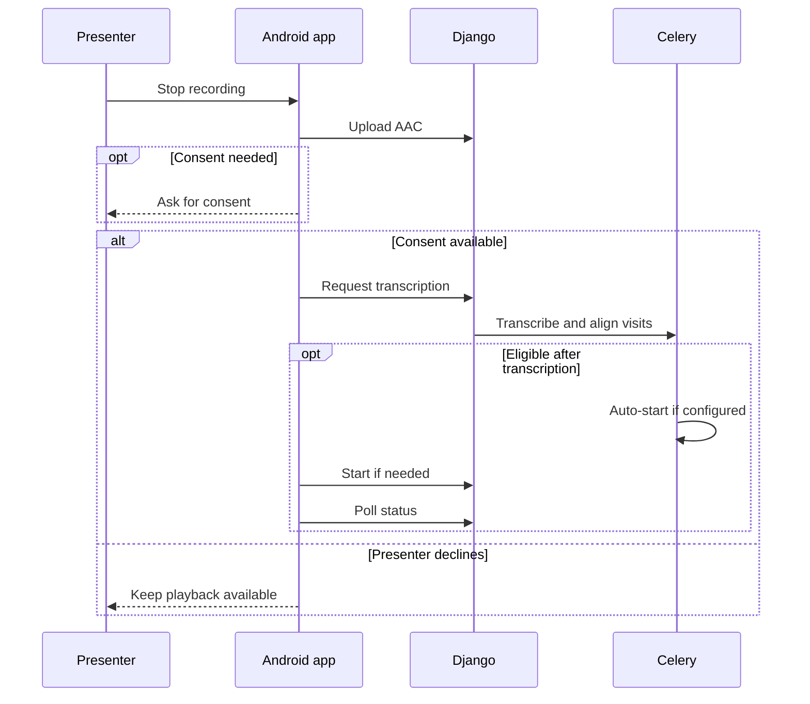

# OutLoud Design Documentation

Team 07 · Rev. 5.0 · Iteration 4 · November 20, 2026

OutLoud is an Android app for rehearsing slide presentations, reviewing feedback linked to saved audio, and practicing audience Q&A.

See [Requirements v5.0](https://github.com/snuhcs-course/swpp-2026-project-team-07/blob/a64ffd571bea09d1a980b8b81c7aa827d5c976e8/docs/requirements/requirements-and-specifications.md) for user-facing behavior and [Testing Documentation](../testing/testing.md) for verification and results.

## 1. Document Revision History

| Version | Date | Change |
| --- | --- | --- |
| 1.0 | 2026-09-28 | Initial design. |
| 2.0 | 2026-10-09 | Documented the Iteration 1 design and proposed extensions. |
| 3.0 | 2026-10-21 | Documented Scribe transcription, rehearsal review, saved settings, transcript corrections, scoring, and Audience Q&A. |
| 3.1 | 2026-10-23 | Clarified upload and consent order, automatic analysis, take selection, database relationships, and recovery. |
| 4.0 | 2026-11-05 | Documented v8 reviewer access, compact review screens, and recovery. [Preserved revision](https://github.com/snuhcs-course/swpp-2026-project-team-07/blob/ffe1d3acf8be31e57a113ed2ebe0c71231bc82d0/docs/design/design-documentation.md) |
| 5.0 | 2026-11-20 | Updated the whole-app design for demo v10, including resumable recording uploads, Feedback v3, and playback across repeated slide visits. |

## 2. System Architecture

The Android app renders slides, records rehearsals, and plays saved audio. Django prepares PDFs and queues transcription, feedback, and Q&A. Celery workers call the speech and AI providers and save results for the app to retrieve.

*Hosted v10 deployment.*

PostgreSQL stores job state, and Redis carries job IDs to Celery. For jobs that use claims, only a worker with a valid claim can save the result. Celery Beat checks for interrupted work every 30 seconds. [Recovery schedule](https://github.com/snuhcs-course/swpp-2026-project-team-07/blob/57455028739ad2d1aeb7f1d04723a01f6fb7190e/backend/config/settings.py#L48-L56) · [Recovery tasks](https://github.com/snuhcs-course/swpp-2026-project-team-07/blob/57455028739ad2d1aeb7f1d04723a01f6fb7190e/backend/rehearsals/tasks.py)

Caddy uses one reviewer code for the Azure workspace. **Home** shows the device’s library. Code holders share access to uploaded decks, recordings, and results on the server. The app sends the code only to the configured HTTPS origin. After code re-entry, uploads and generation requests follow their normal retry rules. The local development API is available over loopback. [Azure deployment](../azure-hosting.md#access-and-data-boundary) · [Local development](../local-development.md)

Provider keys and raw transcription responses stay on the server. Scribe receives audio. In the hosted setup, OpenRouter can receive rendered slide images for cue generation. Feedback v3 sends text, including transcript excerpts and delivery measurements. [Provider payloads](https://github.com/snuhcs-course/swpp-2026-project-team-07/blob/57455028739ad2d1aeb7f1d04723a01f6fb7190e/backend/rehearsals/services/feedback_provider.py#L447-L453) · [Feedback inputs](https://github.com/snuhcs-course/swpp-2026-project-team-07/blob/57455028739ad2d1aeb7f1d04723a01f6fb7190e/backend/rehearsals/feedback_v3/pipeline.py#L245-L256)

| Layer | Libraries and modules |
| --- | --- |
| Android UI | Expo SDK 57, React Native 0.86, TypeScript, Expo Router, Gesture Handler, Reanimated, React Native SVG |
| Local data and media | SQLite, Expo FileSystem, react-native-pdf, document picker, Expo Audio for After Stop |
| Live recorder | Local Expo module using Android AudioRecord, PCM16 mono at 16 kHz, and a sample-count clock |
| Backend | Django REST Framework, PostgreSQL 16, Celery, and Redis 7 |
| PDF and speech | pypdf, pypdfium2, Pillow, ElevenLabs Scribe v2, and the PyAV/Silero/ONNX speech-presence gate |
| Analysis | OpenRouter Responses API. Feedback v3 defaults to `openai/gpt-6-luna` when enabled. |

### Architectural decisions

| Decision | Why |
| --- | --- |
| On-device rehearsal, server analysis | Local slides, recording, and saved playback work offline. Text extraction, transcription, and AI analysis use the server. |
| REST polling | The app can read saved job status after a restart. Updates arrive on the next poll. |
| Keep recordings separate from take choices | Retakes change which audio plays for a slide while preserving the original recording and evidence timestamps. |
| Save uploads and job progress | The phone retains audio during outages. The server saves job state before queuing work so recovery can reuse it. |
| Separate analysis jobs | Slide cues, feedback, and audience questions each track their own progress and retries. |
| One microphone stream for Live feedback | The recorder writes both a full playback WAV and uploadable segments. This uses more storage and requires the server to check that the audio matches. |

## 3. Frontend Architecture

`AppShell` manages the screen stack. Returning to a screen still on the stack preserves its local state. Upload and analysis services are available across screens.

The app saves audience and timing edits on the phone before syncing them to the server. For each recorded slide, it remembers which take and audio intervals to play. [AppShell](https://github.com/snuhcs-course/swpp-2026-project-team-07/blob/57455028739ad2d1aeb7f1d04723a01f6fb7190e/mobile/src/screens/AppShell.tsx) · [Settings draft](https://github.com/snuhcs-course/swpp-2026-project-team-07/blob/57455028739ad2d1aeb7f1d04723a01f6fb7190e/mobile/src/features/presentations/requirementsDraft.ts) · [Run model](https://github.com/snuhcs-course/swpp-2026-project-team-07/blob/57455028739ad2d1aeb7f1d04723a01f6fb7190e/mobile/src/domain/run.ts)

| Area | Main components | Responsibility |
| --- | --- | --- |
| Home and setup | `HomeScreen`, `UploadScreen`, `PresentationSetup` | Open saved presentations, import PDFs, and set the audience and target duration. |
| Rehearsal | `RehearseScreen`, `CaptureEngine` | Navigate slides, show cues, manage the microphone, and record slide timestamps. |
| Upload and analysis | `AnalysisHost`, `IncrementalCaptureHost`, `FeedbackV3Host` | Handle After Stop upload and transcription, resume Live uploads while the app is active, and request feedback for eligible After Stop takes. |
| Review | `WaitScreen`, `OverviewScreen`, `ReviewScreen`, `FeedbackScreen` | Show processing progress and results, and let presenters play the audio cited in feedback. |
| Playback and retakes | `ListenBackKaraokeScreen`, `CompareScreen` | Play saved audio with the transcript and let the presenter choose which take to use for the affected slides. |
| Audience Q&A | `QAScreen` | Present questions and follow-ups, record answers, and display answer feedback. |

## 4. Data Model

A **take** is one rehearsal recording. The server stores each recording, including spoken Q&A answers, as an `Attempt`. A `Run` stores which attempt and audio intervals to play for each slide on the phone. After a retake, selected slides can use the new audio while the rest keep the earlier audio. [Run model](https://github.com/snuhcs-course/swpp-2026-project-team-07/blob/57455028739ad2d1aeb7f1d04723a01f6fb7190e/mobile/src/domain/run.ts)

SQLite stores presentation metadata, saved runs, pending take choices, and Live upload progress. The app keeps PDFs and audio in app-private files. [Local storage](https://github.com/snuhcs-course/swpp-2026-project-team-07/blob/57455028739ad2d1aeb7f1d04723a01f6fb7190e/mobile/src/services/storage.ts) · [Live upload state](https://github.com/snuhcs-course/swpp-2026-project-team-07/blob/57455028739ad2d1aeb7f1d04723a01f6fb7190e/mobile/src/features/recording/incrementalState.ts)

*Core server records for slides, settings, recordings, and feedback. Migrations `0012` and `0013` add the Feedback v3 and Live capture tables.* [Django models](https://github.com/snuhcs-course/swpp-2026-project-team-07/blob/57455028739ad2d1aeb7f1d04723a01f6fb7190e/backend/rehearsals/models.py) · [Migrations](https://github.com/snuhcs-course/swpp-2026-project-team-07/tree/57455028739ad2d1aeb7f1d04723a01f6fb7190e/backend/rehearsals/migrations)

| Records | What they store |
| --- | --- |
| `Deck`, `Slide` | Prepared PDFs are reused by content hash and preparation version. Each slide stores its order, image, and extracted text. |
| `PresentationContext` | Audience, target duration, and settings revision. Multiple contexts can reference the same deck. If a Live capture references a context, the server snapshots its settings when it accepts the first capture declaration. |
| `Attempt` | Audio, duration, slide visits, transcript, and processing state. Each recording gets a new UUID. Retries keep that UUID. |
| `CaptureSession`, `CaptureSegment` | One session per Live recording tracks the append-only list of segments and slide events, Stop and finalization state, and the full audio hash. Each segment has a unique sequence number within the session and stores its slide, time range, audio hash, and transcription state. |
| `CaptureAssessment` | A result keyed by session, slide, and input hash. Revisiting a slide can produce a new result while keeping earlier results. Slide index `-1` represents the whole presentation. |
| `FeedbackRun` | After Stop feedback for a recording and a specific set of inputs. Retrying the same run preserves completed parts. |
| `ProviderRequest`, `TranscriptCorrection` | Private transcription receipts are tracked per recording and processing generation, including Q&A answers. Optional corrections overlay the transcript while preserving the original text and timestamps. |
| `DescriptionSet`, `DescriptionJob` | Reusable slide profiles for cues, with separate records for generating and retrying them. |
| `FeedbackAnalysis`, `FeedbackJob`, `QaAnswer` | Analysis and job records hold generated question sets. Each spoken answer has its own `Attempt`, linked to the question job, question ID, and whether it answers the initial question or the follow-up. |

## 5. Backend API

Routes use the `/api/` prefix. Deck, presentation context, and attempt IDs are UUID strings, slide indexes start at zero, and audio timestamps are integer milliseconds from the start of the recording. [API contract](../reference/api-contract.md) · [Route definitions](https://github.com/snuhcs-course/swpp-2026-project-team-07/blob/57455028739ad2d1aeb7f1d04723a01f6fb7190e/backend/rehearsals/urls.py)

### Presentations and setup

| Route | Behavior |
| --- | --- |
| `POST decks/`, `GET decks/{id}/` | Prepare or retrieve a PDF and its slides. |
| `POST presentation-contexts/`, `GET/PATCH presentation-contexts/{id}/` | Save or read the audience and target duration. Updates require the expected revision. |
| `GET decks/{id}/profiles/`, `POST decks/{id}/profiles/generate/` | Read cached slide cues or request generation or recovery. |

### Rehearsal and review

| Route | Behavior |
| --- | --- |
| `POST attempts/` | Upload an After Stop take or a Q&A answer. Upload retries reuse the recording UUID. |
| `POST attempts/{id}/process/` | Request transcription for an uploaded After Stop rehearsal. |
| `GET attempts/{id}/`, `GET decks/{id}/attempts/` | Read a recording or list a deck’s rehearsals. Live attempts enter deck history after finalization. |
| `GET incremental/capabilities/` | Check Live availability and limits. |
| `GET/POST attempts/{id}/capture/` | Poll Live progress or submit an append-only manifest. Matching duplicates and older snapshots are safe to resend. Changes to earlier entries return `409`. |
| `POST attempts/{id}/segments/{sequence}/` | Upload a declared segment as multipart `file`. Identical bytes are safe to resend. Changed bytes return `409`. |
| `POST attempts/{id}/segments/{sequence}/retry/` | Retry eligible transcription after cooldown. Uncertain outcomes or invalid provider receipts require acknowledgement. |
| `POST attempts/{id}/capture/audio/` | Submit the full playback WAV after Stop. Finalization requires every segment transcript and matching PCM. A mismatch allows re-upload and preserves completed transcripts. |
| `GET/POST attempts/{id}/feedback-run/` | GET reads saved feedback. POST starts, updates, or retries eligible work. |

### Audience Q&A

| Route | Behavior |
| --- | --- |
| `GET/POST attempts/{id}/audience-qa/` | Use a rehearsal attempt ID to read or generate questions for the selected rehearsal sources and audience. |
| `GET/POST attempts/{id}/qa-answer/` | Use the answer’s own attempt ID. POST links the uploaded recording to its question or follow-up and can start processing. GET reads its status or results. |

The API contract also covers corrections, selected-slide review, and presentation scoring. [Live capture protocol](../reference/api-contract.md#continuous-capture-and-incremental-feedback-november-15-2026)

## 6. Core Workflows

### PDF import and setup

Import a PDF (up to 50 MiB) to open **Setup**. Android renders the slides locally, so import can finish offline and fetch slide text later. Setup saves the audience and target duration on the phone before syncing. If settings conflict, **Use server** loads the server values and **Keep mine** resubmits the draft. Saving opens rehearsal. [PDF import](https://github.com/snuhcs-course/swpp-2026-project-team-07/blob/57455028739ad2d1aeb7f1d04723a01f6fb7190e/mobile/src/features/presentations/importer.ts) · [Setup](https://github.com/snuhcs-course/swpp-2026-project-team-07/blob/57455028739ad2d1aeb7f1d04723a01f6fb7190e/mobile/src/screens/PresentationSetup.tsx)

### Rehearsal

The slide counter switches between **Live feedback** and **After Stop** while idle. If Live is unavailable at the start or the presenter declines Live upload, the app uses After Stop. Each take creates a recording with timestamped slide changes. Both modes cap a take at 30 minutes. [Capture engine](https://github.com/snuhcs-course/swpp-2026-project-team-07/blob/57455028739ad2d1aeb7f1d04723a01f6fb7190e/mobile/src/features/rehearsal/CaptureEngine.tsx)

**When the recording is saved**, the next screen depends on the take. [Released v10 flow](https://github.com/snuhcs-course/swpp-2026-project-team-07/blob/a64ffd571bea09d1a980b8b81c7aa827d5c976e8/docs/requirements/requirements-and-specifications.md#71-released-v10-flow) · [Processing screen](https://github.com/snuhcs-course/swpp-2026-project-team-07/blob/57455028739ad2d1aeb7f1d04723a01f6fb7190e/mobile/src/screens/WaitScreen.tsx)

- **First Live take** opens **Review overview** while feedback can still arrive.
- **First After Stop take** opens **Processing** with playback. Review normally opens when results settle or the three-minute timeout is reached. Returning from **Listen back** can block that transition in v10. [Known issue](#open-design-work)
- **Retake with a comparison** opens **Compare takes** in either mode.

#### Live feedback

The app asks for consent before capturing if needed. The native recorder writes a continuous WAV and closes an upload segment at each slide change or after 60 seconds. Segments can wait on the phone while the deck and settings sync. The app polls for feedback on completed slides while recording. [Native recorder](https://github.com/snuhcs-course/swpp-2026-project-team-07/blob/57455028739ad2d1aeb7f1d04723a01f6fb7190e/mobile/modules/outloud-recorder/README.md) · [Capture protocol](../reference/api-contract.md#continuous-capture-and-incremental-feedback-november-15-2026)

#### After Stop

The app saves and uploads one AAC file. If transcription consent is needed, it asks after upload. Declining skips transcription and keeps the local and uploaded copies. [Recording limits](https://github.com/snuhcs-course/swpp-2026-project-team-07/blob/57455028739ad2d1aeb7f1d04723a01f6fb7190e/mobile/src/features/recording/limits.ts) · [Consent gate](https://github.com/snuhcs-course/swpp-2026-project-team-07/blob/57455028739ad2d1aeb7f1d04723a01f6fb7190e/mobile/src/features/transcription/useAttemptAnalysis.ts#L166-L190)

#### Recording recovery

Saved audio stays playable during failures. Live keeps recording through a disconnect and resumes missing uploads when the app is active and connected. Leaving the foreground triggers a stop. On startup, unfinished recordings are marked as interrupted. When enough audio was saved, the app can rebuild an interrupted segment from the full WAV and saved boundaries. An uncertain transcription request needs confirmation before retry because it may incur another charge. [Upload recovery](https://github.com/snuhcs-course/swpp-2026-project-team-07/blob/57455028739ad2d1aeb7f1d04723a01f6fb7190e/mobile/src/features/recording/IncrementalCaptureHost.tsx) · [Segment recovery](https://github.com/snuhcs-course/swpp-2026-project-team-07/blob/57455028739ad2d1aeb7f1d04723a01f6fb7190e/mobile/src/features/recording/captureRecovery.ts)

### Review, playback, and retakes

**Review overview** shows timing, available grades, and feedback status. Open **Feedback** or a recorded slide to review advice and play the audio it cites. **Listen back** follows speaking order for one recording and slide order for a run that combines takes. A combined run uses each slide’s source feedback and has no overall score. [Review overview](https://github.com/snuhcs-course/swpp-2026-project-team-07/blob/57455028739ad2d1aeb7f1d04723a01f6fb7190e/mobile/src/screens/OverviewScreen.tsx) · [Playback order](https://github.com/snuhcs-course/swpp-2026-project-team-07/blob/57455028739ad2d1aeb7f1d04723a01f6fb7190e/mobile/src/domain/listenTimeline.ts)

Tap Record on a previously recorded slide to redo it, or press and hold for **Redo all**. In **Compare takes**, play **Old take** or **New take**. **Keep this take** saves the choice for the affected slides and returns to rehearsal. Original recordings are preserved. **Home** can reopen rehearsal or review and offers **Undo** when a presentation is removed. [Compare takes](https://github.com/snuhcs-course/swpp-2026-project-team-07/blob/57455028739ad2d1aeb7f1d04723a01f6fb7190e/mobile/src/screens/CompareScreen.tsx)

### Audience Q&A

Swipe up from **Review overview** to hear questions based on the synced audience and selected rehearsal takes. Record an answer to a question or follow-up, then replay it and read the evaluation when ready. The app checks consent before uploading and keeps the answer if analysis fails. [Q&A screen](https://github.com/snuhcs-course/swpp-2026-project-team-07/blob/57455028739ad2d1aeb7f1d04723a01f6fb7190e/mobile/src/screens/QAScreen.tsx) · [Answer client](https://github.com/snuhcs-course/swpp-2026-project-team-07/blob/57455028739ad2d1aeb7f1d04723a01f6fb7190e/mobile/src/features/qa/client.ts)

## 7. AI and Analysis

### Slide cues

A background job builds reusable slide profiles from the prepared deck. The cache is tied to the deck content and analysis configuration. Setup can continue while cues are pending or unavailable. [Slide profile jobs](https://github.com/snuhcs-course/swpp-2026-project-team-07/blob/57455028739ad2d1aeb7f1d04723a01f6fb7190e/backend/rehearsals/services/slide_profiles.py)

### Transcription and alignment

Both recording modes use **ElevenLabs Scribe v2** and skip the provider call when speech detection finds no speech. After Stop transcribes the full recording and can include vocabulary hints from visited slides. Live transcribes non-overlapping segments without vocabulary hints and adds each segment’s start time to its word timestamps. A retry can reuse a valid saved Scribe response. The backend assigns words to slide visits by start time, so a word starting exactly at a slide change belongs to the new visit. [After Stop processing](https://github.com/snuhcs-course/swpp-2026-project-team-07/blob/57455028739ad2d1aeb7f1d04723a01f6fb7190e/backend/rehearsals/services/processing.py) · [Live transcription](https://github.com/snuhcs-course/swpp-2026-project-team-07/blob/57455028739ad2d1aeb7f1d04723a01f6fb7190e/backend/rehearsals/services/incremental.py) · [Alignment](https://github.com/snuhcs-course/swpp-2026-project-team-07/blob/57455028739ad2d1aeb7f1d04723a01f6fb7190e/backend/rehearsals/services/alignment.py)

### Feedback and scoring

When enabled, **Feedback v3** sends text to the OpenRouter Responses API. The default model is `openai/gpt-6-luna`. Inputs include the saved audience and target duration, slide context, available profiles, transcript sentences, and delivery measurements. Feedback uses general-audience guidance when the audience is blank. Feedback can use extracted slide text if a profile is missing. [Model configuration](https://github.com/snuhcs-course/swpp-2026-project-team-07/blob/57455028739ad2d1aeb7f1d04723a01f6fb7190e/backend/rehearsals/feedback_v3/llm.py)

| Step | Responsibility |
| --- | --- |
| Prepare | The backend builds timestamped sentences, measures delivery, and decides which slides qualify for grading. It tracks excluded opening or closing slides, unvisited slides, and slides with too little speech. |
| Assess | The model returns rubric levels, reasons, and suggestions. It cites transcript sentence IDs and can also cite measurement IDs for whole-talk feedback. |
| Verify and score | The backend maps known sentence IDs to excerpts and playback times, drops unknown IDs, and converts the levels to Rubric V2 points. |

Pace excludes pauses of one second or more. English uses words per minute, and Korean uses estimated syllables per minute. Pace bands and filler rules are provisional. The overall score is **70% of the mean applicable slide score + 30% of the whole-talk score**, rounded once. It requires at least one applicable slide, scores for every applicable slide, and a whole-talk score. [Delivery measurements](https://github.com/snuhcs-course/swpp-2026-project-team-07/blob/57455028739ad2d1aeb7f1d04723a01f6fb7190e/backend/rehearsals/feedback_v3/measurements.py) · [Rubric V2](https://github.com/snuhcs-course/swpp-2026-project-team-07/blob/57455028739ad2d1aeb7f1d04723a01f6fb7190e/backend/rehearsals/feedback_v3/rubric.py)

Slide and whole-talk results save independently. A Live revisit can show earlier advice as provisional while the new segments are processed. After Stop retries keep completed parts, and both modes can reuse results for matching inputs. Transcript corrections or settings changes can make saved feedback outdated. [Feedback pipeline](https://github.com/snuhcs-course/swpp-2026-project-team-07/blob/57455028739ad2d1aeb7f1d04723a01f6fb7190e/backend/rehearsals/feedback_v3/pipeline.py) · [Live capture protocol](../reference/api-contract.md#continuous-capture-and-incremental-feedback-november-15-2026)

### Audience Q&A

A separate job generates questions and follow-ups from selected transcript excerpts. It requires a synced, nonblank audience. Each recorded answer has its own attempt linked to the question and its initial or follow-up part. Evaluation uses that answer’s saved transcript. [Audience Q&A service](https://github.com/snuhcs-course/swpp-2026-project-team-07/blob/57455028739ad2d1aeb7f1d04723a01f6fb7190e/backend/rehearsals/services/audience_qa.py)

## 8. Iteration 4 Changes and Remaining Design

### Released in v10

Iteration 4 added Live recording with resumable segment uploads, rebuilt slide and whole-talk assessment as Feedback v3, and extended playback to follow repeated slide visits. v10 also restored cue retry controls and fixed Q&A navigation and speech controls. The database changes preserve existing attempts and results. [v10 release](https://github.com/snuhcs-course/swpp-2026-project-team-07/releases/tag/outloud-demo-v10-20261115)

### Open design work

| Area | Current v10 behavior | Remaining work |
| --- | --- | --- |
| Recording | Pressing Android Back leaves the recording active. | Ask whether to stop and save or discard the recording. |
| Setup | Saving untouched Setup before the default audience loads can save a blank audience and cancel default initialization. | Preserve the intended **General audience** default when saving untouched Setup. |
| After Stop privacy | The app uploads audio before showing the first transcription consent prompt. | Ask for consent before uploading audio. |
| Review and accessibility | After returning from **Listen back**, **Processing** can stay open past the three-minute fallback. **Next** can stall at certain slide-visit boundaries. Some text is capped at 1.1× scaling. | Restore the fallback after playback, fix skipping at visit boundaries, and support larger text. |
| Summaries and retakes | Presenters can redo a slide, play the old or new take, and choose which one to keep. | Add summaries of what the presenter said and label unavailable summaries. Add a slide-selection checklist and compare both takes’ transcripts and feedback, including where feedback is missing. |
| Deletion | Removing a presentation from **Home** hides it and offers **Undo**. The local PDF can be removed if the presentation has no saved attempts. | Confirm what will be deleted, remove the affected local and server data, and offer recovery if deletion is incomplete. |

Rubric scores still need comparison with independent human ratings on real presentations. The usefulness of the advice also needs validation with presenters.

[Requirements and acceptance criteria](https://github.com/snuhcs-course/swpp-2026-project-team-07/blob/a64ffd571bea09d1a980b8b81c7aa827d5c976e8/docs/requirements/requirements-and-specifications.md#5-functional-requirements) · [Testing Documentation](../testing/testing.md)

### Iteration 5

Iteration 5 plans include the UI redesign and an English or Korean choice during onboarding. That choice will set the interface and feedback language independently of the language spoken during rehearsal. [Iteration 5 kickoff](https://github.com/snuhcs-course/swpp-2026-project-team-07/blob/44f14c7/docs/meetings/2026-11-19-iteration-5-kickoff.md)

#### Design patterns

Document at least two implemented patterns in detail. For each, identify where it is used, the problem it solves, why it was chosen, its benefits, the roles of its components, and a short code example.