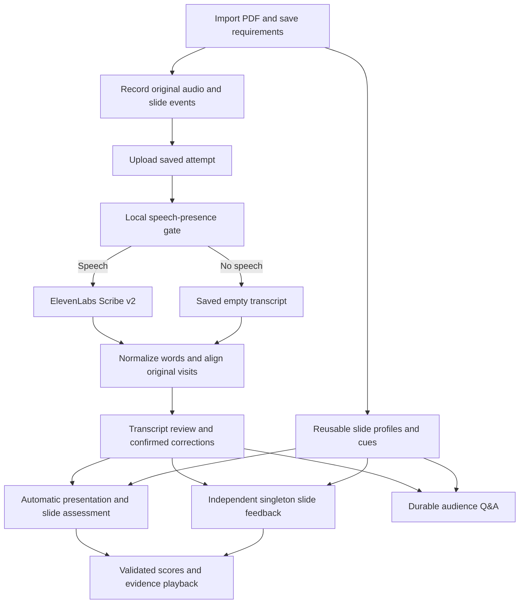

# OutLoud implementation handoff

**Snapshot date:** October 17, 2026

**Application baseline:** `codex/presentation-score` at `e8f48693cc75f2a2bec9cd11eab3b00689dadb34`

**Current integration:** `integration/ai-feedback-with-scribe`

**Audience:** developers, reviewers, and teammates who need to understand the implemented application and its delivery status.

This document inventories the current application, including work inherited from earlier branches. It distinguishes committed application features, the staged Scribe replacement, automated verification, and observed device behavior. It does not assign individual authorship or replace the [API contract](api-contract.md) and the linked feature specifications. Earlier dated documents describe their own checkpoints; their provider names and test counts may differ from this snapshot.

## 1. Implementation and delivery status

| Area | Implemented behavior | Git or verification status |
| --- | --- | --- |
| Presentation setup, recording, review, corrections, durable Q&A | Existing OutLoud implementation and redesigned Android layouts | Included in the authoritative application branch |
| Automatic presentation and per-slide scoring | Backend rubric scoring, automatic Android workflow, evidence validation, saved results and score displays | Committed in `0658944`, `feat: add automatic presentation scoring` |
| Step 1, navigation/layout, cue and singleton-feedback reliability | Compact requests, review routing, reconnect/recovery and discontinued-code removal | Committed in `e8f4869`, `feat: integrate compact feedback and review reliability` |
| Scribe-only transcription | Main's ElevenLabs integration adapted to our application, with consent and migration changes | Implemented, tested, independently reviewed, and staged in an uncommitted integration merge |
| Live Scribe and physical phone | Two successful Scribe submissions; native capture/transcript/playback and restoration observed | Separate, user-authorized verification after mocked integration review |
| Final integration delivery | Commit, push and PR against `main` | Pending user final inspection and approval; no PR merge or deployment |

The integration's recorded staged tree is `afc9fbf6941661e2554bb65921fbbfbbe167acbb`. Subsequent live-test documentation and this handoff remain unstaged. Application source and the original staged snapshot were preserved.

Separate Home-stage experiments in the primary `codex/presentation-stage-home` checkout are outside this application baseline. This report does not claim that those unrelated uncommitted changes were integrated.

## 2. Branch origins and integration approach

The current application includes these relevant ancestry points:

1. `c5c370d`, `feat(it2): integrate AI feedback with Nakajima UI`, joined feedback head `ff8472c` and UI/main ancestor `959025e`.
2. `234c0e1` and `4c23ab6` preserved Step 2 removal and automatic-scoring review artifacts. Artifact commits alone did not commit the complete scoring source.
3. `0658944` committed the complete automatic-scoring source and its required earlier shared modules.
4. `e8f4869` committed compact singleton feedback, retained navigation/layout and reliability work, and removed discontinued runtime/experiment code.
5. Main `5aed316179a7d093f7db02732e792d1fc7c98444` includes PR #30's ElevenLabs Scribe v2 transcription integration.

The integration worktree starts from main `5aed316`, with `e8f4869` as its pending merge parent. Their recorded common ancestor is `959025e4ff2b0ac55125bb4815e7f175480af509`. Completing the pending merge will retain both histories. No history rewrite was used.

Our branch supplies the application behavior and screens. Main supplies the Scribe transcription capability and its supporting request options, vocabulary extraction and PDF handling. The integration adapts that boundary to our existing transcript contract.

The preservation audit compared the integrated source against `e8f4869`: 543 files were unchanged and 45 paths changed, including tests and documentation. An explicit allowlist covers 18 runtime/configuration/migration paths; three of those contain only provider-name comment changes. The audit found no runtime changes outside that allowlist and no rewrite of previously committed migration files. It also verified the original 578-file scoring branch snapshot.

## 3. System structure and normal flow

The Android client uses Expo SDK 57, React Native and TypeScript. The backend uses Django/DRF, PostgreSQL, Celery and Redis. The app stores local presentation, recording, selection and validated result state; the backend owns provider credentials, durable processing jobs, revisions, raw receipts and evidence reconstruction.



The diagram shows dependencies, not permission to regenerate on every dependency read. Admission rules differ: scoring refreshes after synchronized scoring inputs change; singleton feedback and Q&A keep their own initial-generation and explicit-update rules. A score assessment includes its own explanations and does not need an additional slide-feedback request to populate indicators.

## 4. PDF import, presentation setup and reusable cues

### Home and import UI

- The existing gesture-driven Home carousel browses saved presentations with their title, slide count, icon and presentation color.
- Users can open a presentation, pull up to add a PDF, choose another icon and hide/delete a presentation with the existing Undo window. This UI action does not establish backend media deletion.
- The header retains the OutLoud mark/About view and light/dark theme toggle. The assessment ring opens the selected presentation's Full Review.
- Import shows actual PDF preparation/progress and recoverable errors, then opens the shared time/audience setup overlay. Cancelling the picker does not create a successful import.

### PDF and presentation identity

- The Android document picker imports a local PDF, obtains native page count and prepares actual slide previews.
- The backend validates and stores the PDF, renders slide images and extracts slide text. Identical accepted PDF uploads reuse stored content instead of creating duplicate preparations.
- The maximum PDF size is 50 MiB. The application supports a positive slide count without the old ten-slide cap.
- Scribe integration preserves main's extracted-text NUL removal. It removes invalid NUL characters from extracted text before database storage while preserving the original PDF bytes.
- Local presentations and server deck identities remain distinct and must match before dependent context or results can be used.

### Requirements and timing

- The existing setup overlay saves audience and required duration through revisioned presentation-context APIs.
- New untouched imports initialize General audience and 300 seconds through a persisted, idempotent initialization intent. Existing presentations and customized or explicitly cleared preferences are not backfilled.
- Offline initialization and later edits remain pending until synchronization. Conflicts use the existing Use server / Keep mine flow; later local edits cannot be cleared by an earlier response.
- The supported confirmed presentation-duration range is 60–1,800 seconds. Suggested timing is labeled separately from an explicitly saved requirement.
- Per-slide targets use bounded extracted-text weights and deterministic remainder allocation. Integer target seconds sum exactly to the saved total, with slide order breaking ties. Empty/image-only slides get a base weight; the app does not invent image or graph complexity.
- Feedback/scoring prerequisites wait for accepted, matching, synchronized settings rather than using a conflicting local draft.

### Slide profiles and cues

- PDF upload can admit one deduplicated reusable image-aware profile job when feedback is enabled and configured. Cue generation is not a prerequisite for local microphone recording.
- Each slide can expose zero to three Must Cover points and zero to three Further Insight suggestions, with expandable supporting detail. Existing prompt guidance targets concise 8–16-word points, capped at 25 words.
- Cached profiles support feedback, scoring and Q&A without recreating them on each screen visit.
- Cues retain current cached content during transient GET failures. Reconnection backs off at 2.5, 5, 10 and 30 seconds, capped at 30 seconds.
- Foreground/screen activation resumes reads; backgrounding, covering the screen, switching decks and unmounting cancel obsolete cue reads and timers.
- Opening Further Insight expands saved content. It does not submit a new provider request.

See [requirements and cues](api-contract.md), [default initialization](presentation-defaults-verification.md), [timing](phase-3-verification.md), and [cue reliability](cue-feedback-reliability.md).

## 5. Recording, slide visits, source selection and navigation

- Every new capture gets a new attempt UUID. Upload or processing retries keep that UUID and its original saved audio.
- Slide events use zero-based slide indexes and integer milliseconds relative to actual audio capture. Wall-clock timestamps do not replace capture time.
- The first event is at 0 ms. Events remain ordered and must occur before the recording ends.
- The data/validation layer preserves repeated, backward and zero-duration visits. A slide may have several distinct chronological visits.
- New presentation recordings use mono AAC in an M4A container at 44.1 kHz and 64 kbps. The maximum timeline is 1,800,000 ms; capture begins finalization one second before that limit to allow native stop completion.
- The backend audio upload limit remains 25,000,000 bytes. Oversized older recordings remain local/playable but cannot bypass upload validation.
- The recording engine retains saved media and exposes interrupted-capture recovery. Recovery does not silently manufacture a completed transcript or sample assessment.
- A single-slide redo retains the existing comparison screen and Keep current / Overwrite choice. New audio remains pending until source selection is accepted. A recovered redo uses the same decision flow.
- Selected source recordings determine current slide feedback, Q&A scope and displayed scores; a run label alone does not establish source identity.
- The first saved presentation recording opens Full Review; later recordings use the selected-slide review. Keep/Overwrite and return routes preserve the selected slide.
- Review keeps a persistent Full Review action above the scrolling content. Playback and transcript scrolling account for the fixed header.
- Existing landscape PDF behavior, rotation controls, theme styling, slide tiles, recording controls and screen transitions remain our application's implementation.
- Saved timing sums original visit durations per slide. Backend English words/minute and Korean Hangul-runs/minute remain estimates over the full rehearsal, including silence, with mixed-language components separate. Review's current text-based display estimates can reflect confirmed corrections without rewriting original-source metrics.

A zero-duration visit is a valid timeline record. It does not create a positive audio interval, provide speech that was never recorded, or justify an invented slide score.

## 6. Scribe-only transcription

### Provider boundary and configuration

Transcription uses `elevenlabs / scribe_v2` exclusively. The backend reads `ELEVENLABS_API_KEY`; the Android bundle contains no provider credential. OpenAI/Gemini configuration remains available for the existing feedback, scoring and Q&A evaluation providers.

The adapter sends one multipart request through the already locked HTTPX dependency to ElevenLabs' speech-to-text endpoint. It sends original audio rather than trimming or concatenating detected speech. No new provider SDK is required.

| Scribe option | Submitted value |
| --- | --- |
| `model_id` | `scribe_v2` |
| `timestamps_granularity` | `word` |
| `no_verbatim` | `false` |
| `tag_audio_events` | `false` |
| `diarize` | `false` |
| `use_multi_channel` | `false` |
| `keyterms` | Up to 100 deterministic hints; omitted when empty |

HTTPX uses a 120-second timeout, disables redirects and performs no automatic transcription retry. Provider errors, retry-after information and uncertain outcomes feed the existing durable recovery state.

### Vocabulary hints

- Hints come only from extracted text on slides visited in that attempt. Unvisited-slide vocabulary is excluded.
- Extraction is deterministic: Unicode normalization, bounded tokenization, stopword filtering, case-insensitive deduplication and frequency/phrase/acronym ranking produce the selected list.
- The helper caps processing of extracted input and returns no more than 100 hints. It makes no AI call.
- The worker saves the exact submitted options privately before the provider request, so later recovery can inspect the request that was actually submitted.

### Existing transcript contract

Scribe-native output is normalized at the transcription boundary into:

```json
{
  "text": "Um, a short example.",
  "words": [
    {"text": "Um,", "start_ms": 120, "end_ms": 340},
    {"text": "a", "start_ms": 340, "end_ms": 410},
    {"text": "short", "start_ms": 410, "end_ms": 600},
    {"text": "example.", "start_ms": 600, "end_ms": 1100}
  ]
}
```

This is an illustrative contract fragment, not a recorded result. Public responses retain the existing structure and endpoints.

- Only Scribe entries with `type: word` become timed words. Spacing and audio-event entries do not become selectable speech words.
- Seconds convert to integer milliseconds with decimal half-up rounding on the original audio timeline.
- Recognized fillers and false starts remain in the transcript; the adapter does not rewrite fluent prose over them.
- Invalid token shapes, nonfinite/negative/reversed timing and unusable nonempty transcript responses fail validation. Downstream alignment and Android retain their existing duration/source checks.
- Detected language comes from Scribe's `language_code`.
- Raw provider output, private submitted options and request hashes stay in private backend evidence, not the public transcript.

### Speech gating, saved reuse and recovery

- Packaged Silero CPU VAD checks speech presence without transcribing or downloading a model at runtime.
- A no-speech result saves an empty transcript and ordinary aligned empty-word visits/metrics, with no Scribe submission.
- Upload and GET remain storage/read operations; processing admission starts the durable pipeline.
- Duplicate processing requests reuse active/completed work. Saved Scribe raw receipts and normalized transcripts can resume processing without a second submission.
- A submitted request with an unknown outcome requires explicit recovery and the existing charge acknowledgement. The worker does not call another provider or retry blindly.
- Public transcription provenance accepts the exact Scribe provider/model pair, or the existing null states before a provider request. Unsupported identities fail validation.
- Whisper adapter construction, decoding of historical Whisper receipts, provider selection and fallback paths were removed. Historical Whisper development-data support is intentionally absent.

See [Scribe implementation and configuration](scribe-transcription.md) and [integration verification](scribe-only-integration-verification.md).

## 7. Transcript review, playback and confirmed corrections

- The review screens display actual saved transcripts and original audio. Pending or failed processing does not substitute fixture text.
- Native playback position drives transcript highlighting and slide/visit synchronization. Sentence and evidence actions seek through existing playback mechanisms.
- The segment player serializes seeks and cancels obsolete targets; navigation or source changes cannot apply an old seek to another recording.
- Missing remote audio/PDF can be recovered into separate validated local media records. Full Review warns when selected source audio is unavailable.
- Confirmed corrections are versioned overlays on inclusive original-word ranges. The original transcript words, timestamps, slide events and audio remain immutable.
- Suggestions identify recognition errors and offer bounded replacements. They do not rewrite a user's argument, add content, translate speech, or apply themselves automatically.
- Accepted replacements change the effective text used for interpretation, while evidence still cites original words and audio. A replacement spanning a range does not acquire fabricated per-word timings.
- Saves bind to the base transcript identity and expected correction revision. Stale/conflicting writes fail safely; pending edits survive reload and offline errors.
- Confirmed corrections retain historical feedback/assessments but mark dependent results stale. Other attempts and reusable slide-only profiles remain unaffected.
- Singleton feedback needs the existing explicit Update after correction. Automatic scoring instead refreshes once the corrected inputs synchronize, subject to its admission/recovery rules.

See [correction contract](api-contract.md#iteration-2-phase-4--confirmed-transcript-overlays) and [rehearsal review](rehearsal-review.md).

## 8. Singleton AI feedback and Step 1 compact context

### Independent per-slide review

- The current slide-feedback API uses one independent selected slide and exactly its original positive-duration visit segments in chronological order.
- Repeated navigation reuses the matching durable analysis and validated cache instead of generating new feedback for each visit.
- Initial feedback eligibility comes from a new selected recording's transcription handoff. Corrections, ordinary GETs, playback and reopening do not create another initial-generation request.
- Retry/Update synchronize accepted corrections and settings, then respect source, selection, revision, cooldown and uncertain-outcome guards.
- The recovered-initial-request path uses the existing singleton admission checks; losing an earlier acknowledgement does not require a separate feedback architecture.
- Scoring and singleton feedback have independent owners and requests. A score indicator never requires another feedback inference call.

### Feedback content and evidence

- A slide may have zero to four prioritized findings. Valid findings survive invalid peers; partial/invalid/insufficient/model-error results remain distinct from a verified empty successful result.
- Findings use original indexed speech and supported slide facts, including visit/segment identities and bounded playback references.
- The evaluator adapts to informative/descriptive, analytical/persuasive, or mixed/uncertain purpose. It does not assume that a chart requires an analytical argument or that an introduction needs unrelated content.
- Feedback can critique ordering/connections and suggest a clearer expression of the same meaning for the next rehearsal. It leaves the transcript unchanged.
- Up to two optional illustrative enrichments remain separate from problem findings. They are hypothetical examples/analogies or prompts to recall an authentic anecdote, not externally researched factual claims.
- Timing findings use deterministic timing and safe navigation rather than invented speech citations.

### Compact JSON without extra inference

New singleton snapshots freeze `request_context_version=selected-review-context-v1`; the public review schema remains `slide-review-v3`.

The request includes full-deck facts and guidance once, selected original words as explicit compact column rows, at most twenty neighboring words per side of each nonempty selected visit, the corrected full transcript once as background, and confirmed correction ranges/revisions. Neighboring/background words are context, not finding evidence.

The optimization preserves original word identities, quotes, timing, repeated visits, provider selection and output validation. Old singleton snapshots reconstruct their original hashes. Unknown or discontinued grouped protocols fail closed. The change reduces duplicated JSON; it does not establish billed savings, latency improvement or human usefulness by itself.

See [compact-context specification](feedback-compact-context.md), [selected-slide API](api-contract.md#iteration-2-phase-5--selected-slide-review), and [retained-feature verification](retained-features-verification.md).

## 9. Backend presentation scoring

### What one assessment produces

A single assessment can produce an overall presentation score from 0–100, per-slide scores from 0–100, performance levels, a summary, strengths, weaknesses, up to three actionable improvements, limitations and original-source evidence. It reviews communicated meaning using saved requirements, slide role/context and corrected interpretation, rather than awarding points for matching slide wording or speaking longer.

The evaluator selects anchored rubric levels. Backend code validates those selections and calculates scores with deterministic arithmetic. Numerical calculation is deterministic; provider interpretation and usefulness still require human evaluation.

### Scoring modules and reused dependencies

| Module | Responsibility |
| --- | --- |
| `presentation_rubric_v2.py` | Frozen criteria/anchors, units, exact weights, rounding and level boundaries |
| `presentation_visit_evidence.py` | Trusted visit/fact/measurement/requirement registry and compact evidence selections |
| `presentation_score_v2.py` | Versioned request/schema construction, receipt binding, evidence reconstruction, validation and normalized assessment |
| `presentation_scoring.py` | Existing durable feedback-job integration, snapshots, input/protocol fencing, publication and recovery |
| `presentation_score_views.py` | Existing-app GET/POST scoring API |

Required earlier helpers remain: `presentation_score.py`, `presentation_rubric.py`, `presentation_measurements.py`, `presentation_eligibility.py` and `presentation_evidence_selection.py`. Active v2 uses their trusted capture/evidence/measurement code; retaining them does not re-enable the discontinued experiment runners or a separate old scoring UI.

### Frozen rubric and arithmetic

| Level | Unit | UI color |
| --- | --- | --- |
| Beginning | 0 | Red |
| Emerging | 1 | Amber |
| Competent | 2 | Green |
| Advanced | 3 | Blue |

| Slide criterion | Weight | Meaning assessed |
| --- | --- | --- |
| Essential coverage | 40 | Whether essential meaning is communicated and prioritized |
| Explanation depth | 35 | Whether relationships, explanations/examples and implications establish meaning |
| Clarity and relevance | 25 | Whether understandable, relevant expression avoids consequential ambiguity/digression |

Whole-presentation criteria are structure, coherence, audience suitability and delivery, equally weighted within the whole-presentation component. Their anchors progress from consequential communication problems to effective framing, relationships, audience adaptation and supported continuity/pacing.

For slide i, using selected units u1, u2 and u3:

```text
slide_i = (40*u1 + 35*u2 + 25*u3) / 3
whole = 100 * (structure + coherence + audience + delivery units) / 12
overall = 0.70 * mean(exact applicable slide scores) + 0.30 * whole
```

The backend uses exact rational arithmetic and saves numerator/denominator values. It rounds half up once when publishing an integer and never averages displayed integers. All-Competent selections therefore display 67, from an exact 66⅔.

Levels use the unrounded value: Beginning below 100/6; Emerging from 100/6 to below 50; Competent from 50 to below 250/3; Advanced from 250/3 upward. Boundary ties use the higher level. Android consumes the validated backend level for color rather than deriving it from the rounded number.

These are provisional rubric points, not calibrated grades, probabilities or percentiles. Criteria remain internal assessment structure; the current user-facing screens hide criterion cards, weights and anchors.

### Eligibility and validation

- Each deck slide appears exactly once in the assessment contract. An unvisited applicable slide prevents an overall total.
- Only a first or last slide can be not applicable, with explicit evidence/justification. Excluding every slide cannot manufacture a total.
- Positive-duration repeated/backward visits are assessed chronologically. Concise sufficient speech does not fail solely because of the old v1 1,000 ms diagnostic threshold.
- A zero-duration record keeps its valid identity, while a score still requires eligible evidence. No missing slide receives an invented score.
- Assessed slide criteria need valid levels, justification and evidence. Insufficient evidence carries a null level and explicit limitations.
- Speech references identify a known visit and inclusive local word positions. The backend reconstructs quotes and timing from trusted original records.
- Unknown visits/facts, boolean or noninteger indexes, reversed/out-of-range selections, cross-visit ranges, gaps and mismatched slide/source identities fail validation. The validator does not fuzzy-match, clip, split or repair unsupported citations into valid evidence.
- Raw selections, prepared-request hashes, original receipts and reconstruction audits remain private. Public results contain validated reconstructed evidence.
- Bad optional advice items are filtered independently. Score-critical invalid evidence withholds the affected component; valid slide scores survive a rejected overall component.
- Shared weakness IDs and primary criteria prevent unsupported reused deductions; a secondary deduction needs a distinct consequence and supporting evidence.

### Overall-score evidence failure and recovery

The reported Full Review failure was reproduced: slide components could validate while the delivery judgment lacked supporting speech. Versioned prompt `presentation-score-prompt-v2.1` now requires delivery assessments and related deductions to cite speech alongside an eligible non-signal measurement. Duration or requirements alone cannot establish delivery quality.

Validation remains strict. The app retains valid slide scores and displays: **“Presentation score unavailable. Your slide scores are saved.”** It offers explicit Retry.

A completed rejected assessment, or an exactly supported scoring-protocol upgrade, can admit a fresh generation through existing revision/cooldown/uncertainty checks. Older receipts remain attached to their original request/instructions. No old receipt is reinterpreted to create a new score.

Audio unavailable/corrupt/insufficient states suppress the overall score. Delivery is not removed and the remaining weights are not renormalized. Pauses, rate, fillers and repetitions require an explained communication consequence for deductions. Scoring does not claim to grade emotion, confidence, pronunciation, gestures, eye contact or Q&A.

See [complete scoring contract and anchors](presentation-score-v2.md).

## 10. Automatic Android scoring workflow

- The app-level grading host uses the existing backend API, response validator, durable jobs, cache and source-selection infrastructure.
- A new selected recording becomes eligible after valid transcription, accepted source selection and synchronized corrections/requirements are ready.
- Opening a presentation also permits scoring its previously unscored selected recording sources. The host does not backfill unused recording history.
- Initial scoring starts when prerequisites are ready. Later synchronized scoring-input changes use a one-second debounce to combine rapid edits.
- Persisted input/submission identities, shared locks and deduplicated reads prevent repeated Grade-equivalent submissions across screens, navigation and restarts.
- If inputs change during an active/uncertain submission, the host reconciles that outcome before attempting newer inputs.
- Current failed/rejected assessments do not regenerate repeatedly on unchanged inputs. Retry and charge confirmation remain explicit.
- API/attempt/context/source-aware cache validation and revision fences prevent an older response from replacing a newer current result.
- Offline reads retain saved assessments. Pending synchronization, stale source identity and conflicting corrections block unsafe admission/display.
- Selecting another recording uses that recording's assessment rather than substituting a recent result from another take.

Main implementation: `InitialPresentationScoreHost.tsx`, `automaticPresentationScore.ts`, `usePresentationScore.ts`, `presentationScoreStore.ts`, `selectedPresentationScores.ts`, and `useRunPresentationScores.ts`.

## 11. Full Review, slide review and Home score displays

- Existing circular indicators display verified 0–100 values and validated performance labels. Slide navigation tiles display their selected source's per-slide score.
- Beginning is red, Emerging amber, Competent green and Advanced blue across Home, Full Review, slide rings and tiles. Unavailable/stale/noncurrent scores use neutral presentation.
- Rings keep state labels short: scoring, updating, failed, unavailable, no score or not recorded. Explanations and recovery controls sit below the indicators.
- Normal Grade/Update controls and rubric/explanation toggles were removed. Summaries, strengths, weaknesses and actionable improvements appear directly, with evidence playback and slide links.
- Finding counts remain separate from performance points; counts never populate a score wheel.
- A composed run may display per-slide scores from different original attempts. It does not receive an averaged or fabricated overall score.
- An overall display requires one exact original recording selection with the required applicable slide coverage. `Run.full` is not sufficient proof.
- Home's assessment circle uses the same verified overall-score projection as Full Review. Its adjacent statistics are total current verified findings, selected recording duration and WPM.
- Findings count once across selected slides; pending/partial/recovery notices remain visible. Stale or unsupported findings do not become a completed total.
- Evidence actions recheck current assessment/source identity before playback. Zero-length intervals do not produce a fake audio range.

The current integration preserves our layouts, palette/theme handling and navigation. It does not restore main's older screens.

## 12. Durable audience Q&A

- The app generates one initial eligible question set from a new selected recording workflow, using saved audience and selected source manifests. It does not generate questions merely because a user opens an old screen.
- Question scope identifies selected slide indexes, original attempt UUIDs, exact visit segments and presentation context. Different slides can use different takes from the same deck.
- Question generation uses the existing durable feedback jobs, profile prerequisites, revisions, receipts and quota controls. Saved audience is required.
- Results contain one to three audience questions with stable identities, slide/topic context, panelist/role and a follow-up. The current screen retains main/follow-up navigation and saved question history.
- Each answer records a new Attempt UUID and binds it to one completed question job, question ID and main/follow-up part. Repeated submissions cannot bind the same UUID to another question.
- Answers reuse the normal saved-audio/Scribe processing pipeline. Evaluation failure does not discard or retranscribe successful saved STT.
- Answers shorter than eight seconds or fifteen words retain audio/transcript and receive the too-short result without an evaluation provider request. Answer capture is bounded to five minutes.
- Follow-up evaluation receives the active follow-up plus original question context. Existing answer evaluations retain their original question/audience binding after later presentation-setting changes.
- Correction or audience/source changes mark question results outdated; explicit update/recovery uses existing controls. Old answers remain stored.

### Scribe consent in Q&A

The new consent key is `analysis-consent:elevenlabs:scribe-v2:keyterms:v2`. Old OpenAI transcription consent does not authorize a new ElevenLabs submission.

- Recording and Q&A transcription entry points disclose saved audio plus vocabulary hints from recorded slides.
- Missing/new answer upload and new/retried transcription require Scribe consent.
- Cancel leaves the pending answer UUID and audio intact. Continue resumes the same answer identity under the existing in-flight lock.
- Saved successful-result reads, active status polling and feedback-only evaluation recovery do not demand fresh transcription consent.
- The existing dialog styling and durable workflow remain intact. No duplicate answer or parallel Q&A architecture was added.

See [durable Q&A contract](api-contract.md#phase-6--durable-selected-run-audience-qa). The historical Phase 6 ledger predates Scribe and must be read with the current provider specification.

## 13. Shared job, validation and failure behavior

| Concern | Implemented handling |
| --- | --- |
| Duplicate uploads | Stable attempt identity plus content hash; conflicting content does not overwrite the winner |
| Duplicate provider admission | Existing durable analysis ownership, generation/revision checks, database locks and client in-flight guards |
| Background work | Celery worker with PostgreSQL job authority, Redis transport and recovery scheduler |
| Interrupted processing | Recover from saved raw/normalized stages; distinguish work known not submitted from an uncertain submitted request |
| Provider limits | Existing configured quota/reservation and cooldown state; clear wait/overdue/error UI |
| Unknown charge outcome | Explicit acknowledgement before another eligible generation; no exactly-once billing claim |
| Late results | Retain receipts/usage while rejecting publication against newer revisions or sources |
| Network reads | Validated cached-first results and GET-only reconnect; a read failure does not admit inference |
| Evidence | Original attempt/transcript/slide/visit/word/timing provenance checked on backend and client |
| Corrections | Versioned overlays and conservative invalidation of scopes consuming a changed transcript |
| Missing or invalid data | Explicit unavailable/partial/invalid states; no fabricated successful output |

Cue/feedback status distinguishes queued, context preparation, provider processing, verification and quota waits. Two minutes without server timestamp progress adds a delay notice. Missing completed-slide output is a recovery issue rather than an empty successful result or generic insufficient evidence.

These mechanisms improve recoverability; they do not guarantee provider exactly-once execution, zero billing after network loss, semantic correctness or production readiness.

## 14. Database and migration history

The implementation reuses existing Attempt, ProviderRequest, profile/description, feedback-analysis/job/request/quota, correction/context and Q&A binding models. Scoring stores versioned snapshots/results through existing durable feedback fields rather than adding a scoring table.

The integration preserves both existing migration paths:

```text
main:        0007_provider_request_options -----------+
                                                    +--> 0011_merge_scribe_scoring
application: ... --> 0010_slide_review_membership ----+
```

Migration0011 joins the two dependencies and changes defaults for new ProviderRequest provider/model fields to `elevenlabs` and `scribe_v2`. It does not rewrite historical transcript rows or receipts. Fresh SQLite and PostgreSQL initialization reaches one valid graph leaf without model drift.

Step 2's previously committed migration and inert membership model remain for schema consistency. Active runtime does not admit grouped feedback or read/write membership rows. No shared database reset, historical Whisper backfill, migration-history rewrite, recording deletion or worktree cleanup was performed for this integration.

## 15. Public API inventory

Routes below are relative to `/api/`. Public wire details remain in the API contract.

| Endpoint | Role |
| --- | --- |
| `GET health/`, `GET ready/` | API liveness and database/broker readiness; readiness alone is not worker completion proof |
| `POST decks/`, `GET decks/{deck}/` | Store/prepare PDF and read actual deck/slides |
| `GET decks/{deck}/attempts/` | Read saved presentation attempts, excluding bound Q&A answers |
| `POST attempts/`, `GET attempts/{attempt}/` | Save immutable original audio/metadata; inspect processing, transcript, visits and metrics |
| `POST attempts/{attempt}/process/` | Revision-aware processing/recovery, including explicit uncertainty acknowledgement |
| `POST presentation-contexts/`, `GET/PATCH presentation-contexts/{context}/` | Saved audience/duration and revision/conflict handling |
| `GET decks/{deck}/profiles/`, `POST .../profiles/generate/` | Read/recover reusable slide profiles and cues |
| `GET decks/{deck}/descriptions/`, `POST .../descriptions/generate/` | Existing saved description/profile dependency routes |
| `GET/PATCH attempts/{attempt}/corrections/` | Read/save confirmed recognition overlays |
| `GET/POST attempts/{attempt}/correction-suggestions/` | Read or explicitly generate/recover recognition suggestions |
| `GET attempts/{attempt}/feedback/`, `POST .../feedback/generate/` | Existing whole-attempt coaching/recovery, separate from scoring and singleton review |
| `GET/POST attempts/{attempt}/slide-review/` | Read/admit one scoped singleton review |
| `GET/POST attempts/{attempt}/presentation-score/` | Read/admit versioned overall/per-slide assessment for a context |
| `GET/POST attempts/{anchor}/audience-qa/` | Durable selected-run question generation/read/recovery |
| `GET/POST attempts/{answer}/qa-answer/` | Durable answer binding, processing/evaluation/read/recovery |

Legacy synchronous deck Q&A endpoints remain in the code for older callers; the current Android screen uses the durable workflow. Scribe-only applies to their transcription as well, not to their evaluation provider.

## 16. Main implementation locations

Paths below are relative to the repository root. This is a map of feature ownership in code, not a complete changed-file list or a named teammate assignment.

| Area | Entry points |
| --- | --- |
| Screens and navigation | [AppShell](../mobile/src/screens/AppShell.tsx), [Home](../mobile/src/screens/HomeScreen.tsx), [Rehearse](../mobile/src/screens/RehearseScreen.tsx), [Review](../mobile/src/screens/ReviewScreen.tsx), [Full Review](../mobile/src/screens/FullReviewScreen.tsx), [Q&A](../mobile/src/screens/QAScreen.tsx) |
| Import and presentation state | [importer](../mobile/src/features/presentations/importer.ts), [presentation store](../mobile/src/features/presentations/store.ts), [context writer](../mobile/src/features/presentations/contextWriter.ts), [defaults](../mobile/src/features/presentations/defaultRequirements.ts) |
| Capture and selected takes | [CaptureEngine](../mobile/src/features/rehearsal/CaptureEngine.tsx), [recording service](../mobile/src/features/recording/service.ts), [limits](../mobile/src/features/recording/limits.ts), [recovery](../mobile/src/features/recording/recovery.ts), [takes](../mobile/src/features/rehearsal/takes.ts) |
| Scribe boundary | [transcription](../backend/rehearsals/services/transcription.py), [keyterms](../backend/rehearsals/services/keyterms.py), [processing](../backend/rehearsals/services/processing.py), [speech gate](../backend/rehearsals/services/speech_gate.py), [alignment](../backend/rehearsals/services/alignment.py) |
| Transcript validation/cache | [client](../mobile/src/features/transcription/client.ts), [result validation](../mobile/src/features/transcription/resultValidation.ts), [analysis storage/consent](../mobile/src/features/transcription/analysisStorage.ts), [review validation](../mobile/src/features/transcription/reviewValidation.ts) |
| Corrections | [backend corrections](../backend/rehearsals/services/corrections.py), [suggestions](../backend/rehearsals/services/transcript_suggestions.py), [mobile corrections](../mobile/src/features/presentations/useTranscriptCorrections.ts) |
| Cues | [profiles](../backend/rehearsals/services/slide_profiles.py), [cue panel](../mobile/src/features/presentations/CueGuidancePanel.tsx), [profile reader](../mobile/src/features/presentations/useSlideProfiles.ts) |
| Singleton feedback | [backend singleton service](../backend/rehearsals/services/slide_review.py), [coaching admission](../backend/rehearsals/services/coaching.py), [initial host](../mobile/src/features/feedback/InitialFeedbackHost.tsx), [review hook](../mobile/src/features/feedback/useSlideReview.ts) |
| Scoring backend | [rubric](../backend/rehearsals/services/presentation_rubric_v2.py), [visit evidence](../backend/rehearsals/services/presentation_visit_evidence.py), [scorer](../backend/rehearsals/services/presentation_score_v2.py), [durable integration](../backend/rehearsals/services/presentation_scoring.py), [API](../backend/rehearsals/presentation_score_views.py) |
| Scoring Android | [automatic host](../mobile/src/features/feedback/InitialPresentationScoreHost.tsx), [controller](../mobile/src/features/feedback/usePresentationScore.ts), [automatic guards](../mobile/src/features/feedback/automaticPresentationScore.ts), [validator](../mobile/src/features/feedback/presentationScore.ts), [cache](../mobile/src/features/feedback/presentationScoreStore.ts), [selected sources](../mobile/src/features/feedback/selectedPresentationScores.ts) |
| Score display/playback | [panel](../mobile/src/features/feedback/PresentationScorePanel.tsx), [level/playback helpers](../mobile/src/features/feedback/presentationScoreDisplay.ts), [Home statistics](../mobile/src/screens/HomeFeedbackStats.tsx), [slide playback](../mobile/src/screens/ReviewSlidePlayback.tsx), [segment player](../mobile/src/features/rehearsal/useSegmentPlayer.ts) |
| Durable Q&A | [question service](../backend/rehearsals/services/audience_qa.py), [API/bindings](../backend/rehearsals/durable_qa_views.py), [client](../mobile/src/features/qa/client.ts), [state hook](../mobile/src/features/qa/useDurableQa.ts), [saved state](../mobile/src/features/qa/store.ts), [initial host](../mobile/src/features/qa/InitialQaHost.tsx) |
| Durable persistence and scheduling | [models](../backend/rehearsals/models.py), [tasks](../backend/rehearsals/tasks.py), [provider configuration](../backend/rehearsals/services/feedback_config.py), [quota](../backend/rehearsals/services/feedback_quota.py) |
| Migration join | [0011 merge migration](../backend/rehearsals/migrations/0011_merge_scribe_scoring.py) |

## 17. Discontinued implementation and preserved shared code

Step 2 grouped-slide feedback is permanently cancelled. Grouped admission, builders/budgets/ownership, grouped projection/handoff code, obsolete Step 2 documentation and old experiment tooling were removed from active source in the retained-feature work. Unsupported grouped scopes/protocols fail before inference, including at the locked submission boundary.

Old scoring model-comparison, consensus, evaluation and recovery experiment runners/tests were discontinued. Active v2 scoring and its required shared evidence/measurement helpers remain. Removing an experimental runner does not justify deleting a module imported by the production scoring path.

Previously committed migration history, private receipts and original Git history remain. The retained-feature verification recorded no grouped snapshots or membership rows in the inspected local datasets, but the integration did not delete their databases or existing worktrees/branches. Review artifacts and staging backups remain preserved.

## 18. Verification performed

### Current integration automated gates

These results come from the recorded verification of the matching integration source. Creating this documentation did not rerun application suites or make provider calls.

| Check | Recorded result |
| --- | --- |
| Initial main transcription/keyterm baseline | 20 tests passed |
| Focused transcription/processing/keyterm/migration checks | 49 backend tests OK; 3 PostgreSQL-only skips on SQLite |
| Full backend, SQLite | 554 tests OK; 24 expected PostgreSQL-only skips |
| Full backend, disposable PostgreSQL | 554 tests OK; zero skips |
| Fresh migrations, SQLite and PostgreSQL | Passed through both histories and migration0011 |
| Django system checks, migration drift and graph | Passed; no model drift, one valid leaf |
| Mobile `npm run check` | Typecheck passed; 549 tests passed; lint zero errors and one existing player-ref warning |
| Android JS export with source maps | Passed; 112 embedded application source files matched integration |
| Independent integration review | No introduced correctness findings; reviewer independently ran 32 mobile and 82 backend cases, plus 3 client consent-boundary assertions |

Automated provider responses were mocked and transport guarded against paid calls. Suites include scoring arithmetic/evidence, automatic lifecycle/recovery, compact singleton requests, corrections/staleness, durable Q&A, request deduplication, saved assessments, zero/repeated visits, malformed evidence and source/protocol mismatches. PostgreSQL checks used task-owned disposable databases, not a shared phone database.

### Mock Android workflow evidence

A separate `com.team07.outloud.scribemock` package, with no INTERNET permission and synthetic fixtures, exercised the actual Q&A screen/client and existing consent dialog on the emulator:

- Cancel retained the answer/audio with zero uploads or bound-answer POSTs.
- Continue produced one upload and one bound-answer POST for the same UUID.
- Reopening after revoking test consent restored the saved result without another submission.
- Home retained the existing overall-score and findings display.

This mocked package is distinct from the production-source physical-phone APK and does not prove live provider behavior.

### Authorized live Scribe checks

After the mocked gate, the user explicitly authorized live Scribe and physical-phone testing and saved a backend key. Exactly two Scribe submissions completed:

1. **Synthetic backend recording:** 17.086 seconds, 45 timed words, including “Um” and “Uh.” Integer original-audio timing, repeated visits and a zero-duration record at 8,000 ms survived processing. Saved transcript/completed-request replay reused one receipt. Forty private hints excluded unvisited-slide vocabulary; original audio hashes matched. The existing Android parser accepted the actual response and rejected tampered provenance/negative/reversed intervals.
2. **Physical microphone recording:** Samsung Galaxy S23 Ultra / SM-S918N captured 33.921 seconds with slide 1→2 navigation. Native PDF import, fresh Scribe disclosure, upload, status polling, completed transcript rendering, playback progress, transcript highlighting and statistics after process restart were observed. It used one Scribe receipt; reopening did not add a submission.

The final standalone `com.team07.outloud` release APK has SHA256 `4f6b922e2cee4d977cc0f9f6340d80ae50ec8ecd96e6c8824f8f6ecafcb46bec`. Its 112 embedded application files match the integration source. Its signing certificate matches the existing app; `adb install -r` preserved app data. Pulling the installed APK back from the phone reproduced the verified hash.

An initial build contained stale Metro preview output. The source verification rejected it before installation; the replacement build used an isolated cache and passed. No production source change was needed.

The live-check runtime uses a separate local API on port 58010 and its own PostgreSQL, Redis, worker, recovery scheduler and media directory. Existing services/database contents were preserved. Feedback, scoring and Q&A evaluation inference were disabled for these agent-run Scribe checks; those features remain in the application source. No other inference call occurred and billing totals were not queried.

The phone microphone captured surrounding audio more strongly than the Mac's synthetic test phrase. This verifies native pipeline and playback operation, not controlled speech-recognition accuracy or user usefulness. Private audio/transcripts/screenshots remain outside Git.

## 19. Remaining limitations and delivery work

1. **Final integration delivery:** user inspection/approval, the intended merge commit, push of `integration/ai-feedback-with-scribe`, and PR creation targeting `main` remain pending. No PR merge or deployment is authorized.
2. **Human speech and usefulness:** quiet speech, diverse English/Korean/mixed-language/noisy recordings, transcription accuracy and the usefulness/fairness of feedback/scoring/Q&A still need a human pilot. Passing deterministic and mocked tests does not establish provider adherence.
3. **Live overall scoring:** the strict evidence contract remains in force. A provider can still omit required speech evidence; the affected overall score must stay unavailable while valid slides remain saved.
4. **Current manual Scribe runtime:** feedback/scoring/Q&A evaluation are disabled in that isolated test configuration. Their presence in source and mocked verification do not imply live end-to-end evaluation in this session.
5. **Recovery/device limits:** exhaustive Android OS interruption, audible synchronization accuracy and real Celery/Redis process-kill recovery were not re-established for this exact integration. Existing automated recovery coverage remains recorded separately.
6. **Q&A lifecycle:** existing answer polling aborts on unmount; AppState/inactive-layer cancellation was not redesigned by the provider replacement.
7. **Known lint warning:** `useSegmentPlayer.ts:108` retains the pre-existing cleanup-ref warning. There were no lint errors in the recorded gate.
8. **Development scope:** authentication and production hosting/security configuration remain separate work. Local readiness or a physical install is not a deployment claim.
9. **Historical data:** old Whisper development results are intentionally unsupported by the Scribe-only client contract. No historical conversion or shared-data reset was added.

The isolated runtime and temporary APK/log directories are session artifacts, not installed deployment infrastructure. Their availability must be checked again in a later session.

## 20. Detailed specifications and review evidence

- [API contract](api-contract.md): wire formats, identities, correction scopes, singleton review, durable Q&A and scoring seams.
- [Scoring v2](presentation-score-v2.md): complete anchors, formulas, evidence and automatic workflow contracts.
- [Scoring source snapshot](presentation-scoring-source-verification.md): the earlier committed scoring dependency closure and its own historical gate.
- [Compact feedback context](feedback-compact-context.md): retained Step 1 request construction and compatibility.
- [Retained-feature verification](retained-features-verification.md): Step 1/navigation/reliability and discontinued runtime cleanup.
- [Scribe specification](scribe-transcription.md): provider boundary and backend configuration.
- [Scribe integration verification](scribe-only-integration-verification.md): preservation allowlist, automated/independent review and subsequent live-phone evidence.
- [AI-use record](ai-use.md) and [actual collaboration prompts](ai-collaboration-prompts-iteration-2.md): AI assistance and task-level verification, separate from human approval.

The reviewed source patch hash is `3497f6def49dd2c121aedf635552eaefc77d4ef197cd330b57460cc22beec28c`. Seven later runtime-file edits added attribution comments only; byte comparisons confirmed the reviewed implementation remained unchanged.

Local non-repository artifacts: `/private/tmp/outloud-scribe-integration-20261017/` contains review/diff/test/source proofs; `/private/tmp/outloud-scribe-live-phone-20261017/` contains the subsequent live-test and installed-APK proofs. Private recordings, credentials, generated native projects and dependency directories do not belong in the integration commit.

---

Prepared with OpenAI Codex from the current source, committed history, existing feature contracts and recorded verification artifacts. No new feature, runtime source edit, provider call, commit, push, merge or deployment was performed to create this handoff. Documentation remains available for user review before inclusion in any commit.


## Subsequent approved cleanup and delivery authorization

After this handoff's preparation, the user approved audit groups A/B/D/E's seven
unused PNGs and requested the integration PR. Three unused source components,
thirteen unused raster assets and one obsolete component test were removed;
test stubs were cleaned. Editable SVG sources and all other audited groups remain.
Current mobile checks pass 548 tests (one obsolete component test removed),
typecheck/lint and Android export. The 112 embedded live application sources and
all backend source remain unchanged. See [cleanup/review evidence](scribe-integration-cleanup-verification.md).
Earlier staged/pending-delivery statements describe the original snapshot, before
this later authorization. Publication results are reported after remote verification.
