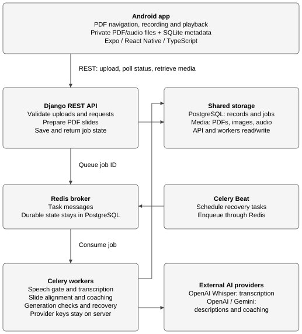
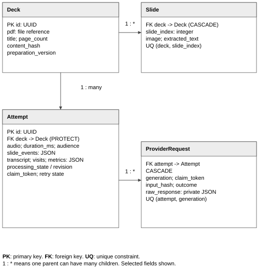
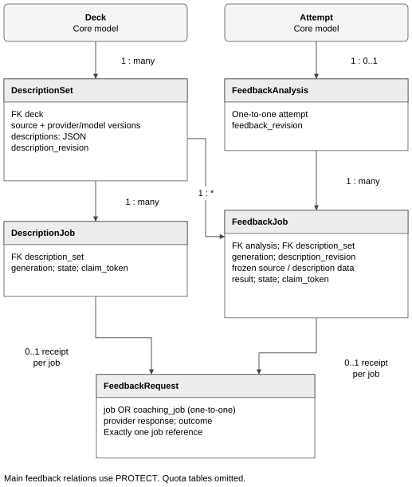
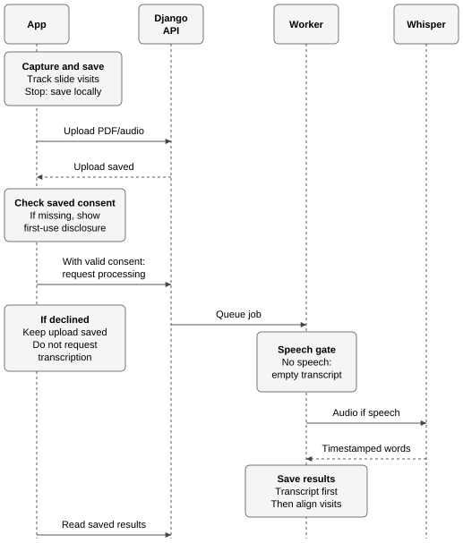
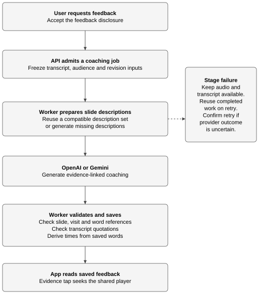
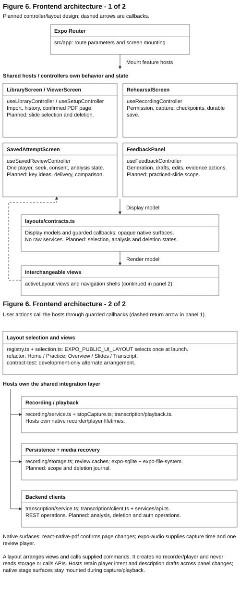

# OutLoud Design Documentation

Team 07 | Rev.3.0 | Iteration 2 | 16 October 2026

**Status:** Canonical Iteration 2 implementation design. Current-behavior claims are
grounded in the checked-out source; proposed work is labeled explicitly.

OutLoud is an Android presentation-rehearsal application. It combines local PDF,
recording and playback workflows with a Django/Celery backend for durable storage,
transcription, slide profiling and evidence-linked coaching.

## 1. Document Revision History

| Version | Date | Description |
| --- | --- | --- |
| 1.0 | 2026-09-28 | Initial design. |
| 2.0 | 2026-10-09 | Iteration 1 design and proposed Iteration 2 roadmap. |
| 3.0 | 2026-10-16 | Replaced roadmap language with the current Iteration 2 architecture, state models, APIs, caching, concurrency, recovery and frontend organization.  |

## 2. System Architecture

The Expo/React Native client owns import interaction, recording, local persistence,
playback and review presentation. Django REST Framework validates resources and
stores durable state. Celery workers perform provider-backed jobs; Redis carries task
messages and PostgreSQL stores identities, revisions, job states and validated
results. API and workers share private media storage for PDFs, slide images and audio.

The client uses REST and polling instead of a persistent socket. GET routes read saved
state and do not submit paid work. Explicit POST actions admit processing or feedback.
Provider keys and calls remain on the backend. Local copies keep capture and playback
useful when upload or analysis fails.

| Layer | Main technology | Responsibility |
| --- | --- | --- |
| Android client | Expo, React Native, TypeScript, Expo Router | Import, capture, local database/files, playback, review and guarded user actions |
| API | Django REST Framework | Validation, durable state, media metadata and job admission |
| Workers | Celery and Redis | Transcription, descriptions, slide review and recovery |
| Persistence | PostgreSQL and shared media volume | Identity, revisions, job state, results, PDF images and audio |
| External AI | OpenAI Whisper and configured OpenAI/Gemini feedback provider | Timestamped transcription and structured feedback |

### 2.1 Design decisions and rationale

| Decision | Choice and rationale |
| --- | --- |
| Local capture, server analysis | Keeps recording responsive and provider credentials off the phone while allowing locally saved recovery. |
| Durable polling state | A review can resume after navigation or restart; the tradeoff is polling traffic and delayed updates. |
| Stable client UUID per recording | Upload and processing retries refer to the same attempt without replacing an earlier rehearsal. |
| Immutable provider source plus overlays | Whisper output remains evidence; confirmed transcript corrections are revisioned overlays rather than destructive edits. |
| Revision- and token-fenced jobs | Duplicate delivery and late workers cannot silently replace newer inputs or results. |
| Structured provider output with local validation | Provider responses are untrusted data and retained only after identity, bounds and evidence checks. |
| Shared cached slide profiles | Slide facts can be reused for compatible jobs while source/configuration fingerprints prevent cross-version mixing. |

The wire-level authority is the [API contract](../architecture/api-contract.md).

## 3. Data and State Model

`Deck` owns ordered `Slide` rows. `PresentationContext` stores revisioned audience and
required-duration inputs independently from deduplicated PDF content. Every recording
creates an `Attempt` with its own UUID, audio, duration and slide-event timeline.
Transcript words, visits and metrics use the same millisecond audio clock.

`ProviderRequest` records private Whisper request evidence by attempt and processing
generation. `TranscriptCorrection` stores the complete confirmed overlay set and a
revision while preserving the original transcript.

`DescriptionSet` identifies a compatible deck/provider/project/model/prompt/schema
scope and holds the current revisioned slide profiles. `DescriptionJob` records each
generation. `FeedbackAnalysis` separates analysis types for an attempt, while
`FeedbackJob` freezes source and description snapshots for a generation.
`FeedbackRequest`, quota buckets and reservations record admission and provider
outcomes without exposing raw receipts to clients.

### 3.1 Core invariants

- `(deck, slide_index)` is unique; slide events use original zero-based indexes and
  nondecreasing millisecond timestamps.
- An attempt belongs to one deck and is never overwritten by a later rehearsal.
- Presentation, processing, description, transcript and feedback revisions are
  independent; a client must not substitute one revision for another.
- A feedback generation retains frozen inputs. A later correction or profile edit
  makes dependent output stale instead of mutating its evidence.
- Raw provider receipts are private backend evidence, not API or media resources.

The concrete constraints are in
[backend/rehearsals/models.py](../../backend/rehearsals/models.py).

## 4. Backend API and Job Lifecycle

Routes use the `/api/` prefix and trailing slashes. The principal resources are:

| Operation group | Purpose |
| --- | --- |
| `POST /decks/`, `GET /decks/{id}/` | Prepare a PDF and read ordered slide metadata. |
| `POST /presentation-contexts/`, `GET/PATCH /presentation-contexts/{id}/` | Create and revision-update audience/duration requirements. |
| `POST /attempts/`, `GET /attempts/{id}/`, `GET /decks/{id}/attempts/` | Store one recording and retrieve durable review/history state. |
| `POST /attempts/{id}/process/` | Explicitly admit transcription/alignment or a revision-aware retry. |
| `GET/PATCH /decks/{id}/descriptions/`, `POST .../generate/` | Read, correct or explicitly generate compatible slide profiles. |
| `GET /attempts/{id}/feedback/`, `POST .../generate/` | Read or explicitly request rehearsal coaching. |
| `GET/PATCH /attempts/{id}/corrections/` | Read or save confirmed transcript overlays. |
| `GET/POST /attempts/{id}/slide-review/` | Read or explicitly generate selected-slide review. |

GET, playback, refresh and navigation do not admit provider work. Generation routes
validate exact payload fields, current source identity, expected selection and the
relevant revision. Retry of an uncertain external outcome requires explicit
acknowledgement. Admission commits queued intent before task delivery, and a worker
must claim the matching generation before submitting or saving a result.

Workers re-check source revisions before provider submission and final write. A lost
broker delivery can be recovered from durable queued state. A saved complete receipt
can be validated and reused; an ambiguous submission is not repeated silently.
Failures retain audio and any earlier valid result, expose a safe error state and use
cooldown/retry metadata rather than fabricating success.

## 5. Recording, Transcription and Playback

The client requests microphone permission, writes the initial slide event at `0 ms`,
uses the native audio clock for confirmed slide changes and finalizes audio before
upload. Permission denial creates no recording. Save/upload failure retains the owned
local file and attempt identity for recovery.

Transcription is an explicit processing operation. The worker checks audio, calls
ElevenLabs `scribe_v2` when usable speech exists, validates timestamped words, and
derives visits and metrics. A deterministic extractor supplies at most 100 bounded
vocabulary keyterms from visited-slide text without another AI request. The durable
provider record snapshots the provider, model and submitted options; historical
Whisper results remain readable under their stored provenance. No recognized speech
produces an explicit outcome rather than invented text. Audio is limited to
25,000,000 downloaded bytes; accepted rehearsal duration is positive and at most
20 minutes.

### 5.1 Alignment

Each visit covers `[start_ms, end_ms)`. A word belongs to the last slide event at or
before the word's start; the final visit ends at recording duration. Repeated and
backward visits remain separate. The player position selects the active visit and word.
Transcript, visit and feedback-evidence taps all seek one shared native player. Seeks
are serialized, newer queued targets replace older ones, and navigation/backgrounding
never resumes playback automatically.

## 6. Slide Profiles and Coaching

Slide profiles contain bounded summary, key-idea and visual facts plus profile cues.
The cache key incorporates the PDF/source fingerprint and provider, project, model,
prompt and schema versions. A compatible completed or human-edited set is reused.
Edits increment the description revision and fence dependent work.

Coaching freezes the effective transcript, selected visits, presentation requirements
and compatible slide profiles. The provider returns structured findings. Backend and
mobile validators check slide membership, word/visit bounds, evidence quotations,
categories and result sizes. Invalid evidence is rejected or shown as unavailable;
validation supports traceability but does not prove that advice is correct or useful.

The user explicitly requests feedback and accepts the applicable disclosure. Reading
or replaying a saved rehearsal never generates feedback. Results distinguish content,
audience and delivery suggestions from measured timing/transcript data. Empty valid
results are allowed, and stale results cannot authorize evidence playback.

Audience Q&A is an implemented companion flow. The existing Q&A screen explicitly
requests deck-aware questions, records an answer, sends it through the same current
speech adapter, and submits the transcript for provider review. Consent and provider
configuration gates are reused, but question/answer operations remain separate from
rehearsal coaching so replaying a saved result does not generate new provider work.

## 7. Frontend Organization

Expo Router enters a screen layer under `mobile/src/screens/`. Reusable feature state,
wire parsing and guarded actions live under `mobile/src/features/`; shared design
components live under `mobile/src/design/`. The main flow is Home → Upload → Rehearse
→ Review, with comparison from saved attempts.

| Area | Primary ownership |
| --- | --- |
| `features/presentations` and `features/pdf` | Local presentation identity, server mapping, requirements and import |
| `features/recording` and `features/rehearsal` | Capture lifecycle, timeline, persistence, upload and recovery |
| `features/transcription` | Validated review state, native-player status and seeking |
| `features/feedback` | Profile/coaching contracts, revision-aware actions and evidence display |
| `features/qa` and `screens/QAScreen.tsx` | Audience-question generation, answer capture/transcription and answer review |
| `screens/TakePlayback.tsx` | Shared review/player host and editable profile presentation |
| `screens/CompareScreen.tsx` | Side-by-side attempt comparison without a new provider call |

The client validates wire data into read models before enabling capabilities. Cache
keys include the normalized API address and resource identity. Refresh preserves a
newer revision and retains last-known data on transient failure with a stale notice.
Downloads use unique temporary files, enforce size/time limits, validate native media
before publication and do not replace a known-good or original capture on failure.

## 8. Scope and Remaining Design Work

The mandatory Iteration 2 design covers PDF import, recording/timeline persistence,
durable review, transcription/alignment, slide profiles, evidence-linked feedback,
Audience Q&A, history/retry and comparison. The [product traceability map](traceability.md)
records where completion still requires team-owned testing.

Deletion, multi-user ownership and authenticated private-media delivery remain design
risks. They must not be represented as complete without implementation and test
evidence. Final performance, transcription-quality, feedback-quality, accessibility
and device-coverage targets also require explicit team decisions before Testing
Documentation is authored.
