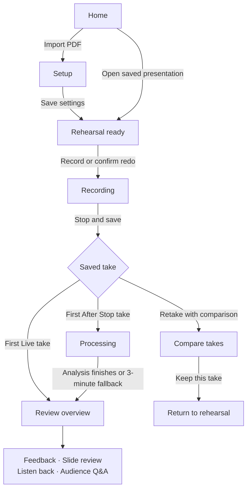
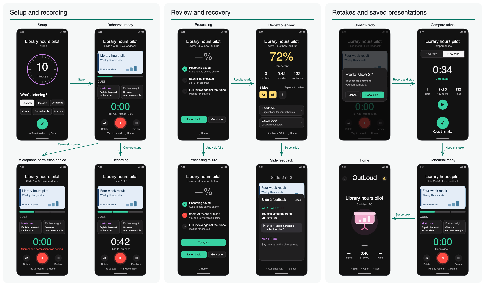

# OutLoud Requirements & Specifications

Team 07 (치르치르), Software Development Principles and Practice, Seoul National University 
Version 5.0, 19 November 2026

## Table of Contents

1. [Document Revision History](#1-document-revision-history)
2. [Project Abstract](#2-project-abstract)
3. [Customer](#3-customer)
4. [Competitive Landscape](#4-competitive-landscape)
5. [Functional Requirements](#5-functional-requirements)
   - [5.1 Presentation management](#51-presentation-management)
   - [5.2 Recording and slide synchronization](#52-recording-and-slide-synchronization)
   - [5.3 Transcription and rehearsal playback](#53-transcription-and-rehearsal-playback)
   - [5.4 Slide-specific and audience feedback](#54-slide-specific-and-audience-feedback)
   - [5.5 Speaking delivery feedback](#55-speaking-delivery-feedback)
   - [5.6 Retry and comparison](#56-retry-and-comparison)
   - [5.7 History, data management and recovery](#57-history-data-management-and-recovery)
6. [Non-functional Requirements](#6-non-functional-requirements)
7. [User Interface Requirements](#7-user-interface-requirements)
   - [7.1 Released v10 flow](#71-released-v10-flow)
   - [7.2 v10 wireframes](#72-v10-wireframes)
8. [Additional Features](#8-additional-features)
   - [8.1 Semester Scope](#81-semester-scope)
   - [8.2 Optional Extensions](#82-optional-extensions)

## 1. Document Revision History

| Version | Date | Key changes |
| --- | --- | --- |
| 1.0 | 2026-09-28 | Initial specification: scope, eleven user stories with acceptance criteria, quality requirements and low-fidelity UI flows. |
| 2.0 | 2026-10-09 | Merged closely related stories into nine mandatory stories in seven functional groups, and added the team's stories on filler words, pauses and student knowledge levels. Added failure and recovery scenarios. Separated automatic transcription from requested AI feedback. Added a competitor comparison table. Replaced text wireframes with Figma screens and navigation flow diagrams. |
| 3.0 | 2026-10-23 | Added Iteration 2 status and device findings. Updated recording limits and initial-feedback behavior to PR31. Scheduled feature gaps, pre-upload disclosure, bug follow-up and pilot-based target setting for Iteration 3. Clarified Q&A/Korean scope. Acceptance criteria unchanged. |
| 4.0 | 2026-11-05 | Reconciled published v8, release-reported backend repair and unreleased work. Updated defaults, access, provider and UI specifications; retained requirement IDs, acceptance criteria and unmet requirements. |
| 5.0 | 2026-11-19 | Updated the specification to the Iteration 4 v10 baseline, covering live feedback, segment upload recovery, and selected-slide retakes. Retained the existing user stories and acceptance criteria. The APK was built from `5745502`, and PR #60 merged the v10 implementation into `main`. [v10 release](https://github.com/snuhcs-course/swpp-2026-project-team-07/releases/tag/outloud-demo-v10-20261115) · [Merged PR #60](https://github.com/snuhcs-course/swpp-2026-project-team-07/pull/60) |

## 2. Project Abstract

OutLoud is an Android presentation rehearsal app for students and professionals. Users can upload PDF slides, record rehearsals, and receive feedback on their delivery. OutLoud uses AI to transcribe rehearsals, assess how well speakers cover each slide, and suggest improvements. Feedback links to the relevant slide and moment in the recording, so presenters can hear the explanation they want to improve. They can get feedback while rehearsing or review it afterward, then retake an individual slide and choose which recording to keep. To prepare for Q&A, presenters can practice answering questions and follow-ups generated from their rehearsal and saved audience settings.

## 3. Customer

OutLoud is for students and professionals who rehearse slide-based presentations on their own. They want to find explanations that need work, practice those parts again, and prepare for questions from their audience.

- **University students** rehearse class presentations and practice explaining a difficult slide before presenting to classmates.
- **Business and technical presenters** practice explaining proposals or technical concepts to clients who may be unfamiliar with the subject.
- **Startup founders** rehearse timed pitches and practice explaining charts or metrics that investors may ask about.
- **Professors and instructors** rehearse lessons and look for explanations that assume more background knowledge than their students have.

## 4. Competitive Landscape

**Yes** indicates documented support. **—** indicates that the sources reviewed don’t establish support for that capability.

| Capability | ChatGPT | PowerPoint Speaker Coach | Yoodli | OutLoud v10 |
| --- | --- | --- | --- | --- |
| Rehearse while presenting your own slides | — | Yes | Via screen sharing | Yes |
| Speaking pace and filler-word feedback | — | Yes | Yes | Yes |
| Flags reading slide text aloud | — | Yes | — | — |
| Feedback on presentation content | On request | — | With custom screen-sharing goals | Yes |
| Review saved rehearsal results | — | — | Yes | Yes |
| Feedback linked to a slide and a moment in the recording | — | — | — | Yes |
| Retake an individual slide | — | — | — | Yes |
| Listen to and choose between two takes of the same slide | — | — | — | Yes |
| Built-in presentation Q&A practice | — | — | Yes | Yes |

**How OutLoud differs.** Presenters can find the slide that needs work, replay their explanation, and retake that slide within the same rehearsal.

[ChatGPT file and audio uploads](https://help.openai.com/en/articles/8555545-uploading-files-and-audio-to-chatgpt) · [PowerPoint Speaker Coach](https://support.microsoft.com/en-us/powerpoint/rehearse-your-slide-show-with-speaker-coach) · [Yoodli practice](https://support.yoodli.ai/en/articles/9550465-practice-with-yoodli) · [Yoodli delivery feedback](https://yoodli.ai/blog/how-to-stop-using-filler-words) · [Yoodli screen-sharing goals](https://support.yoodli.ai/en/articles/11591789-screensharing-goals) · [OutLoud v10 release](https://github.com/snuhcs-course/swpp-2026-project-team-07/releases/tag/outloud-demo-v10-20261115)

## 5. Functional Requirements

The nine stories below describe what OutLoud must support, from importing slides to managing saved rehearsals. Each story uses Given–When–Then acceptance criteria to describe expected behavior in successful and failure cases.

**Iteration 4 user acceptance testing (UAT).** The team froze six user stories at the end of Iteration 3 and used them to design the Iteration 4 UAT. The workbook’s **User Story** tab lists them. They cover slide upload and practice, transcription and recording, AI grading, speech habit analysis, AI feedback consistency, and Q&A tailored to the target audience. The workbook records reviewer outcomes and comments by test step. [Iteration 4 UAT workbook](https://docs.google.com/spreadsheets/d/1msuddEecIikY6-PvD1mlmtFlIzOmrz8frR-_GfDpQ7U/edit#gid=0)

| Functional area | User stories |
| --- | --- |
| 5.1 Presentation management | US-01 · Import and inspect slides |
| 5.2 Recording and slide synchronization | US-02 · Record a slide-based rehearsal |
| 5.3 Transcription and rehearsal playback | US-03 · Review recordings, transcripts and key ideas |
| 5.4 Slide-specific and audience feedback | US-05 · Review evidence-linked content feedback US-07 · Adapt feedback to the audience’s knowledge level |
| 5.5 Speaking delivery feedback | US-06 · Review pace, slide timing, filler words and pauses |
| 5.6 Retry and comparison | US-08 · Practice selected slides again and compare attempts |
| 5.7 History, data management and recovery | US-10 · Reopen saved attempts and recover analysis US-11 · Delete rehearsal data |

### 5.1 Presentation management

#### US-01. Import and inspect slides

**As a** presenter, **I want** to import and navigate a PDF presentation, **so that** I can rehearse using my own slides.

- **AC-01a. Import a valid PDF (Positive)**
  - **Given** a valid three-page PDF
  - **When** I import it
  - **Then** the app shows three slides in their original order and lets me move between them.
- **AC-01b. Reject an unusable file (Negative)**
  - **Given** a corrupt, encrypted or otherwise unsupported PDF, or a file that is not a PDF
  - **When** I import it
  - **Then** the app explains the failure and lets me choose another file, without creating a deck that is ready to practice.
- **AC-01c. Cancel file selection (Negative)**
  - **Given** my presentation library is open
  - **When** I cancel the file picker
  - **Then** the library is unchanged.

### 5.2 Recording and slide synchronization

#### US-02. Record a slide-based rehearsal

**As a** presenter, **I want** to record my speech while changing slides, **so that** I can later review what I said on each slide.

**v10 note.** Pressing Android Back during recording leaves it running. The stop, save, or discard choice in AC-02d remains open.

- **AC-02a. Record repeated slide visits (Positive)**
  - **Given** a loaded deck and microphone permission
  - **When** I record while visiting slides 1, 2 and then 1 again, and press Stop
  - **Then** one saved attempt contains the audio and all three slide visits in order, each at its position in the recording.
- **AC-02b. Microphone permission denied (Negative)**
  - **Given** microphone permission is denied
  - **When** I select Start recording
  - **Then** recording does not start, and the app explains how to allow access or return to the deck.
- **AC-02c. Recording interrupted (Negative)**
  - **Given** a recording is interrupted, for example by a phone call or by the app closing
  - **When** I return to the app
  - **Then** the app identifies the interrupted attempt, keeps any recoverable audio, and does not show the attempt as a completed rehearsal.
- **AC-02d. Leave while recording (Negative)**
  - **Given** a recording is in progress
  - **When** I press Back
  - **Then** the app asks whether to stop and save the attempt or discard it, and does not discard audio without my confirmation.

### 5.3 Transcription and rehearsal playback

#### US-03. Review recordings, transcripts and key ideas

**As a** presenter, **I want** to replay each slide's recording with its transcript and a separate summary of key ideas, **so that** I can find the parts that need improvement without losing my original wording.

**v10 note.** Recordings preserve repeated slide visits. The **Next** control can stall at a visit boundary. The separate summary of what the presenter said and its unavailable state remain incomplete (AC-03d, AC-03e).

- **AC-03a. Play a transcript segment (Positive)**
  - **Given** a processed attempt with speech on slide 2
  - **When** I open slide 2 and select a transcript segment
  - **Then** the app displays that segment and plays its linked audio interval from that attempt.
- **AC-03b. Slide without recognized speech (Negative)**
  - **Given** a visited slide with no recognized speech
  - **When** I open its Transcript and Key ideas views
  - **Then** both views state that no speech was recognized, which the app distinguishes from a transcript that is unavailable; no summary or slide description is shown in its place, and any available audio still plays.
- **AC-03c. Repeated visits to one slide (Positive)**
  - **Given** an attempt in which I visited the same slide twice
  - **When** I select one of those visits during playback
  - **Then** the displayed slide and transcript follow that visit's position in the recording, not the other visit.
- **AC-03d. Separate key ideas (Positive)**
  - **Given** an analyzed slide
  - **When** I switch between Transcript and Key ideas
  - **Then** the recognized words remain unchanged, and the summary of what I said appears as a separately labeled AI-generated view.
- **AC-03e. Summary could not be generated (Negative)**
  - **Given** a slide with recognized speech whose summary could not be generated
  - **When** I open Key ideas
  - **Then** the app states that the summary is unavailable and keeps the transcript and audio available.

### 5.4 Slide-specific and audience feedback

#### US-05. Review evidence-linked content feedback

**As a** presenter, **I want** suggestions grounded in my slides and speech, **so that** I can review possible inconsistencies and improve unclear explanations.

- **AC-05a. Feedback for a selected slide, with evidence (Positive)**
  - **Given** a rehearsal with feedback available, in which slide 2 states "Revenue increased by 20%" and the recording says "Revenue decreased by 20%" about the same period
  - **When** I select slide 2 to review
  - **Then** the app displays slide 2's feedback: it identifies the possible mismatch, shows the slide text and the speech interval as evidence, explains the issue and suggests checking or correcting the explanation. Human review confirms whether the interpretation is correct.
- **AC-05b. Reject invalid evidence (Negative)**
  - **Given** a generated suggestion that refers to a slide that does not exist or to an audio interval outside the recording
  - **When** results are prepared for display
  - **Then** that suggestion is not shown as a valid evidence-linked suggestion.
- **AC-05c. Respect the practiced slides (Negative)**
  - **Given** a rehearsal of slides 2 and 3 only
  - **When** content feedback is generated
  - **Then** slides outside that selection are not flagged as missing explanations, and decorative or irrelevant slide elements need not be spoken aloud.

#### US-07. Adapt feedback to the audience's knowledge level

**As a** presenter, **I want** feedback on wording and explanations that may be hard for the audience I describe, such as nontechnical clients or students with limited background, **so that** I can explain my ideas at the right level.

- **AC-07a. Plain wording for nontechnical clients (Positive)**
  - **Given** the presenter selected the audience "nontechnical clients" and recorded a pitch that uses "p95 latency" without explaining it
  - **When** the presenter requests feedback
  - **Then** the app highlights the term, links to where it was said in the recording, and suggests clearer, plain-language wording. Human review assesses usefulness and correctness.
- **AC-07b. No audience described (Negative)**
  - **Given** no audience description or knowledge level was supplied
  - **When** I request feedback
  - **Then** regular feedback remains available, and the app neither invents an audience profile nor assumes a particular course prerequisite or student background.
- **AC-07c. Simpler explanation for students (Positive)**
  - **Given** the professor has specified the students' knowledge level and recorded a presentation containing an explanation that assumes more advanced knowledge
  - **When** the professor requests feedback
  - **Then** the app highlights that explanation and suggests a simpler explanation.

### 5.5 Speaking delivery feedback

#### US-06. Review pace, slide timing, filler words and pauses

**As a** presenter, **I want** to review my speaking pace, time per slide, filler words and pauses, **so that** I can identify sections to shorten and improve my delivery habits.

- **AC-06a. Pace and duration for one slide (Positive)**
  - **Given** a slide interval with 60 recognized words over 30 seconds
  - **When** I review its pace
  - **Then** the app shows an elapsed-time rate of 120 words per minute and a slide duration of 30 seconds.
- **AC-06b. Pace or pauses unavailable (Negative)**
  - **Given** no valid speech or an interval of zero duration
  - **When** I review statistics
  - **Then** pace is labeled unavailable instead of being shown as a normal score. Pause results state the detection rule used, and pauses that could not be measured are labeled unavailable.
- **AC-06c. Filler results unavailable (Negative)**
  - **Given** filler-word results are unavailable for a rehearsal, for example because detection failed
  - **When** I review delivery feedback
  - **Then** the filler category is labeled unavailable instead of reporting that no fillers occurred.
- **AC-06d. Total time for a revisited slide (Positive)**
  - **Given** slide 1 was visited for 10 seconds and later for 20 seconds
  - **When** I review time per slide
  - **Then** slide 1 shows a total of 30 seconds, and both visits remain available for review.
- **AC-06e. Flag filler words and pauses (Positive)**
  - **Given** the presenter has recorded a rehearsal containing filler words and pauses
  - **When** the presenter requests feedback
  - **Then** the app flags the sections containing filler words and pauses for review.

An unavailable label is an error state; it does not satisfy AC-06e. Repetition and false-start detection are optional and appear only after the detector passes the team's pilot check.

### 5.6 Retry and comparison

#### US-08. Practice selected slides again and compare attempts

**As a** presenter, **I want** to rehearse the whole deck or selected slides again as a new attempt and compare the same slide across attempts, **so that** I can improve weak sections and judge whether my revision helped.

**v10 note.** Presenters can listen to the old and new takes and choose which to keep. The full slide checklist (AC-08b) and comparison of both takes’ transcripts and feedback, including the missing-feedback state (AC-08c, AC-08e), remain incomplete.

- **AC-08a. Retry one slide (Positive)**
  - **Given** attempt A covers slides 1 to 3
  - **When** I select only slide 2 and complete another rehearsal
  - **Then** a separate attempt B contains slide 2 with new audio and results, and attempt A's audio, transcript and feedback remain unchanged.
- **AC-08b. No slide selected (Negative)**
  - **Given** no slides are selected
  - **When** I open retry setup
  - **Then** Start remains unavailable until I select at least one slide or the whole deck.
- **AC-08c. Compare slide 2 in two attempts (Positive)**
  - **Given** full attempt A and selected-slide attempt B both include slide 2 of the same deck
  - **When** I compare that slide
  - **Then** both attempts' audio, transcripts and feedback are available with clear attempt labels.
- **AC-08d. No shared slide (Negative)**
  - **Given** two attempts that do not share a slide from the same uploaded deck
  - **When** I select comparison
  - **Then** the app explains that no comparable slide is available and does not pair unrelated slide numbers.
- **AC-08e. Feedback missing for one attempt (Negative)**
  - **Given** one of two compatible attempts has no completed feedback
  - **When** I compare them
  - **Then** the available audio and text remain reviewable, and the missing feedback is labeled.

### 5.7 History, data management and recovery

#### US-10. Reopen saved attempts and recover analysis

**As a** presenter, **I want** saved rehearsals to reopen and failed analysis to be retryable, **so that** a network or model failure does not require another recording.

- **AC-10a. Reopen a saved attempt (Positive)**
  - **Given** a saved attempt
  - **When** I close and reopen the app and select it
  - **Then** its available audio, transcript and results reopen with the correct processing status.
- **AC-10b. Retry failed analysis (Positive)**
  - **Given** saved audio and a failed analysis
  - **When** I select Retry analysis after the service recovers
  - **Then** analysis uses the same recording and preserves earlier attempts, and repeating the request does not create duplicate rehearsal attempts.
- **AC-10c. Later stage fails (Negative)**
  - **Given** a history refresh or a later analysis stage fails
  - **When** I return to review
  - **Then** previously saved material remains available, the failure is explained, and an eligible recovery action is offered.

#### US-11. Delete rehearsal data

**As a** presenter, **I want** to delete an attempt or deck I no longer need, **so that** I can control the rehearsal data retained by the app.

**v10 note.** Presenters can remove a presentation from Home. Complete deletion of local and server data, including confirmation and recovery if deletion fails, remains incomplete (AC-11a–c).

- **AC-11a. Cancel or confirm deletion (Positive)**
  - **Given** a deletion confirmation that names the selected attempt
  - **When** I cancel, **Then** nothing is deleted.
  - **When** I confirm, **Then** its app-owned audio and derived data are removed, and the attempt can no longer be reopened.
- **AC-11b. Delete a deck with several attempts (Positive)**
  - **Given** a deck with several attempts
  - **When** I request deck deletion
  - **Then** the confirmation lists the attempts that will be deleted, and other decks and their attempts remain intact.
- **AC-11c. Deletion cannot finish (Negative)**
  - **Given** a deletion that cannot finish
  - **When** I return to history
  - **Then** the app reports the incomplete deletion and offers recovery, without claiming that all affected data was removed.

## 6. Non-functional Requirements

| Requirement | Expected behavior | How to verify |
| --- | --- | --- |
| **NFR-01 · Data integrity** | A new attempt preserves earlier attempts. Feedback links open the correct slide, attempt, and time interval. | Compare saved attempts before and after a retake. Check links for repeated slide visits and invalid references. |
| **NFR-02 · Responsiveness** | Recording and slide navigation remain usable while analysis runs. The app shows processing progress and indicates when processing fails or can be retried. | Rehearse on a slow or interrupted connection. Measure slide-change, save, transcription, and feedback times separately. |
| **NFR-03 · AI quality and transparency** | Transcripts, summaries, delivery statistics, and suggestions have distinct labels. Uncertain advice asks the presenter to check the evidence. Missing measurements are labeled **Unavailable**. | Have independent reviewers check clear, contradictory, noisy, and ambiguous samples. Record missed issues, false warnings, and whether the advice was correct and useful. |
| **NFR-04 · Recovery** | Saved audio survives analysis failures. Retrying uses the same recording and avoids duplicate attempts or active jobs. Interrupted recordings are marked **Interrupted**. | Interrupt an upload or analysis, restart the app, and retry. Check that saved material remains available and that retries preserve the attempt. |
| **NFR-05 · Privacy** | Before rehearsal data leaves the device, the app explains what will be uploaded and lets the presenter decline. Deleting a rehearsal removes its app-owned audio and results. | Decline the disclosure and verify that no rehearsal data was sent. Confirm deletion and check the device and server. |
| **NFR-06 · Compatibility and accessibility** | The agreed Android build supports import, recording, review, and recovery on the Galaxy S22 and S23. Users can distinguish recording, saving, processing, and failure states and navigate with large text and TalkBack. | Run those tasks on both devices, including microphone denial, long text, and TalkBack navigation. |
| **NFR-07 · Cost and maintainability** | Reopening saved results uses existing analysis. Retries reuse completed work. Processing records the model version, duration, failed stage, and cost where available. | Check provider requests during replay, refresh, and retry. Record provider cost per minute of rehearsal. |

**Known v10 gaps.** After Stop uploads rehearsal audio before the first transcription disclosure. The signed build also limits text enlargement in some views. [Audio upload](https://github.com/snuhcs-course/swpp-2026-project-team-07/blob/57455028739ad2d1aeb7f1d04723a01f6fb7190e/mobile/src/features/recording/upload.ts#L79-L89) · [Transcription consent gate](https://github.com/snuhcs-course/swpp-2026-project-team-07/blob/57455028739ad2d1aeb7f1d04723a01f6fb7190e/mobile/src/features/transcription/useAttemptAnalysis.ts#L166-L190) · [Text scaling limit](https://github.com/snuhcs-course/swpp-2026-project-team-07/blob/57455028739ad2d1aeb7f1d04723a01f6fb7190e/mobile/src/design/frame.tsx#L78-L81)

**Numerical targets.** Pass thresholds are still open for slide-change and save times, processing time per minute of audio, transcription word error rate, feedback quality, and provider cost per rehearsal minute.

**v10 operating limits.** PDFs must contain at least one slide and be at most 50 MiB. The planned presentation duration can be set from 1 to 30 minutes, and the audience description can contain up to 500 characters. Live recording is capped at 30 minutes. After Stop has a separate audio upload limit of 25,000,000 bytes.

## 7. User Interface Requirements

### 7.1 Released v10 flow

**Setup and recording.** Importing a PDF opens **Setup**. Saving the audience and planned duration opens the rehearsal screen. While the screen is idle, the slide counter switches between **Live feedback** and **After Stop**. If Live feedback is unavailable when recording starts, v10 uses After Stop. If microphone permission is denied, the screen displays an error and returns to idle.

**Stop and review.** The next screen depends on the saved take. If saving fails, the app shows an error and returns to idle. A first Live take opens **Review overview**, where completed slide feedback can appear while other results are pending. A first After Stop take opens **Processing**, where the presenter can listen to the saved recording. The app opens **Review overview** when analysis finishes. From **Review overview**, the presenter can open **Feedback**, select a slide for review, open **Listen back**, or swipe up to open **Audience Q&A**.

**Retakes.** Confirming a redo starts a new recording. If the saved retake has a previous take to compare, **Compare takes** opens. The presenter can listen to **Old take** or **New take**, then select **Keep this take** to save the choice and return to rehearsal.

### 7.2 v10 wireframes

*Wireframes based on the released OutLoud v10. Slide content, times, and scores are illustrative.* [Open full-size wireframe](figures/png/outloud-v10-wireframes.png)

| Screen or state | What the presenter can do | What v10 does |
|---|---|---|
| **Recording** | Tap **Stop** or press Android Back. | **Stop** ends capture and tries to save the take. Android Back leaves recording active. |
| **Processing** | Open **Listen back** while analysis is pending. | Saved audio can play while the transcript is pending. After returning from **Listen back**, v10 may stay on **Processing** past the three-minute timeout. |
| **Review overview** | Tap a slide tile. | A recorded slide opens its review. A skipped slide opens rehearsal for that slide. |
| **Slide feedback** | Play a cited excerpt. | Playback starts at the cited moment in the recording. |
| **Redo and compare** | Cancel the redo or leave **Compare takes** before keeping a take. | Cancel returns to rehearsal with the existing take. Leaving Compare returns to rehearsal with the choice still pending. |

The table describes released v10 behavior. See [Functional Requirements](#5-functional-requirements) for the acceptance criteria.

## 8. Additional Features

### 8.1 Semester Scope

**US-20. App and feedback language (planned for Iteration 5).** OutLoud should let presenters choose English or Korean during onboarding. This choice should set the language of the app interface and AI-generated feedback independently of the language spoken during rehearsal.

- **AC-20a (proposed).** If a presenter chooses Korean during onboarding and rehearses in English, the interface and generated feedback appear in Korean, while the transcript and direct quotes from the rehearsal remain in English. The same rule applies when a presenter chooses English and rehearses in Korean.

### 8.2 Optional Extensions

- **US-18. Attach a rehearsal script.** **AC-18a.** A supported script is saved separately from the transcript. Canceling or choosing an unsupported file leaves existing rehearsal data intact.
- **US-19. Share rehearsal material.** **AC-19a.** When an authenticated owner confirms sharing, only the selected recipients gain access to the selected material.

See the [original stories and contributor attributions](https://github.com/snuhcs-course/swpp-2026-project-team-07/blob/e6f56fb25cfff6b7506ee348a61e159a24e80bee/docs/requirements/requirements-and-specifications.md#58-original-team-stories) for their mapping to the current criteria and the [story-to-test matrix](../testing/story-test-matrix.md) for verification.
