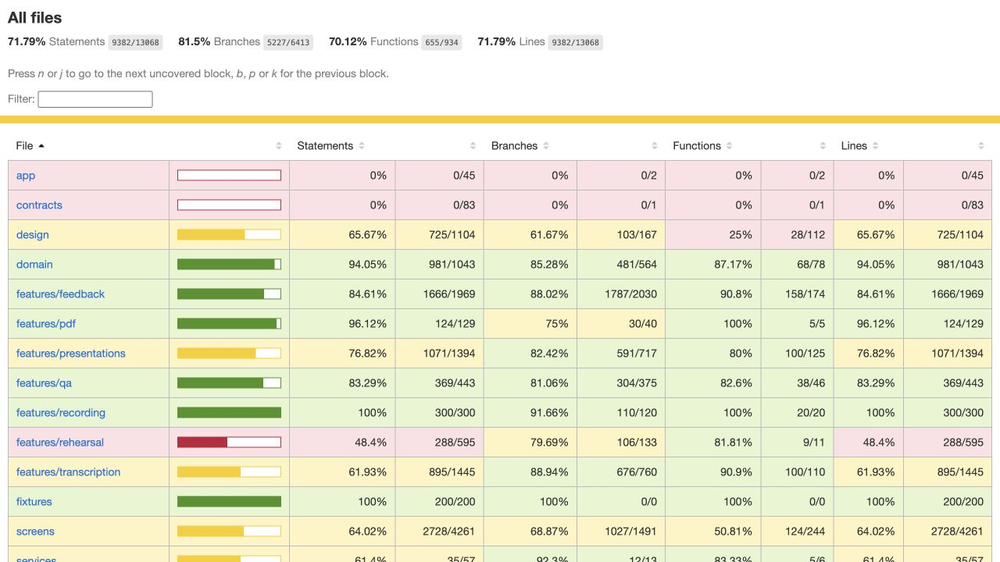
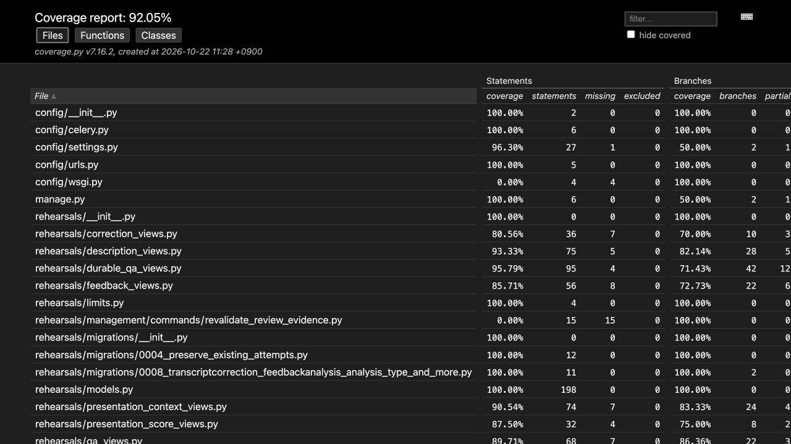

# Testing Documentation

Team 07 · Iteration 2 · October 22, 2026

[Test Inventory](test-inventory.md) lists test files. [Story-to-Test Matrix](story-test-matrix.md) maps tests to acceptance criteria.

## 1. Test Responsibility & Schedule (Iteration 2)

### Plan

| Component | Test maintainer |
| --- | --- |
| Mobile logic and storage | Jooyoung |
| Mobile screens and components | Jaewon |
| Backend logic and services | Seoyeon |
| Backend API and runtime | Injoon |
| Manual Android testing | All four members |

Maintainers write and maintain tests for new or changed behavior and regression fixes. Coordinate integration tests that span components.

Run CI on each push and pull request. Before merge, require mobile type/lint checks, collector validation, tests, coverage thresholds and Android JavaScript export; require backend system/migration checks, coverage-tool tests, application tests and coverage thresholds. Retain reports on failure. Rerun affected suites after changes and update results before each iteration submission.

### Results

Main CI passed on October 20. Test and coverage runs completed on October 22. Coverage checks have not run in remote CI; GitHub merge enforcement remains unverified. Human review is pending.

## 2. Unit Testing & Integration Testing (starting from Iteration 2)

### Plan

Test recording timelines, speech-to-slide alignment, PDF/audio storage, evidence validation, scoring, settings/corrections, feedback and Q&A. Include normal, error, boundary and recovery cases.

**Frameworks:** mobile logic/storage uses the Node test runner with native/network mocks and fakes. Screen/component tests add React test renderer and custom native loaders. Both groups use [c8](https://github.com/bcoe/c8#sourcemap-support) 12.0.0. Both backend groups use Django's test runner, `unittest.mock`, provider fixtures and a disposable PostgreSQL test database; API tests use DRF request-response checks. Backend coverage uses [coverage.py](https://coverage.readthedocs.io/en/latest/branch.html) 7.16.2.

#### Coverage targets

| Component | Source scope | Target: line / branch | Reason |
| --- | --- | --- | --- |
| Mobile logic and storage | `mobile/src/**/*.ts` | 85% / 75% | Recording, saved-take selection and recovery need strong coverage. |
| Mobile screens and components | `mobile/src/**/*.tsx` | 70% / 60% | Tests simulate native interfaces and lifecycle behavior; phone checks cover microphone, playback and Android behavior. |
| Backend logic and services | `backend/rehearsals/services/**/*.py`, plus `models.py`, `limits.py` and `tasks.py` under `backend/rehearsals/` | 85% / 75% | Evidence validation, scoring and persistence errors can corrupt feedback or saved results. |
| Backend API and runtime | Remaining application Python under `backend/` | 80% / 70% | Request/error paths need strong checks; configuration and operational paths need extra setup. |

Include untested files at zero coverage, including application code replaced by mocks. Exclude dependencies, build output, generated native projects, type declarations, tests/helpers and generated schema migrations. Include handwritten repair logic and mixed schema/data migrations. The [file-scope record](testing-evidence/coverage-2026-10-22.json) lists exact inclusions/exclusions.

Calculate group coverage from summed covered/total counts across files. Use the union of unit/integration execution so shared lines count once. c8 uses V8 line/block metrics; coverage.py uses statement/branch metrics.

#### Environment and commands

Use Node.js 24, Python 3.12 and PostgreSQL 16-alpine with the committed lockfiles. Follow the [local development guide](https://github.com/snuhcs-course/swpp-2026-project-team-07/blob/c4a3f48d2a635bb2edb44828c62fb286b55f8d94/docs/local-development.md) for environment setup.

Start each block from the repository root with Python 3.12 active. Use a separate PostgreSQL instance with the credentials below and a role that can create test databases. Export these values for backend commands; blank provider keys override ignored `.env` credentials.

```sh
export POSTGRES_HOST=127.0.0.1
export POSTGRES_PORT=5432
export POSTGRES_DB=outloud
export POSTGRES_USER=outloud
export POSTGRES_PASSWORD=outloud-local-only
export DJANGO_DEBUG=1
export OPENAI_API_KEY= GEMINI_API_KEY= ELEVENLABS_API_KEY=
```

Mobile checks and coverage:

```sh
cd mobile
npm ci
npm run typecheck
npm run lint
node tools/validate-coverage.mjs
npm run test:coverage
npm run bundle:android
```

Backend checks and coverage:

```sh
cd backend
python -m pip install -r requirements-test.txt
python -m unittest discover -s ../tools -p 'test_coverage_report.py' -v
python manage.py check
python manage.py makemigrations --check --dry-run
python manage.py migrate
python -m coverage run manage.py test --noinput
python -m coverage json
python -m coverage html
python ../tools/coverage_report.py backend --check
```

Each component directory receives `coverage/groups.json` and `coverage/groups.html`. Native reports: `mobile/coverage/index.html` and `backend/coverage/html/index.html`. Coverage checks return 1 after generating reports if a group misses a target.

### Results

#### October 22 local coverage

**Date:** October 22, 2026, KST · **Application baseline:** [merged PR #31](https://github.com/snuhcs-course/swpp-2026-project-team-07/pull/31), `c4a3f48d2a635bb2edb44828c62fb286b55f8d94` · **Executor:** Codex.

B09's separate fix branch is excluded from these test counts and coverage results.

**Environment:** macOS, Node.js 24.20.0, Python 3.12.13, PostgreSQL 16-alpine. Commands: the coverage blocks above. [Configuration hashes and file scope](testing-evidence/coverage-2026-10-22.json) identify the measured setup.

| Suite | Passed | Failed | Skipped |
| --- | --- | --- | --- |
| Mobile | 548 | 0 | 0 |
| Backend, PostgreSQL | 554 | 0 | 0 |

Percentages: **line / branch**.

| Component | Frameworks | Target | Actual | Date | Command / Report |
| --- | --- | --- | --- | --- | --- |
| Mobile logic and storage | Node; mocks/fakes; c8 | 85% / 75% | 80.73% / 86.26%; **Fail: lines** | 2026-10-22 | `npm run test:coverage`; [report](testing-evidence/mobile-native-coverage-2026-10-22.jpg) |
| Mobile screens and components | Node; React test renderer; native loaders; c8 | 70% / 60% | 61.78% / 70.89%; **Fail: lines** | 2026-10-22 | `npm run test:coverage`; [report](testing-evidence/mobile-native-coverage-2026-10-22.jpg) |
| Backend logic and services | Django; `unittest.mock`; coverage.py | 85% / 75% | 94.67% / 87.84%; **Pass** | 2026-10-22 | `python -m coverage run manage.py test --noinput`; [report](testing-evidence/backend-native-coverage-2026-10-22.jpg) |
| Backend API and runtime | Django/DRF; `unittest.mock`; coverage.py | 80% / 70% | 87.62% / 78.00%; **Pass** | 2026-10-22 | `python -m coverage run manage.py test --noinput`; [report](testing-evidence/backend-native-coverage-2026-10-22.jpg) |

**Mobile coverage report (c8)**



**Backend coverage report (coverage.py)**



Screenshots show whole-component totals; the table separates architectural groups. The backend headline, 92.05%, combines statement and branch opportunities.

**Shortfall:** mobile tests leave feedback/media hooks and parts of Home/AppShell/Upload unexecuted. Add tests for these paths and rerun coverage. Mobile coverage exited 1; backend coverage exited 0.

Type checking, Android JavaScript export, backend system/migration checks, collector validation and three coverage-tool tests passed. Lint reported one existing warning. The export verifies JavaScript bundling; device behavior requires phone tests. [Earlier CI and detailed test records](testing-evidence/iteration-2-supporting-records.md).

## 3. AI Module Testing (starting from Iteration 3)

To be completed in Iteration 3.

## 4. Acceptance Testing (starting from Iteration 3)

Plan to be completed in Iteration 3; results in Iteration 4.

## 5. Alpha & Beta Testing (Iteration 5)

To be completed in Iteration 5.

## Supplementary Manual Testing

### Plan

All four members check import/settings, recording/transcription, feedback/evidence playback, retake/comparison, spoken Q&A and reopening saved results. Record device/OS, build, date, tester, steps, expected/actual behavior, outcome and evidence.

### Results

The October 19 Galaxy S25 walkthrough identified [B01–B09](testing-evidence/iteration-2-supporting-records.md#october-19-manual-testing). The exact build, Android version, per-case operators, complete steps/results and video references remain missing.

On October 20, Codex verified B09's first-Redo fix on a separate branch: five regression tests and agent-operated Galaxy S25 checks passed. The fix remains unmerged. The reported 0:00-to-0:07 timer jump remains open and unreproduced; audible quality was not assessed.
