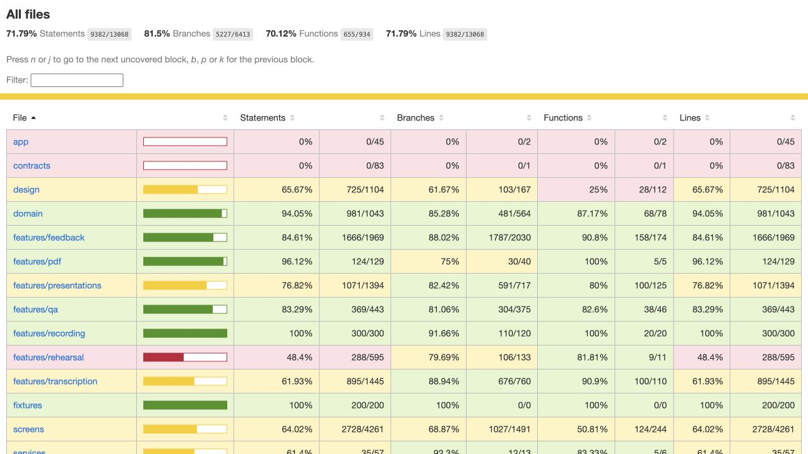
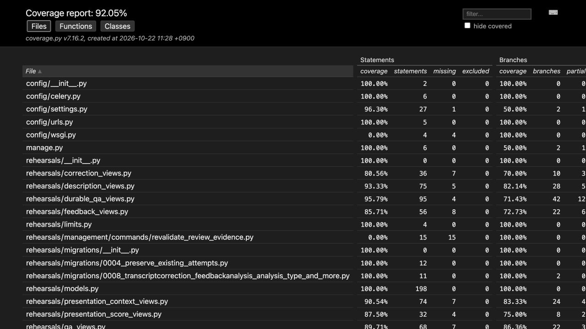

# Testing Documentation

## Coverage on main

GitHub Actions measures line and branch coverage and enforces the [four group targets](../../tools/coverage-policy.json). The mobile and backend jobs upload their coverage reports after the checks run.

From `mobile/` with Node 24 and Python 3 available:

```sh
npm ci
node tools/validate-coverage.mjs
npm run test:coverage
```

From `backend/` with the test dependencies and a disposable PostgreSQL database as described in the [environment setup](#environment-and-commands):

```sh
python -m pip install -r requirements-test.txt
python -m coverage run manage.py test --noinput
python -m coverage json
python -m coverage html
python ../tools/coverage_report.py backend --check
```

Open `coverage/groups.html` in either directory for the targets and results. The archived Iteration 2 instructions and results below describe the October snapshot.

## Iteration 3 evidence update — November 5, 2026

The [dated reconciliation](evidence/iteration-3-reconciliation-2026-11-05.md) separates main/PR31, published v8, the release-reported backend v2.4 repair and unreleased local candidates. The published demo includes first-Redo repair, selected PR34 UI, combined v7 fixes and targeted v8 recovery. Earlier statements below that B09 remains unmerged describe main administration, not absence from the demo.

The October coverage percentages and teammate reports below remain unchanged historical evidence. V8 release checks and the later English/Korean phone smoke cover bounded operational cases; no current coverage measurement, full UAT, calibrated scoring or human usefulness acceptance is claimed. This documentation task ran documentation checks only.

## Iteration 4 evidence update — November 20, 2026

This update combines the classic automated and manual checks with the new checks recorded during Iteration 4. The [Iteration 4 testing notes](https://docs.google.com/document/d/1N6EU8jcLnEaCquKc7DqqpKhecuA4EqrPyNQKjgrHNDk/edit) and the [dated Android phone record](evidence/incremental-phone-test-2026-11-15.md) are the sources. Results below retain the test type and limits: an executed test is not evidence of unmeasured accuracy or human acceptance.

### Classic regression tests and Android checks

The v10 source regression run reported **669 mobile tests** and **710 backend tests on PostgreSQL**, all passing with zero skips. Type checking, lint, Django checks and migration consistency also passed. This is a test-count result, not a new coverage measurement; the Iteration 2 coverage percentages above remain historical. The separate Azure image check records 710 backend tests with 27 expected SQLite skips, so that SQLite result is not combined with the PostgreSQL run.

Agent-operated phone checks on a Samsung SM-S918N running Android 16 covered both the original After Stop path and Live feedback. The v10 After Stop take retained a playable 41,814 ms M4A and 107 transcript words, with one whole-audio Scribe request and three completed feedback calls. The Live take retained 45,900 ms across two segments and 108 words; feedback appeared before Stop while the server still reported `stopped:false`. The full playback PCM matched segment audio. Two segment transcription calls and three feedback calls completed, with no whole-audio Scribe request. Q&A tap controls and cue offline/retry states were also checked. The detailed [phone record](evidence/incremental-phone-test-2026-11-15.md) includes earlier outage recovery, revisits and nine-segment continuity checks.

These were agent-operated checks using generated speech and real provider calls. They verify specific flows and audio handling, not human usability, Korean performance, scoring quality or broad production reliability. The playback-end event was not observed in the final v10 player check; PCM completeness was checked separately.

### Scoring repeatability and output handling — November 12

Injoon ran three attempts with the current and proposed rubric on ten presentations. The exploratory results show score variation and several non-score outcomes:

| Presentation | Current rubric | Proposed rubric |
| --- | --- | --- |
| Library return point | 80 / 76 / 80 | No grade / No grade / No grade |
| Gym refill station | 67 / 64 / 67 | 59 / No grade / 64 |
| Duplicate photo | 77 / 83 / 81 | 61 / 64 / 67 |
| Campus shuttle | 74 / No grade / 80 | 76 / 78 / 76 |
| Courtyard garden | 67 / 75 / 75 | 68 / 65 / 66 |
| Dataset Exchange | 68 / 66 / 69 | 62 / 64 / 66 |
| CSS architecture | Output cap / Output cap / Output cap | Output cap / Output cap / Output cap |
| Media synchronization | 70 / 68 / 65 | 65 / 65 / 63 |
| Sports broadcasting | 72 / 72 / 70 | 66 / 62 / 61 |
| OpenEXR for machine learning | 77 / 79 / 81 | 68 / 69 / Evidence rejected |

The notes describe the scores as appearing “consistent,” but no repeatability threshold, reference grades, blinded human ratings or statistical analysis was supplied. “No grade,” “Output cap” and “Evidence rejected” are outcomes, not zero scores. This is an exploratory comparison and does not establish rubric validity or that the proposed rubric is better.

### AI processing-time benchmark — November 17

Seoyeon compared the old sequential pipeline with the new concurrent slide-feedback pipeline using four fixed synthetic English workloads and the same model (`openai/gpt-6-luna`). There were 32 server-side trials and 292 real model calls. Each pair used identical synthetic input; run order alternated. Prompt/output caps and reasoning settings differed between pipeline versions, which limits a direct speed comparison.

| Slides / words | Attempts | Old median | New median | Reported ratio | Validation complete, old / new |
| --- | ---: | ---: | ---: | ---: | ---: |
| 2 / 116 | 5 | 39.1 s | 8.1 s | 4.8× | 4/5 / 5/5 |
| 6 / 355 | 5 | 75.8 s | 8.7 s | 8.7× | 3/5 / 5/5 |
| 10 / 1,456 | 3 | 103.7 s | 10.3 s | 10.1× | 0/3 / 3/3 |
| 20 / 2,927 | 3 | 183.7 s | 16.1 s | 11.4× | 0/3 / 3/3 |

Across these trials, validation completed in 7/16 old attempts and 16/16 new attempts. The reported ratios include old attempts that failed validation, so they describe processing time per attempt, not time to a valid result. First feedback was not uniformly faster: in the two-slide workload its median was 3.4 seconds old versus 6.9 seconds new; other workloads were about 3.5–3.7 seconds. All 90 individual old slide reviews succeeded in the larger workloads, while all six old whole-presentation scores failed evidence validation; HTTP responses were 200. The new pipeline also changed validation rules, so completion is not a comparative accuracy measure.

The benchmark did not include recording, upload, transcription, audio analysis, workers, database persistence or phone display. It does not establish production latency, Korean performance, score accuracy or usefulness. A separate earlier synthetic audio smoke reported feedback 7.3–10.7 seconds after segment upload and final feedback 15.0–16.4 seconds after Stop; that smoke was not repeated as part of this benchmark.

### Heuristic evaluation and UAT practice

The Iteration 3 heuristic evaluation on v8, performed by three evaluators on November 4, is the historical baseline, not a new Iteration 4 test. It identified analysis progress and wait time, text size/clutter, icon clarity, audience-field placement, replay/jump controls, Must Cover purpose, zero-score messaging, onboarding and deletion/recovery. Some observations informed the v10 UI. Swipe-back convention and folders were left unchanged. The notes do not provide a new scored heuristic evaluation of v10.

On November 16, a TA and 김승민 (Group 5) performed **UAT practice on v10**. Every executed step was marked Accepted; no step was marked failed. The notes do not provide a complete case count, and human-grader comparison, repeated scripted consistency and some Q&A cases were not tested. Feedback included convenient UI after adjustment, a 5/5 rating for choosing between Redo and existing takes, and 5/5 for transcription accuracy exceeding expectations. Reported concerns were shaky sentence highlighting (4/5), scores that felt hard to earn without seeing criteria beforehand, fast slide swiping (3/5), and unclear UAT steps/preconditions. The session was practice, not full acceptance testing.

#### UAT analysis and Cycle 2 follow-up

The [UAT sheet](https://docs.google.com/spreadsheets/d/1msuddEecIikY6-PvD1mlmtFlIzOmrz8frR-_GfDpQ7U/edit?gid=1402259234#gid=1402259234) records the Cycle 1 practice results and supporting notes. Upload slides and practice, and transcription and recording, met their acceptance criteria. Speech habit analysis passed for one tester who practiced a spontaneous presentation. AI grading mostly passed, but the tester steps were confusing and the independent human-score comparison was not completed. AI feedback consistency was not tested because the planned repeated Good/Bad presentations were time-consuming and difficult to assess. Q&A was tried briefly; whether changing the target audience changes the generated questions was not established. Fine-grained steps without recorded evidence remain Not Tested.

The original AI grading plan asked a member to score the tester's presentation with the same rubric and compare it with the AI score. A random, unprepared topic made presentation quality difficult to judge and the comparison too time-consuming. Cycle 2 will use several prewritten scripts with matching AI feedback. Testers will rate and comment on evidence relevance, score validity, and usefulness of improvement advice. For the numeric comparison, a human score must be recorded independently for the same saved audio using the same rubric; the case passes only when the absolute AI–human score difference is 10 points or less. The original AI feedback consistency plan repeated Good and Bad presentations twice; replace it with this prepared-script review, which focuses on feedback quality and validity.

For Q&A, provide a completed practice session and have the tester change only the target audience, then assess whether the generated questions reflect that change. Rewrite the test steps from the tester's perspective before Cycle 2, with clear prerequisites, screen-by-screen actions, and scoring criteria. UAT feedback also called for slower slide swiping (“발표자료 swipe할 때 너무 빨리 넘어가요”), a clearer effect on the sentence currently being spoken, and scoring criteria that are explained before practice or can be adjusted. Testers described the UI as convenient after a short adjustment period, transcription recognition as better than expected, and choosing between a new and prior recording as convenient. One tester questioned whether TTS accuracy belongs in UAT; confirm whether it is an explicit product acceptance requirement before retaining that test item.

The project schedule lists the Cycle 2 instruction rewrite, prepared-script AI feedback survey and review, same-audio human-score comparison, Q&A audience comparison, and usability improvements. See [P10–P14 in the project schedule](https://docs.google.com/spreadsheets/d/1UdtKHe8mqMDaoj7WWcHZbLKiX0N7DfYbuhVIsp6yKIQ/edit#gid=1650926073).

No completed Iteration 4 Korean-patch test is recorded. Do not infer Korean support from the earlier phone evidence.

Team 07 · Iteration 2 · October 23, 2026

[Test Inventory](test-inventory.md) lists test files. [Story-to-Test Matrix](story-test-matrix.md) maps tests to acceptance criteria.

## 1. Test Responsibility & Schedule (Iteration 2)

### Plan

| Component | Test maintainer |
| --- | --- |
| Mobile logic and storage | Jooyoung |
| Mobile screens and components | Jaewon |
| Backend logic and services | Seoyeon |
| Backend API and runtime | Injoon |
| Manual Android testing | All four members |

Maintainers write and maintain tests for new or changed behavior and regression fixes. Coordinate integration tests that span components.

Run CI on each push and pull request. Before merge, require mobile type/lint checks, collector validation, tests, coverage thresholds and Android JavaScript export; require backend system/migration checks, coverage-tool tests, application tests and coverage thresholds. Retain reports on failure. Rerun affected suites after changes and update results before each iteration submission.

### Results

Main CI passed on October 20. [October 22 coverage CI](https://github.com/snuhcs-course/swpp-2026-project-team-07/actions/runs/39718480282) passed the backend job; the mobile job failed its line-coverage targets. GitHub merge enforcement remains unverified.

## 2. Unit Testing & Integration Testing (starting from Iteration 2)

### Plan

Test recording timelines, speech-to-slide alignment, PDF/audio storage, evidence validation, scoring, settings/corrections, feedback and Q&A. Include normal, error, boundary and recovery cases.

**Frameworks:** mobile logic/storage uses the Node test runner with native/network mocks and fakes. Screen/component tests add React test renderer and custom native loaders. Both groups use [c8](https://github.com/bcoe/c8#sourcemap-support) 12.0.0. Both backend groups use Django's test runner, `unittest.mock`, provider fixtures and a disposable PostgreSQL test database; API tests use DRF request-response checks. Backend coverage uses [coverage.py](https://coverage.readthedocs.io/en/latest/branch.html) 7.16.2.

#### Coverage targets

| Component | Source scope | Target: line / branch | Reason |
| --- | --- | --- | --- |
| Mobile logic and storage | `mobile/src/**/*.ts` | 85% / 75% | Recording, saved-take selection and recovery need strong coverage. |
| Mobile screens and components | `mobile/src/**/*.tsx` | 70% / 60% | Tests simulate native interfaces and lifecycle behavior; phone checks cover microphone, playback and Android behavior. |
| Backend logic and services | `backend/rehearsals/services/**/*.py`, plus `models.py`, `limits.py` and `tasks.py` under `backend/rehearsals/` | 85% / 75% | Evidence validation, scoring and persistence errors can corrupt feedback or saved results. |
| Backend API and runtime | Remaining application Python under `backend/` | 80% / 70% | Request/error paths need strong checks; configuration and operational paths need extra setup. |

Include untested files at zero coverage, including application code replaced by mocks. Exclude dependencies, build output, generated native projects, type declarations, tests/helpers and generated schema migrations. Include handwritten repair logic and mixed schema/data migrations. The [file-scope record](evidence/coverage-2026-10-22/coverage.json) lists exact inclusions/exclusions.

Calculate group coverage from summed covered/total counts across files. Use the union of unit/integration execution so shared lines count once. c8 uses V8 line/block metrics; coverage.py uses statement/branch metrics.

#### Environment and commands

Use Node.js 24.20.0, Python 3.12.13 and Docker. The [coverage snapshot](https://github.com/snuhcs-course/swpp-2026-project-team-07/tree/f0d7148c23a1f754f54b18a86f6f4a581856b356), `f0d7148c23a1f754f54b18a86f6f4a581856b356`, contains the coverage tooling and lockfiles for application baseline `c4a3f48`. Clone it into a new directory:

```sh
git clone --no-checkout https://github.com/snuhcs-course/swpp-2026-project-team-07.git outloud-iter2-coverage
cd outloud-iter2-coverage
git checkout --detach f0d7148c23a1f754f54b18a86f6f4a581856b356
python3.12 -m venv .venv
. .venv/bin/activate
```

Start a separate PostgreSQL 16 instance. Its initial role can create test databases:

```sh
docker run --detach --name outloud-iter2-coverage-db \
  --publish 127.0.0.1:55432:5432 \
  --env POSTGRES_DB=outloud \
  --env POSTGRES_USER=outloud \
  --env POSTGRES_PASSWORD=outloud-local-only \
  postgres:16-alpine
docker exec outloud-iter2-coverage-db pg_isready -U outloud -d outloud
```

Repeat the readiness check until PostgreSQL reports that it accepts connections. Start each check block below from the cloned repository root with the virtual environment active. Export these values for backend commands; blank provider keys override `.env` credentials. The [local development guide](https://github.com/snuhcs-course/swpp-2026-project-team-07/blob/f0d7148c23a1f754f54b18a86f6f4a581856b356/docs/local-development.md) covers application setup.

```sh
export POSTGRES_HOST=127.0.0.1
export POSTGRES_PORT=55432
export POSTGRES_DB=outloud
export POSTGRES_USER=outloud
export POSTGRES_PASSWORD=outloud-local-only
export DJANGO_DEBUG=1
export OPENAI_API_KEY= GEMINI_API_KEY= ELEVENLABS_API_KEY=
```

Mobile checks and coverage:

```sh
cd mobile
npm ci
npm run typecheck
npm run lint
node tools/validate-coverage.mjs
npm run test:coverage
npm run bundle:android
```

Backend checks and coverage:

```sh
cd backend
python -m pip install -r requirements-test.txt
python -m unittest discover -s ../tools -p 'test_coverage_report.py' -v
python manage.py check
python manage.py makemigrations --check --dry-run
python manage.py migrate
python -m coverage run manage.py test --noinput
python -m coverage json
python -m coverage html
python ../tools/coverage_report.py backend --check
```

Each component directory receives `coverage/groups.json` and `coverage/groups.html`. Native reports: `mobile/coverage/index.html` and `backend/coverage/html/index.html`. Coverage checks return 1 after generating reports if a group misses a target.

### Results

#### October 22 local coverage

**Date:** October 22, 2026, KST · **Application baseline:** [merged PR #31](https://github.com/snuhcs-course/swpp-2026-project-team-07/pull/31), `c4a3f48d2a635bb2edb44828c62fb286b55f8d94` · **Executor:** Codex.

B09's separate fix branch is excluded from these test counts and coverage results.

**Environment:** macOS, Node.js 24.20.0, Python 3.12.13, PostgreSQL 16-alpine. Commands: the coverage blocks above. [Configuration hashes and file scope](evidence/coverage-2026-10-22/coverage.json) identify the measured setup.

| Suite | Passed | Failed | Skipped |
| --- | --- | --- | --- |
| Mobile | 548 | 0 | 0 |
| Backend, PostgreSQL | 554 | 0 | 0 |

Percentages: **line / branch**.

| Component | Frameworks | Target | Actual | Date | Command / Report |
| --- | --- | --- | --- | --- | --- |
| Mobile logic and storage | Node; mocks/fakes; c8 | 85% / 75% | 80.73% / 86.26%; **Fail: lines** | 2026-10-22 | `npm run test:coverage`; [report](evidence/coverage-2026-10-22/mobile-native-coverage.jpg) |
| Mobile screens and components | Node; React test renderer; native loaders; c8 | 70% / 60% | 61.78% / 70.89%; **Fail: lines** | 2026-10-22 | `npm run test:coverage`; [report](evidence/coverage-2026-10-22/mobile-native-coverage.jpg) |
| Backend logic and services | Django; `unittest.mock`; coverage.py | 85% / 75% | 94.67% / 87.84%; **Pass** | 2026-10-22 | `python -m coverage run manage.py test --noinput`; [report](evidence/coverage-2026-10-22/backend-native-coverage.jpg) |
| Backend API and runtime | Django/DRF; `unittest.mock`; coverage.py | 80% / 70% | 87.62% / 78.00%; **Pass** | 2026-10-22 | `python -m coverage run manage.py test --noinput`; [report](evidence/coverage-2026-10-22/backend-native-coverage.jpg) |

**Mobile coverage report (c8)**



**Backend coverage report (coverage.py)**



Screenshots show whole-component totals; the table separates architectural groups. The backend headline, 92.05%, combines statement and branch opportunities.

**Shortfall:** mobile tests leave feedback/media hooks and parts of Home/AppShell/Upload unexecuted. Add tests for these paths and rerun coverage. Mobile coverage exited 1; backend coverage exited 0.

Type checking, Android JavaScript export, backend system/migration checks, collector validation and three coverage-tool tests passed. Lint reported one existing warning. The export verifies JavaScript bundling; device behavior requires phone tests. [Earlier CI and detailed test records](evidence/iteration-2-supporting-records.md).

#### Additional focused checks

A separate October 22 run on `f1af9dd` reports **456 backend passes, 19 PostgreSQL-dependent skips under SQLite, and 477 client passes**, with zero failures/errors. Its narrower scopes, tools and targets differ from the full-suite run above. Companion logs/reports were not supplied. [Focused-run results and limits](evidence/iteration-2-supporting-records.md#seoyeon-focused-automated-checks).

## 3. AI Module Testing (starting from Iteration 3)

Available Iteration 3 evidence is listed in the [reconciliation](evidence/iteration-3-reconciliation-2026-11-05.md); Iteration 4 scoring and timing evidence is summarized above and in the linked notes. Automated provider mocks test source references, failure states, retries and arithmetic; they do not establish semantic correctness. The Iteration 4 repeated-rubric comparison is exploratory, and the synthetic pipeline benchmark does not measure score accuracy or end-to-end production latency. Full AI evaluation must record language, source/build, sample size, supported/unsupported suggestions, missed issues, unavailable results, repeat-score consistency and human usefulness. Numerical acceptance thresholds remain unset.

## 4. Acceptance Testing (starting from Iteration 3)

Use the unchanged acceptance criteria and [Story-to-Test Matrix](story-test-matrix.md) to record each case's build, device/OS, tester, steps, expected/actual result and evidence. Prioritize import/settings, recording and repeated visits, disclosure timing, playback/precise seeking, Redo/Keep/Overwrite, recovery and restart persistence, Q&A, large text and TalkBack. Keep incomplete deletion, spoken summaries, full comparison and stop/save/discard criteria open. Iteration 4 has bounded phone evidence and a November 16 UAT practice, but no complete acceptance run or calibrated scoring/usefulness acceptance is established.

## 5. Alpha & Beta Testing (Iteration 5)

To be completed in Iteration 5.

## Supplementary Manual Testing

### Plan

All four members check import/settings, recording/transcription, feedback/evidence playback, retake/comparison, spoken Q&A and reopening saved results. Record device/OS, build, date, tester, steps, expected/actual behavior, outcome and evidence.

### Results

| Contributor | Test date (2026) | Device | Recorded outcome |
| --- | --- | --- | --- |
| Injoon | October 19 | Galaxy S25 | [B01–B09](evidence/iteration-2-supporting-records.md#october-19-manual-testing): nine walkthrough findings. |
| Jaewon (JJ) | Not recorded | Galaxy S22 | [JJ01–JJ06](evidence/iteration-2-supporting-records.md#jaewon-galaxy-s22-findings): navigation/alignment/setup/numbering observations and UI/onboarding proposals. |
| Jooyoung | October 23 | Galaxy Tab S7 FE | [JY01–JY05](evidence/iteration-2-supporting-records.md#jooyoung-pdf-upload-failure): two PDF-upload HTTP 500 responses with a surrogate-character encoding error, plus related UI/retry observations. |
| Seoyeon | October 15–16 | Phone model not recorded | [SY01–SY07](evidence/iteration-2-supporting-records.md#seoyeon-phone-observations): cues and short playback/transcription worked after initial failures; visit display, controls, corrections, playback and Q&A had reported issues. |

Exact installed builds and Android versions are unrecorded; per-case evidence is incomplete. Jooyoung's log/video/input PDF are referenced but were not supplied; the causal link between the upload failure and later UI symptoms needs investigation. No complete personal retest of Seoyeon's fixes is recorded. Jaewon's backward-navigation restriction and onboarding suggestions remain proposals.

On October 20, Codex verified B09's first-Redo fix on a separate branch: five regression tests and agent-operated Galaxy S25 checks passed. The fix remains unmerged. The reported 0:00-to-0:07 timer jump remains open and unreproduced; audible quality was not assessed.

## Additional integration checks

Use the [main coverage commands](#coverage-on-main) for current measurements. The local Django settings can run synthetic checks on SQLite, which skips PostgreSQL-specific races. On a disposable PostgreSQL test database, the dedicated concurrency classes cover processing, upload, description and coaching races.

```sh
cd backend
.venv/bin/python manage.py test rehearsals.test_processing.ConcurrentProcessingTests rehearsals.test_storage.ConcurrentUploadTests rehearsals.test_descriptions.ConcurrentDescriptionTests rehearsals.test_coaching.ConcurrentCoachingTests --settings=config.settings
```

Worker recovery, interrupted Android sessions, cache and replay, and hosted first-use disclosure need separate checks. See the [earlier verification snapshots](evidence/rehearsal-and-feedback-verification-2026-10-08.md) and [cue and feedback reliability evidence](evidence/cue-feedback-reliability-2026-10-16.md). Use the [October 22 mobile test proposals](https://github.com/snuhcs-course/swpp-2026-project-team-07/blob/42c2154a54e209f4c9e931fd4db5777d6816c3d6/docs/mobile-zero-coverage-test-specs.md) as a checklist when identifying remaining coverage gaps. Their proposed cases and original zero-coverage inventory are not current results.
